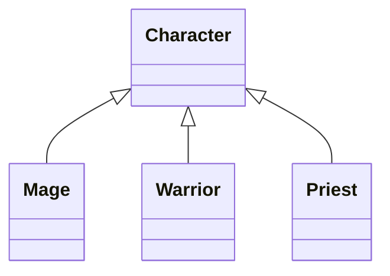

# Inheritance

- A subclass inherits behaviour from a base class
- Related objects can share an interface while supplying different methods
- `Mage`, `Warrior` and `Priest` specialise `Character`
- Health, mana and rage values here are simplified teaching data

---

# Duplicated Code

- Both classes initialise a name and health
- A change to shared behaviour requires editing both implementations
- A base class can hold that common behaviour

```python
class Mage:
    def __init__(self, name: str) -> None:
        self.name: str = name
        self.health: int = 100
        self.mana: int = 100


class Warrior:
    def __init__(self, name: str) -> None:
        self.name: str = name
        self.health: int = 100
        self.rage: int = 0
```

> `demo01 · duplication`

---

# Cost of Duplication

- Repeated logic can diverge when one copy changes
- Inheritance puts shared behaviour in one implementation
- Subclasses retain their specific state and methods

---

# Base Classes and Subclasses

- A subclass names its base in parentheses
- The base implementation remains available through the subclass
- An empty subclass can inherit the initialiser and methods unchanged

```python
class Character:
    def __init__(self, name: str) -> None:
        self.name: str = name
        self.health: int = 100

    def attack(self) -> str:
        return f"{self.name} attacks"


class Mage(Character):
    pass
```

> `demo02 · subclass`

---

# Inherited Members

- Inherited methods are found through the class hierarchy
- The base initialiser creates attributes on the actual subclass instance
- The object remains an instance of both its class and its base



---

# Constructor Chaining

- A subclass initialiser can call `super().__init__`
- The base initialiser stores shared attributes on the same object
- The subclass then adds its own attributes

```python
class Mage(Character):
    def __init__(self, name: str, mana: int = 100) -> None:
        super().__init__(name)
        self.mana: int = mana
```

> `demo03 · super_init`

---

# Overriding Methods

- Defining the same method name in a subclass overrides the base method
- Method lookup starts at the instance's class and follows its method resolution order
- `Mage.attack` is found before `Character.attack`

```python
def attack(self) -> str:
        return f"{self.name} casts Frostbolt"

jaina = Mage("Jaina")
print(jaina.attack())
print(Character.attack(jaina))
```

> `demo04 · overriding`

---

# Extending with super

- `super()` delegates according to the method resolution order
- An initialiser can extend shared setup without copying it
- Both initialisers receive the same `self` object

```python
class Mage(Character):
    def __init__(self, name: str, mana: int = 100) -> None:
        super().__init__(name)
        self.mana: int = mana
```


---

# isinstance and issubclass

- `isinstance` includes inherited relationships
- `issubclass` asks about classes rather than instances
- Exact `type(...)` equality excludes subclass instances

```python
jaina = Mage("Jaina")
print(isinstance(jaina, Mage))
print(isinstance(jaina, Character))
print(issubclass(Mage, Character))
print(type(jaina) is Character)
```

> `demo05 · relationships`

---

# str and repr

- `__str__` supplies a readable display value
- `__repr__` supplies a debugging representation
- Containers display their elements with `repr`

```python
def __str__(self) -> str:
        return self.name

    def __repr__(self) -> str:
        return f"{type(self).__name__}(name={self.name!r})"
```

> `demo06 · str_and_repr`

---

# Polymorphism

- One loop can call the same method on different subclass instances
- Each object supplies its own implementation
- The caller does not need a branch for each class

```python
raid: list[Character] = [Mage("Jaina"), Warrior("Varian"), Priest("Anduin")]
for member in raid:
    print(member.attack())
```

> `demo07 · polymorphism`

---

# Abstract Base Classes

- `ABC` and `abstractmethod` declare a required method
- A concrete subclass must implement every abstract method
- Abstract classes can also provide ordinary methods and initialisers

```python
class Ability(ABC):
    @abstractmethod
    def cast(self) -> str:
        """Return the ability's action."""


class Frostbolt(Ability):
    def cast(self) -> str:
        return "Frostbolt deals frost damage"
```

> `demo08 · abstract_contract`

---

# Enforcing the Contract

- An incomplete subclass fails when it is instantiated
- The error names the missing abstract method
- A concrete subclass remains an ordinary Python class

```python
try:
    UnfinishedAbility()
except TypeError as error:
    print(f"TypeError: {error}")
```


---

# Composition

- A character has a mount and an inventory
- Composition stores collaborating objects in attributes
- Inheritance describes a kind of object; composition describes what it holds

```python
class Character:
    def __init__(self, name: str, mount: Mount) -> None:
        self.name: str = name
        self.mount: Mount = mount
        self.inventory: Inventory = Inventory()
```

> `demo09 · composition`

---

# Scraper Toolkit

- An abstract scraper defines `parse` and shares collection behaviour
- Books and quotes supply different parsers behind the same interface
- This applied example uses local records and makes no network requests
- The scraping module applies the same separation to HTML

> `demo10 · scraper_toolkit`

---

# Advanced Python Topics

- Advanced Python extends this introduction :
  - Multiple inheritance and mixins
  - Protocols, descriptors and metaclasses
- These mechanisms are not required for the remaining libraries modules

---

# Summary : Inheritance

- Base classes share state and behaviour with subclasses
- Overrides supply specialised implementations
- `super` extends inherited behaviour on the same object
- Polymorphic calls use the implementation supplied by each object
- Abstract methods enforce a contract; composition stores collaborators

> `exercise01 · Inheritance`
