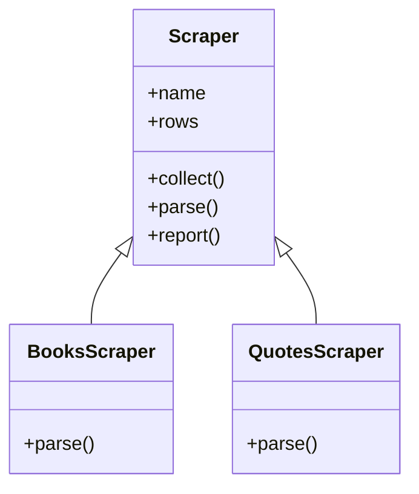

# Inheritance

- A first course builds one class at a time :
  - A blueprint, its attributes, its methods, and `self`
- Working code is rarely a single class :
  - It is several classes doing one job on different data
- This module is about the relationship between them :
  - What they share, what each one changes, where to draw the line
- The worked example is a scraper :
  - One base class, two sites, and nothing written twice
- The same design comes back in the web scraping module


---

# Duplicated Code

- A scraper for one site is a small class :
  - Collect the rows, keep them, report what was found
- A second site needs that class again :
  - Only the parsing differs, because only the markup differs
- Copying the file is the fastest thing to do :

```python
class BooksScraper:
    def __init__(self, name: str) -> None: ...
    def collect(self) -> None: ...
    def parse(self) -> list[dict[str, str]]: ...   # the only site-specific part
    def report(self) -> str: ...

class QuotesScraper:            # the same file again, one method changed
    ...
```

- Four of the five methods end up identical, character for character

> `demo01 · duplication`

---

# Cost of Duplication

- A bug fixed in one copy stays alive in the other :
  - Nothing in the code records that the two files belong together
- A new field means an edit in every copy :
  - The number of copies only ever grows
- A reader cannot tell the shared part from the deliberate difference :
  - Both look the same on the page
- The repair is to write the shared part once :
  - And let each site supply only what is genuinely its own


---

# Base Classes and Subclasses

- A class may name another class as its base :
  - Written as `class BooksScraper(Scraper):`
- The base class holds everything that is not site-specific
- Each subclass supplies only the part that differs :

```python
class Scraper:
    def __init__(self, name: str) -> None:
        self.name: str = name
        self.rows: list[dict[str, str]] = []
    def collect(self) -> None:
        self.rows = self.parse()
    def parse(self) -> list[dict[str, str]]:
        return []

class BooksScraper(Scraper):
    def parse(self) -> list[dict[str, str]]:
        return [row.copy() for row in BOOK_ROWS]
```

> `demo02 · subclass`

---

# Inherited Members

- Every method the base class defines, without repeating it
- Every attribute the base `__init__` creates, for the same reason
- A subclass may add to that, replace part of it, or leave it alone




---

# Constructor Chaining

- A subclass with attributes of its own needs its own `__init__` :
  - The base initialiser still has to run
- `super().__init__(...)` calls the version one level up :
  - Call it first, before setting anything of your own

```python
class BooksScraper(Scraper):
    def __init__(self, name: str, base_url: str) -> None:
        super().__init__(name)          # name and rows exist after this line
        self.base_url: str = base_url
```

- Leaving that line out is the most common mistake in the module :
  - The object is built happily, then fails later with `AttributeError`

> `demo03 · super_init`


---

# Overriding Methods

- A method on the subclass wins over the one on the base :
  - Same name, different body, no declaration needed anywhere
- Replacing a method throws the base version away :

```python
class Scraper:
    def clean(self, value: str) -> str:
        return value.strip()

class BooksScraper(Scraper):
    def clean(self, value: str) -> str:
        return value.removeprefix("$")      # the strip() is gone
```

- Given the raw value `"  $51.77  "` that override returns it unchanged :
  - The leading spaces are still there when `removeprefix` looks

---

# Extending with super

- `super()` reaches the base version from inside the override :

```python
class BooksScraper(Scraper):
    def clean(self, value: str) -> str:
        return super().clean(value).removeprefix("$")
```

- The base class does its part, the subclass adds one step
- Choose between the two deliberately :
  - Replace when the inherited behaviour is wrong here
  - Extend when it is right and merely incomplete
- Overriding `__init__` is the same decision, and usually the extending one

> `demo04 · overriding`


---

# isinstance and issubclass

- `isinstance(obj, Class)` asks whether an object is usable as that class :
  - True for the class itself and for every subclass of it
- `issubclass(Sub, Base)` asks the same question about two classes
- `type(obj) is Class` is a stricter and usually wrong question :
  - It refuses subclasses, which defeats the point of having them

```python
isinstance(paged, BooksScraper)     # True, PagedBooksScraper inherits from it
type(paged) is BooksScraper         # False, the type is not exactly that
isinstance(value, (str, bytes))     # a tuple asks about several at once
```

- Reach for it only where the code genuinely has to branch on type

> `demo05 · relationships`

---

# str and repr

- `__str__` is for the person reading the output :
  - Used by `print()` and by `f"{value}"`
- `__repr__` is for the person debugging :
  - Used by the interpreter, and by every container
- A list shows the `__repr__` of its elements, never the `__str__` :
  - Which is why a list of objects prints hexadecimal addresses

```python
class Scraper:
    def __str__(self) -> str:
        return f"{self.name} with {len(self.rows)} rows"
    def __repr__(self) -> str:
        return f"{type(self).__name__}(name={self.name!r}, rows={len(self.rows)})"
```

- Define both once on the base class and every subclass inherits them

> `demo06 · str_and_repr`


---

# Polymorphism

- One list may hold objects of several classes at once :
  - Provided they answer to the same methods
- The loop calls the method and Python picks the version :

```python
def run_all(scrapers: list[Scraper]) -> int:
    total = 0
    for scraper in scrapers:
        scraper.collect()            # a different parse() runs each time round
        print(scraper.report())
        total += len(scraper.rows)
    return total
```

- Adding a fourth site changes the list, and nothing else
- This is polymorphism, and it is the reason the base class earns its place

> `demo07 · polymorphism`

---

# Abstract Base Classes

- A base `parse()` that returns an empty list is a promise nobody enforces :
  - A subclass that forgets it scrapes nothing, silently
- An abstract base class states the requirement and enforces it :

```python
from abc import ABC, abstractmethod

class Scraper(ABC):
    @abstractmethod
    def parse(self) -> list[dict[str, str]]:
        """Return the rows found in one page of this site."""

    def collect(self) -> None:          # concrete, and calls the abstract method
        self.rows = self.parse()
```

- A subclass without `parse` cannot be created at all
- Neither can the abstract class itself, which is the point of it

> `demo08 · abstract_contract`

---

# Enforcing the Contract

- The failure moves to the earliest moment it possibly can :

```text
TypeError: Can't instantiate abstract class HalfFinishedScraper
without an implementation for abstract method 'parse'
```

- The requirement is written down where the next reader will find it
- The base class may still carry real shared code :
  - Abstract methods and ordinary methods sit side by side
- Use one when several classes must offer the same set of methods :
  - Leave it out for a base class that already works on its own


---

# Composition

- Inheritance is a strong claim, so say it out loud before writing it :
  - A `BooksScraper` is a `Scraper`, so it inherits
  - A `BooksScraper` is not a `RowStore`, so it holds one instead
- Holding another object as an attribute is composition :

```python
class BooksScraper(Scraper):
    def __init__(self, name: str, store: RowStore) -> None:
        super().__init__(name)
        self.store: RowStore = store
```

- A wrong base class publishes methods nobody meant to offer :
  - Inheriting from `dict` gives a scraper eleven public dictionary methods
- Prefer composition where the choice is unclear, as it is easier to undo

> `demo09 · composition`

---

# Scraper Toolkit

- The finished shape, in one file :
  - An abstract `Scraper`, with `parse` as the contract
  - Shared `clean`, `collect`, `row_count`, `__str__` and `__repr__`
  - `BooksScraper` and `QuotesScraper`, one method each
- The rows are canned, so nothing here touches the network
- The web scraping module replaces `parse` with real HTML :
  - Every other line of the file stays exactly as it is

> `demo10 · scraper_toolkit`


---

# Advanced Python Topics

- The same topic, carried a long way further :
  - Multiple inheritance, and the order Python searches the bases in
  - Mixins, small classes that add one behaviour to many others
  - `Protocol`, a contract a class satisfies without ever naming it
- And the machinery underneath the classes :
  - `__new__`, descriptors, metaclasses and `__slots__`
- Everything above assumes exactly what this module has just covered
- Nothing on this slide is needed for the rest of this course

---

# Summary : Inheritance

- Inheritance exists to stop the same code being written twice :
  - Shared behaviour in a base class, differences in the subclasses
- A subclass inherits methods and the attributes the base `__init__` creates :
  - `super().__init__(...)` runs that initialiser, and is easy to forget
- Overriding replaces a method, and `super()` inside it extends instead
- `__str__` is for output and `__repr__` is for debugging :
  - Containers always show the second one
- One loop over a list of related objects calls a different method each time
- An abstract base class turns the promise into a rule the interpreter enforces
- Composition, a plain attribute, is the answer whenever "is a" sounds wrong

> `exercise01 · Inheritance`
