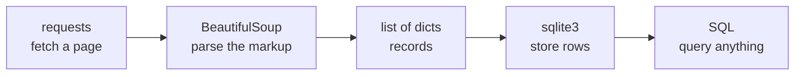

# Web Scraping

- Every scraper is the same three steps, in the same order :
  - Fetch, parse, store
- They stay separate on purpose :
  - Each step can be tested and re-run without the others
  - Only the middle step knows anything about HTML




---

# Fetching a Page

- `requests.get` returns a response object, not a string :
  - `.text` is the decoded body, `.content` is the raw bytes
- Two arguments matter far more than the rest :
  - `timeout`, because there is no default and a hung server hangs you
  - `headers`, to say which program is asking

```python
response = requests.get(
    "https://books.toscrape.com/catalogue/category/books/mystery_3/index.html",
    timeout=10,
    headers={"User-Agent": "MyScraper/1.0 (you@example.com)"},
)
response.raise_for_status()
print(response.status_code, len(response.text))
```

> `demo01 · fetching_pages`


---

# Status Codes and Timeouts

- The status code is the first thing to check :
  - `200` fine, `301` and `302` redirects that `requests` follows for you
  - `404` gone, `403` refused, `429` slow down, `5xx` their problem
- `raise_for_status` turns any `4xx` or `5xx` into an exception :
  - Nothing happens for `2xx` and `3xx`, so it is safe to always call
- `response.encoding` can be set when a page is decoded wrongly

```text
  200 OK                    passes, response.ok is True
  404 Not Found             raises HTTPError
  429 Too Many Requests     raises HTTPError
```


---

# BeautifulSoup

- `BeautifulSoup` takes the markup and the name of a parser :
  - `"lxml"` is fast and forgiving, and is installed for this course
  - `"html.parser"` is built into Python and needs nothing extra
- The result is a tree you can search, not a string :
  - Real pages are malformed, and the parser quietly repairs them
- `response.text` is already decoded, so it goes straight in :
  - The server declares the encoding, and a price of £51.77 proves it worked

```python
from bs4 import BeautifulSoup

html = requests.get(URL, timeout=10).text
soup = BeautifulSoup(html, "lxml")
print(soup.title.text)
```

> `demo02 · making_soup`


---

# find and find_all

- `find` returns the first match, or `None` :
  - `find_all` returns a list, which may be empty
- Both take a tag name, and keyword arguments for attributes :
  - `class_` has the underscore because `class` is a Python keyword
- Searching a tag searches inside that tag only

```python
pods = soup.find_all("article", class_="product_pod")
for pod in pods:
    title = pod.find("h3").find("a")["title"]
    price = pod.find("p", class_="price_color").text
    print(title, price)
```

> `demo03 · finding_the_books`


---

# Text and Attributes

- `.text` collects every string inside a tag :
  - `get_text(strip=True)` is the same thing with the whitespace tidied
- Attributes are read like a dictionary :
  - `tag["href"]` raises `KeyError` when the attribute is absent
  - `tag.get("href")` returns `None`, or a default you supply
- `class` comes back as a list, because an element can carry several

```python
stars = pod.find("p", class_="star-rating")
print(stars["class"])              # ['star-rating', 'Four']
print(stars.get("data-value"))     # None, the attribute is not there
```


---

# CSS Selectors

- `select` and `select_one` take one selector string :
  - The same language a stylesheet or the browser inspector uses
- A whole path through the document fits in one argument :
  - `article.product_pod h3 a` means a inside h3 inside that article
  - `p.star-rating.Four` means both classes on one element

```python
titles = soup.select("article.product_pod h3 a")
crumb = soup.select_one("ul.breadcrumb li.active")
images = soup.select("div.image_container > a > img[alt]")
```

> `demo04 · css_selectors`


---

# Navigating the Tree

- Start at something easy to find and move from there :
  - `.parent` is one step up, `.find_parent("article")` goes up until it matches
  - `.find_next_sibling("p")` skips the whitespace between tags
- Useful when the thing you want has no class of its own :
  - A price is easy to find, the module it belongs to is upward from it

```python
price = soup.select_one("p.price_color")
pod = price.find_parent("article")
availability = price.find_next_sibling("p")
print(pod.select_one("h3 a")["title"], availability.get_text(strip=True))
```

> `demo05 · walking_the_tree`


---

# Missing Elements

- Real pages are inconsistent, and a scraper meets all of it :
  - The attribute missing on one row in five hundred
  - The module that has no price because the item is sold out
- Decide per field what absence means :
  - `.get("href")` for optional, square brackets for required
  - A required field that is missing should fail loudly, not silently

```python
url = link["href"]                        # required, so let it raise
cover = image.get("data-src", "")         # optional, so a default is fine
if pod.find("p", class_="price_color") is None:
    continue                              # no price, no record
```


---

# HTML Tables

- A table is the easiest markup to scrape, and the most common :
  - One header row gives the keys, one body row gives the values
- `zip(headers, cells, strict=True)` refuses to guess :
  - A short row raises instead of silently shifting every column

```python
headers = [cell.get_text(strip=True) for cell in table.select("tr th")]

rows = []
for row in table.select("tbody tr"):
    cells = [cell.get_text(strip=True) for cell in row.find_all("td")]
    rows.append(dict(zip(headers, cells, strict=True)))
```

> `demo06 · parsing_a_table`


---

# Extracting Records

- One function, one page, a list of dictionaries out :
  - After this line the markup has stopped mattering
- Convert while parsing, not later :
  - A price becomes a `float`, a rating becomes an `int`
  - A relative link becomes an absolute one, with `urljoin`

```python
soup = BeautifulSoup(html, "lxml")

books = []
for pod in soup.select("article.product_pod"):
    link = pod.select_one("h3 a")
    books.append({
        "title": link["title"],
        "price_gbp": float(re.sub(r"[^\d.]", "", pod.select_one("p.price_color").text)),
        "url": urljoin(URL, link["href"]),
    })
```

> `demo07 · extracting_records`


---

# SQLite Schema

- The same care as any other schema :
  - One column per field, with a type, and `NOT NULL` where it is true
  - A natural key, `UNIQUE`, so the same page cannot arrive twice
- `first_seen` and `last_seen` make a re-run informative

```sql
CREATE TABLE IF NOT EXISTS books (
    id           INTEGER PRIMARY KEY,
    title        TEXT    NOT NULL,
    price_gbp    REAL    NOT NULL,
    rating       INTEGER NOT NULL,
    url          TEXT    NOT NULL UNIQUE,
    last_seen    TEXT    NOT NULL
);
```


---

# Parameterised Inserts

- Placeholders keep the values out of the SQL text :
  - `?` by position, or `:name` by name
- Named placeholders take a dictionary as it is :
  - Which is exactly what the parse step produced
- `executemany` sends the whole list in one call

```python
INSERT = """
INSERT INTO books (title, price_gbp, rating, url, last_seen)
VALUES (:title, :price_gbp, :rating, :url, :seen_at)
"""
conn.executemany(INSERT, [book | {"seen_at": now} for book in books])
conn.commit()
```

> `demo08 · storing_in_sqlite`


---

# SQL Injection

- The database is not the only thing that reads the string :
  - A title containing an apostrophe ends the quoted value early
  - Anything after it is executed as SQL
- One book on the page proves it :

```text
title = "The Bachelor Girl's Guide to Murder"

f"SELECT ... WHERE title = '{title}'"   sqlite3.OperationalError: near "s"
"SELECT ... WHERE title = ?", (title,)  found 1 row
```

- The parameterised form is also faster, because the query is reused


---

# Upsert

- A scrape that only works the first time is not finished :
  - The job will be re-run, after a crash, or every night
- `INSERT ... ON CONFLICT DO UPDATE` is one statement for both cases :
  - `excluded` is the row that was about to be inserted
  - Columns left out of the `SET` keep the value they had

```sql
INSERT INTO books (title, price_gbp, url, first_seen, last_seen)
VALUES (:title, :price_gbp, :url, :seen_at, :seen_at)
ON CONFLICT(url) DO UPDATE SET
    price_gbp = excluded.price_gbp,
    last_seen = excluded.last_seen
```

> `demo09 · upsert`


---

# Scrape Pipeline

- One script, read top to bottom, in four labelled sections :
  - Fetch the page, parse the records, store them, report on the table
- Nothing is wrapped in a function it does not need :
  - The whole file is the pipeline, and the order on screen is the order it runs
- Running it a second time changes `last_seen` and nothing else

```bash
uv run demos/04-web-scraping/10_scrape_pipeline.py
```

> `demo10 · scrape_pipeline`


---

# robots.txt and Rate Limiting

- `robots.txt` describes which paths a crawler may request.
- `RobotFileParser` reads the rules; this example uses saved text.

```python
from urllib.robotparser import RobotFileParser

ROBOTS = "User-agent: *\nDisallow: /basket/\nCrawl-delay: 5\n"
AGENT = "TrainingDemo/1.0"
url = "https://books.toscrape.com/basket/"
rules = RobotFileParser()
rules.parse(ROBOTS.splitlines())
print(rules.can_fetch(AGENT, url))  # False
print(rules.crawl_delay(AGENT))  # 5
```

- Identify the scraper with a `User-Agent` and contact details.
- Respect the site's rules, pause between requests and reuse cached pages.

> `demo11 · being_a_good_citizen`

---

# Scraping versus an API

- Scraping is the last resort, not the first :
  - An API returns JSON that does not change when the design does
  - A CSV or data export is better still, and often already there
- Signs it is time to stop :
  - The page builds itself with JavaScript, so the markup is empty
  - There is a login, a CAPTCHA, or a rate limit aimed at you
  - The markup changes weekly and the parser breaks weekly
- Look for `/api/`, an RSS feed, or a documented download first


---

# Database Handover

- The database is the handover point :
  - Pandas reads it back with `read_sql`
  - A GUI can put a window on the same table
- A checked in `.sql` file rebuilds it without the scraper :
  - So the later blocks work even if nothing was ever scraped

```python
seed = Path("data/books-seed.sql").read_text(encoding="utf-8")
conn.executescript(seed)
conn.execute("SELECT title, price_gbp FROM books ORDER BY price_gbp DESC")
```

> `demo12 · rebuilding_from_seed`


---

# Summary : Web Scraping

- Fetch, parse and store live in separate functions
- Every request has a timeout and a `User-Agent`
- Parsing is a separate step, so it can be re-run without re-fetching
- Values are converted at the parse step, not at the database
- Inserts are parameterised, and the re-run is an upsert
- The pace respects `robots.txt`, and the log says who you are
