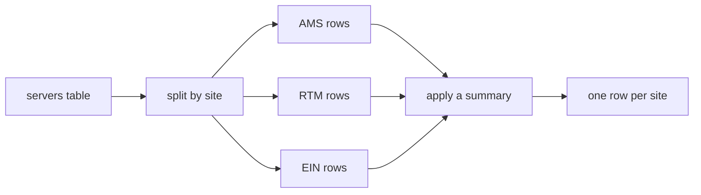

# Pandas

- `pandas` is the library for tables of data :
  - Rows and columns, where the columns have names and different types
- The thing it replaces is a spreadsheet, or a pile of parsing code :
  - A CSV, a sheet of a workbook, a query result, all become the same object
- Built on top of NumPy :
  - Each column is an array, so a column operation runs at array speed
- The working loop is short :
  - Read a file, look at it, filter it, summarise it, write it out again
- Two objects carry the whole library :
  - `Series`, one column · `DataFrame`, a table of them

```python
import pandas as pd
```


---

# Series

- A `Series` is a one-dimensional array with an index attached :
  - The index is a label per row, not a row number
- The two halves are reachable separately :
  - `.index` gives the labels, `.to_numpy()` gives the values
- Arithmetic and comparison apply to the whole column at once

```python
free_gb = pd.Series([55.5, 48.8, 550.0], index=["web01", "web02", "db01"])
free_gb["db01"]          # 550.0, looked up by label
free_gb / 1024           # every element, no loop
free_gb > 100            # a Series of True and False
```

> `demo01 · series_basics`


---

# DataFrame

- A `DataFrame` is a dictionary of `Series` that all share one index :
  - Each column has a name and its own type
- Built from a dictionary, a list of dictionaries, or read from a file
- `.shape`, `.columns` and `.index` are the three facts to check first

```python
servers = pd.DataFrame({
    "hostname": ["web01", "web02", "db01"],
    "site": ["AMS", "AMS", "AMS"],
    "cpu_cores": [4, 4, 16],
})
servers.shape            # (3, 3), rows by columns
servers["cpu_cores"]     # one column, which is a Series
```

> `demo02 · dataframe_basics`


---

# The Index

- The index is the row's name, and it travels with the row :
  - Filtering, sorting and joining all keep it
- `set_index` promotes a column to be the index

```python
by_host = servers.set_index("hostname")
by_host.loc["db01"]      # a row fetched by name
```

- Operations align on the label, not on the position :
  - Two Series in different orders still line up correctly

```python
quota = pd.Series([500, 2000], index=["web01", "db01"])
used = pd.Series([1450.0, 64.5], index=["db01", "web01"])
quota - used             # matched by name, not by row
```

> `demo03 · the_index`


---

# Reading a CSV

- `read_csv` takes a path and returns a `DataFrame` :
  - Column types are inferred from the file, not declared
- The keywords that rescue somebody else's export :
  - `sep=` a different delimiter · `index_col=` which column is the key
  - `usecols=` only the columns wanted · `na_values=` what counts as empty
  - `skiprows=` junk at the top · `header=None` no header row at all

```python
servers = pd.read_csv(DATA / "servers.csv")
print(servers.head(2))

servers = pd.read_csv(DATA / "servers.csv", index_col="hostname")
print(servers.head(2))
```

> `demo04 · read_csv`


---

# Reading a Spreadsheet

- `read_excel` is the same idea for a workbook :
  - Needs `openpyxl` installed, which the lockfile already pins
- A workbook has sheets, so one more argument is needed :
  - `sheet_name="servers"` by name, `0` by position, `None` for all of them

```python
pd.ExcelFile("data/servers.xlsx").sheet_names   # ['servers', 'sites']

servers = pd.read_excel("data/servers.xlsx", sheet_name="servers")
every = pd.read_excel("data/servers.xlsx", sheet_name=None)   # a dict
```

- Reading every sheet gives a dictionary keyed by sheet name

> `demo05 · read_excel`


---

# head and tail

- `head()` and `tail()` show the ends of the table :
  - Five rows by default, or as many as asked for
- They return a `DataFrame`, so they chain and print like any other
- `sample()` is the honest third option :
  - The head of a file is often sorted, and a sorted head is not typical

```python
servers.head()           # first five rows
servers.head(2)          # first two
servers.tail(3)          # last three
servers.sample(3, random_state=0)   # three at random, reproducibly
```

> `demo06 · head_and_tail`


---

# info and describe

- `info()` describes the structure :
  - Row count, column names, type of each, and how many values are present
- `describe()` summarises the numbers :
  - Count, mean, standard deviation, minimum, quartiles, maximum

```text
 #   Column        Non-Null Count  Dtype
---  ------        --------------  -----
 6   disk_gb       14 non-null     int64
 7   used_gb       13 non-null     float64
 8   last_patched  12 non-null     str
```

- The non-null counts are the fastest missing-data check there is :
  - Any column short of the row count has holes in it

> `demo07 · info_and_describe`


---

# Selecting Columns

- One name in square brackets gives a `Series` :
  - `servers["memory_gb"]`
- A list of names gives a `DataFrame`, in the order given :
  - `servers[["site", "role", "memory_gb"]]`
- The double brackets are a list inside a selection, not special syntax

```python
servers["memory_gb"]                  # a Series
servers[["memory_gb"]]                # a DataFrame with one column
servers[["role", "site", "disk_gb"]]  # three columns, reordered
```

- Selecting with a list is also how a report gets its column order

> `demo08 · selecting_columns`


---

# loc

- `loc[rows, columns]`, both given as labels :
  - A single label, a list of labels, or a slice of labels

```python
servers.loc["db01", "memory_gb"]              # one cell
servers.loc["db01"]                           # one row, as a Series
servers.loc["db01", ["site", "role"]]         # one row, chosen columns
servers.loc[:, ["site", "role"]]              # every row, two columns
servers.loc["web01":"db01", "site":"os"]      # a module
```

- A label slice includes both ends, unlike every other slice in Python

> `demo09 · loc_by_label`


---

# iloc

- `iloc[rows, columns]`, both given as integers :
  - The labels are ignored entirely, as if the table were a list of lists

```python
servers.iloc[0, 4]        # first row, fifth column
servers.iloc[:3, :4]      # first three rows, first four columns
servers.iloc[-2:, :4]     # last two rows
servers.iloc[[0, 5, 2], [0, 1]]   # lists of positions, in that order
```

- An integer slice stops before its end, exactly like a list slice
- The same cell, two ways : `loc["db01", "memory_gb"]` is `iloc[2, 4]`

> `demo10 · iloc_by_position`


---

# loc and iloc

<div class="two-col">
<div>

`loc`, by label

- Takes the row and column names
- Slices include both ends
- Survives a re-sort of the table
- What you want most of the time

</div>
<div>

`iloc`, by position

- Takes integers, counting from zero
- Slices stop before the end
- Changes meaning when rows move
- For "the first" and "the last"

</div>
</div>

- Both take a comma : rows first, then columns
- Plain `[]` is neither : it selects columns on a frame


---

# Filtering Rows

- A comparison on a column gives one `True` or `False` per row :
  - That is an ordinary value, and it can be given a name
- Indexing the frame with that mask keeps only the matching rows

```python
big = servers["memory_gb"] >= 64      # a Series of booleans
servers[big]                          # the rows where it is True

servers[servers["disk_gb"] > 1000]    # usually written in one line
servers[servers["role"] == "web"]     # text compares just as well
```

- A mask sums to a count, because `True` is one and `False` is zero

> `demo11 · boolean_filter`


---

# Combining Filters

- `&` for and, `|` for or, `~` for not :
  - Not the words `and`, `or` and `not`, which want one answer, not a column
- Every comparison needs its own parentheses, because `&` binds tighter

```python
servers[(servers["cpu_cores"] >= 8) & (servers["disk_gb"] >= 2000)]
servers[(servers["role"] == "database") | (servers["role"] == "build")]
servers[~servers["site"].isin(["AMS", "RTM"])]
```

- Two shorthands :
  - `.isin([...])` replaces a chain of ors
  - `.between(low, high)` replaces two comparisons, and includes both ends

> `demo12 · combining_filters`


---

# Adding a Column

- Assigning to a name that does not exist creates the column :
  - A scalar is broadcast to every row
  - A `Series` is computed element by element, aligned on the index

```python
servers["managed"] = True
servers["free_gb"] = servers["disk_gb"] - servers["used_gb"]
servers["used_pct"] = (servers["used_gb"] / servers["disk_gb"] * 100).round(1)
```

- `assign` does the same but returns a new frame, so it chains
- `drop(columns=[...])` removes columns and also returns a new frame

> `demo13 · adding_columns`


---

# Deriving a Column

- Three ways to compute a column from another :
  - `.str` gives every string method, applied down the column
  - `.map(dictionary)` translates codes into labels
  - `np.where(condition, yes, no)` is a vectorised if-else

```python
servers["distro"] = servers["os"].str.split().str[0]
servers["tier"] = servers["role"].map({"web": "front line", "db": "critical"})
servers["alert"] = np.where(servers["used_pct"] > 75, "FULL", "ok")
```

- A missing value never compares true, so it lands in the `no` branch :
  - Which quietly turns "never measured" into "fine"

> `demo14 · deriving_columns`


---

# Sorting

- `sort_values` takes a column name, or a list of them :
  - `ascending=` takes one boolean, or one per column
- It returns a new frame, the original is untouched

```python
servers.sort_values("disk_gb", ascending=False)
servers.sort_values(["site", "disk_gb"], ascending=[True, False])
servers.nlargest(3, "used_gb")     # sort plus head, saying what it means
servers.sort_index()               # back into label order
```

- `nlargest` and `nsmallest` read better than a sort followed by a head

> `demo15 · sort_values`


---

# groupby



- One row per distinct value of the grouping column comes back


---

# groupby Aggregation

- `groupby("column")`, then a column to summarise, then a summary

```python
servers.groupby("site")["cpu_cores"].sum()
servers.groupby("role")["disk_gb"].mean().round(1)
servers.groupby("site").size()                    # how many per group
```

- `agg` takes a list of functions, or a dictionary per column

```python
servers.groupby("site")["memory_gb"].agg(["count", "sum", "mean", "max"])
servers.groupby("site").agg({"cpu_cores": "sum", "disk_gb": "max"})
```

- The grouping column becomes the index of the answer

> `demo16 · groupby_agg`


---

# Named Aggregation

- Named aggregation gives each output column the name the report wants :
  - Keyword is the new column, value is `(column, summary)`
- `reset_index()` turns the grouping key back into an ordinary column

```python
per_site = (
    servers.groupby("site")
    .agg(servers=("hostname", "count"),
         total_cores=("cpu_cores", "sum"),
         mean_used_gb=("used_gb", "mean"))
    .round(1)
    .reset_index()
)
```

- Grouping by two keys is the same call with a list of column names

> `demo17 · groupby_named_agg`


---

# merge

- `merge` combines two frames on a shared key column :
  - `on=` names a column that exists in both
  - `left_on=` and `right_on=` when the two sides call it different things

```python
servers = pd.read_csv("data/servers.csv")   # has a site code
sites = pd.read_csv("data/sites.csv")       # explains what the code means

joined = servers.merge(sites, on="site")
joined.groupby("city").size()               # only possible after the join
```

- The result is an ordinary frame, so it filters, sorts and groups

> `demo18 · merge_on_key`


---

# Join Types

- `how=` decides what happens to rows that match nothing :
  - `inner`, the default, keeps only rows present on both sides
  - `left` keeps every row of the left frame, filling gaps with `NaN`
  - `right` does the mirror image, `outer` keeps everything

```python
servers.merge(sites, on="site", how="left")
servers.merge(sites, on="site", how="outer", indicator=True)
```

- `indicator=True` adds a `_merge` column saying where each row came from :
  - `both`, `left_only`, `right_only`
- It answers whether the join lost rows

> `demo19 · merge_how`


---

# Missing Values

- An empty field becomes `NaN`, and `NaN` is not equal to anything
- `isna()` gives a mask of the same shape, and a mask sums to a count

```python
servers.isna().sum()                       # holes per column
servers[servers.isna().any(axis=1)]        # the rows with any hole
servers.dropna()                           # drop any row with any hole
servers.dropna(subset=["used_gb"])         # only rows missing that column
servers.fillna({"used_gb": 0.0, "last_patched": "never"})
```

- Summaries skip `NaN` silently, so a mean is a mean of what was there

> `demo20 · missing_data`


---

# read_sql

- `read_sql` runs a query and returns the result set as a `DataFrame` :
  - Takes any DB-API connection, `sqlite3` included
- Values go in as parameters, never by string formatting

```python
import sqlite3

conn = sqlite3.connect("data/books.db")
books = pd.read_sql("SELECT * FROM books", conn)
dear = pd.read_sql("SELECT * FROM books WHERE price_gbp > ?",
                   conn, params=(45.0,))
conn.close()
```

- Push the work the database is good at into the query, then stop

> `demo21 · read_sql`


---

# to_sql

- `to_sql` writes a frame into a table, creating it if it is not there :
  - `if_exists=` is `fail` by default, or `replace`, or `append`
  - `index=False` keeps the frame's row labels out of the table

```python
conn = sqlite3.connect("data/pandas-demo.db")
servers.to_sql("servers", conn, if_exists="replace", index=False)
conn.commit()
print(pd.read_sql("PRAGMA table_info(servers)", conn))
conn.close()
```

- The round trip is the point : summarise in pandas, store the result back
- Column types are chosen by pandas from the dtypes

> `demo22 · to_sql`


---

# Writing Files

- `to_csv` and `to_excel` are the mirror of the readers :
  - `index=False` unless the index is real data somebody wants
- `ExcelWriter` puts several frames into one workbook, a sheet each

```python
report.to_csv("data/servers-report.csv", index=False)
report.to_csv("data/servers-report.tsv", sep="\t", index=False)

with pd.ExcelWriter("data/report.xlsx", engine="openpyxl") as workbook:
    report.to_excel(workbook, sheet_name="servers", index=False)
    per_site.to_excel(workbook, sheet_name="per site", index=False)
```

> `demo23 · writing_files`


---

# Plotting

- Any frame or column can draw itself with `.plot()` :
  - `kind=` is `line`, `bar`, `barh`, `hist`, `scatter`, `box`
- Choose the non-interactive backend first, and the script writes a file

```python
import matplotlib
matplotlib.use("Agg")          # before pyplot, so no window is opened

per_site = servers.groupby("site")[["used_gb", "free_gb"]].sum()
axes = per_site.plot(kind="barh", stacked=True)
axes.get_figure().savefig("data/servers-plot.png", dpi=120)
```

- Good enough to look at, and rarely good enough to publish

> `demo24 · plot_to_file`


---

# Summary : Pandas

- `Series` is a column with labels, `DataFrame` is a table of them :
  - The index is a name per row, and everything aligns on it
- Read with `read_csv`, `read_excel`, `read_sql`, write with the `to_` pair
- Look before working : `head`, `tail`, `info`, `describe`
- Address with `loc` by label and `iloc` by position, rows before columns
- Filter with a boolean mask, combined with `&`, `|` and `~`
- Summarise with `groupby().agg()`, combine tables with `merge`
- Handle holes deliberately : `isna`, `dropna(subset=)`, `fillna`
