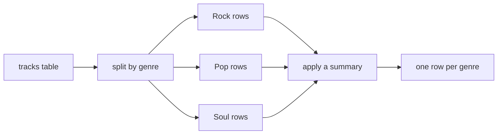

# Pandas

- `pandas` works with labelled tables :
  - `Series` represents a column; `DataFrame` represents a table
- CSV files, spreadsheets and query results share the same operations
- Column operations use NumPy arrays and other array implementations
- A typical report reads, inspects, filters, summarises and exports data

```python
import pandas as pd
```

---

# Series

- A `Series` has one index label per value
- Arithmetic and comparisons apply to every value
- `.index` gives the labels; `.to_numpy()` gives the values

```python
durations = pd.Series([183, 126, 146],
                      index=["Imagine", "Yesterday", "Respect"])
print(durations["Imagine"])
print(durations / 60)
print(durations > 180)
print(durations.index.tolist())
print(durations.to_numpy())
```

> `demo01 · series_basics`

---

# DataFrame

- A `DataFrame` has named columns with independent types
- A dictionary supplies one list per column
- `.shape` gives rows and columns; `.columns` gives their names

```python
tracks = pd.DataFrame({
    "title": ["Imagine", "Yesterday", "Respect"],
    "artist": ["John Lennon", "The Beatles", "Aretha Franklin"],
    "duration_s": [183, 126, 146],
})
print(tracks)
print(tracks.shape)
print(tracks["duration_s"])
```

> `demo02 · dataframe_basics`

---

# The Index

- `set_index` promotes a column to row labels
- Filtering and sorting retain the labels
- Arithmetic aligns matching labels even when their positions differ

```python
by_title = tracks.set_index("title")
print(by_title.loc["Imagine", ["artist", "duration_s"]])
durations = pd.Series([183, 126], index=["Imagine", "Yesterday"])
limits = pd.Series([180, 240], index=["Yesterday", "Imagine"])
print(limits - durations)
```

> `demo03 · the_index`

---

# Reading a CSV

- `read_csv` infers column types from the file
- Useful options select a delimiter, columns and row labels :
  - `sep=`, `usecols=`, `index_col=`
- `parse_dates=` converts named date columns; `na_values=` adds missing-value markers

```python
tracks = pd.read_csv(DATA / "tracks.csv", index_col="title",
                     parse_dates=["last_played"])
print(tracks[["artist", "duration_s", "last_played"]].head(3))
```

> `demo04 · read_csv`

---

# Reading a Spreadsheet

- `read_excel` reads a sheet into a `DataFrame`
- `sheet_name=` selects the sheet by name or position
- `ExcelFile(...).sheet_names` lists the available sheets

```python
tracks = pd.read_excel(DATA / "tracks.xlsx", sheet_name="tracks")
print(pd.ExcelFile(DATA / "tracks.xlsx").sheet_names)
print(tracks[["title", "genre", "plays"]].head(3))
```

> `demo05 · read_excel`

---

# head and tail

- `head(n)` and `tail(n)` select rows at either end
- `sample(n, random_state=...)` gives a reproducible sample
- A sample can reveal values that the first rows do not contain

```python
print(tracks[["genre", "plays"]].head(2))
print(tracks[["genre", "plays"]].tail(2))
print(tracks[["genre", "plays"]].sample(3, random_state=0))
```

> `demo06 · head_and_tail`

---

# info and describe

- `info()` reports names, dtypes and non-missing counts
- `describe()` summarises numeric columns :
  - Count, mean, standard deviation, quartiles and range
- Date parsing changes a text column into a datetime dtype

```python
tracks.info()
print(tracks[["duration_s", "plays"]].describe().round(1))
```

> `demo07 · info_and_describe`

---

# Selecting Columns

- A column name selects a `Series`
- A list of column names selects a `DataFrame`
- The list also determines the report column order

```python
print(tracks["plays"].head(3))
print(tracks[["plays"]].head(3))
print(tracks[["genre", "artist", "duration_s"]].head(3))
```

> `demo08 · selecting_columns`

---

# loc

- `loc[rows, columns]` selects by labels :
  - One label, a list of labels, or a label slice
- Label slices include both ends

```python
print(tracks.loc["Imagine", "duration_s"])
print(tracks.loc["Imagine", ["artist", "genre"]])
print(tracks.loc["Imagine":"Respect", "year":"plays"])
print(tracks.loc[:, ["genre", "plays"]].head(3))
```

> `demo09 · loc_by_label`

---

# iloc

- `iloc[rows, columns]` selects by integer positions
- Integer slices exclude the stop position
- Moving rows changes what an integer position selects

```python
print(tracks.iloc[0, 3])
print(tracks.iloc[:3, :2])
print(tracks.iloc[-2:, :2])
print(tracks.iloc[[0, 5, 2], [0, 1]])
```

> `demo10 · iloc_by_position`

---

# loc and iloc

- `loc` uses labels and includes the slice endpoint
- `iloc` uses zero-based positions and excludes the endpoint
- Both put rows before columns
- Plain `frame[...]` selects columns; a boolean mask selects rows

```python
print(tracks.loc["Imagine", "duration_s"])
print(tracks.iloc[0, 3])
```

---

# Filtering Rows

- A column comparison produces a boolean `Series`
- Indexing with that mask keeps rows where it is `True`
- Summing a mask counts matching rows

```python
popular = tracks["plays"] >= 50
print(tracks[popular][["genre", "plays"]].head(4))
print(int(popular.sum()))
print(tracks[tracks["genre"] == "Soul"][["plays"]])
```

> `demo11 · boolean_filter`

---

# Combining Filters

- `&`, `|` and `~` combine boolean masks
- Each comparison needs parentheses
- `isin` checks membership; `between` checks an inclusive interval

```python
mask = (tracks["plays"] >= 50) & (tracks["duration_s"] < 240)
print(tracks[mask][["duration_s", "plays"]].head(4))
print(tracks[tracks["genre"].isin(["Soul", "Country"])][["genre"]].head(4))
print(tracks[tracks["year"].between(1980, 1999)][["year"]].head(4))
print(tracks[~tracks["genre"].isin(["Rock", "Pop"])][["genre"]].head(4))
```

> `demo12 · combining_filters`

---

# Adding a Column

- Assigning a new column name creates the column
- A scalar applies to every row; a computed `Series` aligns by index
- `assign` returns a new frame; `drop(columns=...)` removes columns

```python
tracks["available"] = True
tracks["listened_s"] = tracks["duration_s"] * tracks["plays"]
report = tracks.assign(minutes=tracks["listened_s"] / 60)
print(report[["plays", "minutes"]].head(3).round(1))
print(tracks.drop(columns=["available"]).columns.tolist())
```

> `demo13 · adding_columns`

---

# Deriving a Column

- `.str` applies string operations down a column
- `.map(dictionary)` translates values to labels
- `np.where` chooses between values for each row

```python
tracks["initial"] = tracks["artist"].str.upper().str[:1]
tracks["style"] = tracks["genre"].map({"Rock": "guitar", "Pop": "vocal"})
tracks["status"] = np.where(tracks["plays"] > 50, "favourite", "occasional")
tracks.loc[tracks["last_played"].isna(), "status"] = "never"
print(tracks[["initial", "style", "status"]].head(6))
```

> `demo14 · deriving_columns`

---

# Sorting

- `sort_values` takes one column or a list of columns
- `ascending` accepts one boolean or a boolean per column
- `nlargest` and `nsmallest` select extreme rows; `sort_index` orders labels

```python
print(tracks.sort_values("plays", ascending=False)[["plays"]].head(3))
print(tracks.sort_values(["genre", "plays"], ascending=[True, False])
      [["genre", "plays"]].head(4))
print(tracks.nlargest(3, "plays")[["plays"]])
print(tracks.nsmallest(2, "duration_s")[["duration_s"]])
print(tracks.sort_index()[["plays"]].head(2))
```

> `demo15 · sort_values`

---

# groupby



- Each distinct grouping value produces one summary row

---

# groupby Aggregation

- Select the grouping column, then the values and summary
- `agg` accepts a list of summaries or a dictionary per column
- The group label becomes the result index

```python
print(tracks.groupby("genre")["plays"].sum())
print(tracks.groupby("genre")["duration_s"].mean().round(1))
print(tracks.groupby("genre").size())
print(tracks.groupby("genre")["plays"].agg(["count", "sum", "mean", "max"]))
print(tracks.groupby("genre").agg({"plays": "sum", "year": "min"}))
```

> `demo16 · groupby_agg`

---

# Named Aggregation

- Each keyword names a result column
- Its value is `(source_column, summary)`
- `reset_index()` restores grouping labels as ordinary columns

```python
per_genre = tracks.groupby("genre").agg(
    titles=("artist", "count"),
    total_plays=("plays", "sum"),
    mean_duration=("duration_s", "mean"),
).round(1).reset_index()
print(per_genre)
tracks["decade"] = tracks["year"] // 10 * 10
print(tracks.groupby(["genre", "decade"])["plays"].sum())
```

> `demo17 · groupby_named_agg`

---

# merge

- `merge` combines frames on a shared key
- `on` names the shared column
- `left_on` and `right_on` support different key names

```python
artists = pd.read_csv(DATA / "artists.csv")
joined = tracks.merge(artists, on="artist")
print(joined[["title", "artist", "country"]].head(3))
print(joined.groupby("country")["plays"].sum())
```

> `demo18 · merge_on_key`

---

# Join Types

- `inner` keeps matching keys; `left` keeps every left row
- `right` keeps every right row; `outer` keeps both sides
- `indicator=True` records `both`, `left_only` or `right_only`

```python
artists = pd.read_csv(DATA / "artists.csv")
for how in ("inner", "left", "right", "outer"):
    merged = tracks.merge(artists, on="artist", how=how)
    print(f"{how}: {len(merged)} rows")
outer = tracks.merge(artists, on="artist", how="outer", indicator=True)
print(outer.loc[outer["_merge"] != "both", ["title", "artist", "_merge"]])
```

> `demo19 · merge_how`

---

# Missing Values

- `isna` recognises missing values; summing its mask counts them
- `dropna(subset=...)` removes rows missing selected columns
- `fillna` replaces missing values explicitly
- Summaries generally skip missing values

```python
print(tracks.isna().sum())
print(tracks.loc[tracks["last_played"].isna(), ["artist", "last_played"]])
print(len(tracks.dropna(subset=["last_played"])))
filled = tracks.fillna({"last_played": "never"})
print(filled.loc["Hey Jude", "last_played"])
```

> `demo20 · missing_data`

---

# read_sql

- `read_sql` returns a query result as a `DataFrame`
- A `sqlite3` connection can read the scraping module's books database
- Query parameters keep values separate from SQL

```python
query = "SELECT title, price_gbp, rating FROM books WHERE price_gbp > ? ORDER BY price_gbp DESC"
print(pd.read_sql(query, conn, params=(45.0,)).to_string())
```

> `demo21 · read_sql`

---

# to_sql

- `to_sql` writes a frame to a database table
- `if_exists` selects `fail`, `replace` or `append`
- `index=False` excludes row labels from the stored table

```python
conn = sqlite3.connect(DATA / "pandas-demo.db")
books = pd.read_csv(DATA / "books-sample.csv")
summary = books.groupby("rating", as_index=False)["price_gbp"].mean()
summary.to_sql("rating_summary", conn, if_exists="replace", index=False)
conn.commit()
print(pd.read_sql("SELECT * FROM rating_summary", conn))
conn.close()
```

> `demo22 · to_sql`

---

# Writing Files

- `to_csv` and `to_excel` export frames
- `index=False` excludes row labels when they are not report data
- `ExcelWriter` writes several sheets into one workbook

```python
report = tracks.reset_index().sort_values("plays", ascending=False)
report.to_csv(DATA / "tracks-report.csv", index=False)
report.to_csv(DATA / "tracks-report.tsv", sep="\t", index=False)
per_genre = tracks.groupby("genre", as_index=False)["plays"].sum()
with pd.ExcelWriter(DATA / "tracks-report.xlsx", engine="openpyxl") as workbook:
    report.to_excel(workbook, sheet_name="tracks", index=False)
    per_genre.to_excel(workbook, sheet_name="per genre", index=False)
print(pd.ExcelFile(DATA / "tracks-report.xlsx").sheet_names)
```

> `demo23 · writing_files`

---

# Plotting

- `.plot(kind=...)` draws a frame or column
- The `Agg` backend writes files without opening a window
- `get_figure().savefig(...)` saves the resulting chart

```python
tracks["decade"] = tracks["year"] // 10 * 10
per_decade = tracks.groupby("decade")["plays"].sum()
axes = per_decade.plot(kind="bar", title="Fictional plays by decade")
axes.set_ylabel("plays")
axes.get_figure().tight_layout()
axes.get_figure().savefig(DATA / "tracks-plot.png", dpi=120)
plt.close(axes.get_figure())
print(per_decade)
```

> `demo24 · plot_to_file`

---

# Summary : Pandas

- `Series` and `DataFrame` attach labels to data
- Read CSV, Excel and SQL; inspect structure and missing values
- Select by label with `loc` or by position with `iloc`
- Filter with masks; derive columns with array operations
- Summarise groups, join lookup tables and export reports
