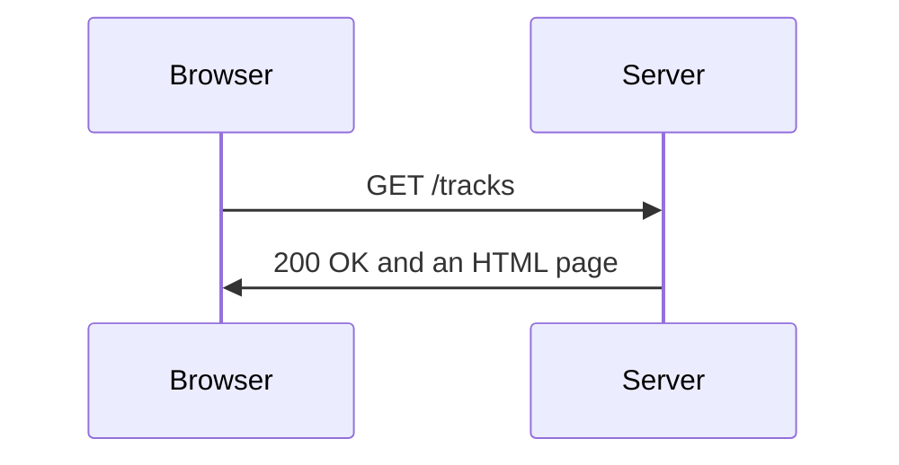

# What is a Web Application?

- A web application runs in two places :
  - The backend is a Python program on a server
  - The frontend is the HTML page the browser shows
- The browser sends a request, the server sends back a response
- The same backend serves every browser that connects to it




---

# HTTP Requests

- A request names a method and a path :
  - `GET /tracks` asks for a page
  - `POST /guess` sends data, such as a filled-in form
- The address can carry extra values after a `?` :
  - `/tracks?genre=Soul`
- A response starts with a status code :

| Code | Meaning |
| --- | --- |
| `200` | OK |
| `404` | Not found |
| `422` | The request values are not valid |


---

# FastAPI

- `FastAPI` maps paths to ordinary Python functions
- `uvicorn` is the web server that runs the application
- The libraries project already includes both; a new project adds them :

```bash
uv add fastapi uvicorn jinja2 python-multipart
```

- `jinja2` fills in HTML pages, `python-multipart` reads forms
- A server runs until it is stopped with `Ctrl+C`


---

# First Application

- `FastAPI()` creates the application
- `@app.get("/")` connects the path `/` to the function below it
- A returned dictionary reaches the browser as JSON

```python
app = FastAPI(title="Playlist")


@app.get("/")
def home() -> dict[str, str]:
    return {"message": "Hello from the playlist"}


if __name__ == "__main__":
    uvicorn.run(app, host="127.0.0.1", port=8000)
```

- `uvicorn.run` serves the application at `http://127.0.0.1:8000`
- `/docs` lists every path and runs requests from the browser

> `demo01 · first_app`


---

# HTML Templates

- A browser page is HTML, written in a separate template file
- `Jinja2Templates` finds the templates in a folder
- `TemplateResponse` fills one in with values from Python :
  - The request, the file name, and a dictionary of values

```python
templates = Jinja2Templates(directory=Path(__file__).parent / "templates")


@app.get("/")
def home(request: Request) -> HTMLResponse:
    return templates.TemplateResponse(request, "tracks.html", {"tracks": tracks})
```

> `demo02 · templates`


---

# Template Syntax

- `{{ ... }}` inserts a value :
  - Text is escaped, so `<` in a title cannot break the page
- `` and `` repeat or hide part of the page
- `|` applies a filter, such as `length` or `upper`

```html
<p>{{ tracks | length }} tracks</p>
<ul>
  
  <li>{{ track.title }} by {{ track.artist }}</li>
  
</ul>
```


---

# Forms

- A form with `method="post"` sends its fields in a `POST` request :
  - Each `<input>` is sent under its `name`
- `@app.post` handles the request
- `Annotated[str, Form()]` reads one field

```python
@app.post("/")
def add_track(
    request: Request, title: Annotated[str, Form()], artist: Annotated[str, Form()],
) -> HTMLResponse:
    playlist.append({"title": title, "artist": artist})
    return templates.TemplateResponse(request, "playlist.html", {"playlist": playlist})
```

```html
<form method="post">
  <input name="title" placeholder="Title">
  <input name="artist" placeholder="Artist">
  <button>Add</button>
</form>
```

> `demo03 · forms`


---

# Path Parameters

- A name in braces in the path becomes a function parameter
- The type hint converts the text :
  - `/tracks/abc` is answered with `422` before the function runs
- `HTTPException` answers with an error status

```python
@app.get("/tracks/{number}")
def track(number: int) -> dict[str, str]:
    if not 1 <= number <= len(tracks):
        raise HTTPException(status_code=404, detail=f"No track {number}")
    row = tracks[number - 1]
    return {"title": row["title"], "artist": row["artist"]}
```

```text
/tracks/3     200  {"title":"Respect","artist":"Aretha Franklin"}
/tracks/99    404  {"detail":"No track 99"}
```

> `demo04 · path_parameters`


---

# Query Parameters

- A parameter that is not in the path is read from after the `?`
- A default value makes it optional

```python
@app.get("/tracks")
def list_tracks(genre: str | None = None, limit: int = 5) -> list[str]:
    found = [row for row in tracks if genre is None or row["genre"] == genre]
    return [row["title"] for row in found[:limit]]
```

```text
/tracks                    ["Imagine","Yesterday","Respect","Toxic","Thriller"]
/tracks?genre=Soul         ["Respect","Think","Chain of Fools","I Say a Little Prayer"]
/tracks?genre=Pop&limit=2  ["Toxic","Thriller"]
```

> `demo05 · query_parameters`


---

# Testing with TestClient

- `TestClient` sends requests straight to the application :
  - No server, no browser and no network
- A response has a `status_code`, a `text` and a `json()` method
- The same calls work inside pytest tests

```python
client = TestClient(app)

response = client.get("/genre/Jolene")
print(response.status_code, response.json())

response = client.get("/genre/Toxic")
print(response.status_code, response.json())
```

```text
200 {'title': 'Jolene', 'genre': 'Country'}
404 {'detail': 'Unknown track'}
```

> `demo06 · test_client`


---

# FastAPI and Flask

- Flask is the older and very common alternative :
  - Same idea of a decorated function per path
  - Templates are also Jinja
- FastAPI uses type hints to convert and check values
- Django is a larger framework with a database layer and an admin site

```python
@app.route("/tracks/<int:number>")
def track(number: int) -> dict[str, str]:
    return {"title": tracks[number - 1]["title"]}
```


---

# Summary : Web Applications

- The browser sends requests, the Python backend answers them
- A FastAPI application connects paths to functions :
  - `@app.get` for pages, `@app.post` for forms
- Parameters come from the path, the query string or a form
- Templates turn Python values into HTML
- `uvicorn` runs the application, `TestClient` tests it

> `exercise09 · Web Applications`
