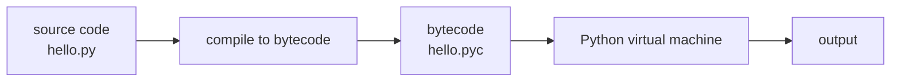

# What is Python?

- Python is a general purpose high-level scripting language :
  - Supports many applications from text processing to WWW browsers and games
- Python is Beginner's Language :
  - Great language for the beginner programmers
- Python is interpreted :
  - Processed at runtime by the interpreter, with no separate compile step to run



- Python is interactive :
  - Prompt allows you to interact with the interpreter directly to write your programs
- Python is Object Oriented :
  - Supports Object-Oriented style programming that encapsulates code within objects
- Python is easy to learn and easy to read :
  - Python has relatively few keywords, simple structure, and a clearly defined syntax
  - Python code is much more clearly defined and visible to the eye

---

# Python Features

- Broad standard library :
  - Bulk of the library is cross portable on UNIX, Windows, and Macintosh
- Portable :
  - Python runs on a wide variety of platforms and has same interface on all platforms
- Extendable :
  - Python allows the addition of low-level modules to the Python interpreter
- Databases :
  - Python provides interfaces to all major commercial databases
- GUI Programming :
  - Python supports GUI applications that can be ported to many system calls
- Web Applications :
  - Django and Flask Framework allow building of Python Web Applications
- Scalable :
  - Python provides better structure and support for large programs than shell scripting
- Supports automatic garbage collection :
  - Can be easily integrated with C, C++, COM, ActiveX, CORBA, and Java

---

# History of Python

- Python was developed by Guido van Rossum around 1990 at :
  - National Research Institute for Mathematics and Computer Science in Netherlands
- Python is derived from many other languages :
  - Including Modula-3, C, C++,SmallTalk, Unix shell and other scripting languages
- Python is usable as :
  - Scripting language or compiled to byte-code for building large applications
- Python is copyrighted and Python source code available :
  - Like Perl under the GNU General Public License (GPL)
- Python is maintained by a development team at the institute :
  - Guido van Rossum still holds a vital role in directing it's progress
- Python supports :
  - Functional and structured programming methods as well as OOP
  - Very high-level dynamic data types and dynamic type checking

---

# Getting Started

- Python Official Website :
  - `http://www.python.org/`
  - Has most up-to-date and current source code and binaries
  - Both Python 2 and Python 3 are available which differ significantly
- Linux Installation :
  - Download the zipped source code available for Unix/Linux
  - Extract files and enter `make install`
  - This will install Python in a standard location `/usr/local/bin`
- Windows Installation :
  - Download the Windows installer `python-XYZ.msi` file
  - Double-click the `msi` file and run the Python installation wizard
  - Accept the default settings or choose an installation directory
- Python Documentation Website :
  - `www.python.org/doc/`
  - Documentation available in HTML, PDF and PostScript format

---

# Setting up PATH

- To invoke the Python interpreter from any particular directory :
  - Add the Python directory to your path
- PATH is an environment variable :
  - Provides a search path that lists directories that OS searches for executables
  - Named PATH in Unix or Path in Windows
  - Unix is case-sensitive, Windows is not
- Setting PATH in Linux :
  - In the bash shell type :

```bash
export PATH="$PATH:/usr/local/bin/python"
```

- Setting PATH in Windows :
  - At a command prompt type :

```bash
PATH=%PATH%;C:\Python
```

  - Or use the environment variables tab under System Properties
- PYTHONPATH :
  - Tells Python interpreter where to locate module files you import into a program

---

# Running Python

- Invoke Python interpreter from any particular directory :
  - Add the Python directory to your path
- Interactive Interpreter :
  - Start the Python interactive interpreter from command line by entering `python`
  - You will get `$python` in Linux and `>>>` in Windows or Anaconda prompt with `IPython`
  - Script can be parameterized with command line arguments `C:\ python -h`
- Script from Command Line :
  - A Python script can be executed at command line by invoking the interpreter

```text
$ python script.py      # Linux
C:> python script.py    # Windows
```

- Integrated Development Environment :
  - Run Python from a graphical user interface (GUI) environment
  - GUI IDE for Python on system that supports Python is IDLE
- Jupyter Notebook on a web server :
  - Give command jupyter notebook from Anaconda prompt

---

# Python in Interactive Mode

- Python language has many similarities to Perl, C, and Java :
  - There are some definite differences between the languages
- Start with Hello World Python program in interactive mode :
  - Invoke the interpreter by typing `python` in a command prompt

```text
C:\> python
Python 3.14.0 (main, Oct  7 2025, 10:12:33) [MSC v.1942 64 bit (AMD64)] on win32
Type "help", "copyright", "credits" or "license" for more information.
>>> print("Hello, Python!")
Hello, Python!
>>>
```

- Type the statement right of the `>>>` prompt and press Enter :
  - The interpreter evaluates it and prints the result immediately
- Separate multiple statements with a semicolon ;

---

# Python in Script Mode

- When the interpreter is invoked with a script parameter :
  - The script begins execution and continues until it is finished
  - When the script is finished, the interpreter is no longer active
- All Python files will have extension `.py` :
  - Put the following source code in a `test.py` file

```python
print ("Hello, Python!")
```

- Run the script as follows :

```text
C:\ python test.py
```

- In a Unix environment make file executable with `:`

```bash
$ chmod +x test.py # set execute permission
```

- This will produce following result :

```text
Hello, Python!
```


- `print()` default prints a new line

> `demo01 · hellopython`


---

# Python Identifiers

- Names used to identify things in Python :
  - Variable, function, class, module, or other object
- Identifier Rules :
  - Starts with a letter A to Z or a to z or an underscore (_)
  - Followed by zero or more letters, underscores, and digits (0 to 9)
  - Punctuation characters such as @, $, and % not allowed within identifiers
- Python is a case sensitive programming language :
  - `myVar` and `Myvar` are different
- Naming conventions for Python :
  - Class names start with uppercase letters, all other identifiers with lowercase letters
  - Leading underscore is a weak private indicator :
    - `from M import *` does not import objects with name starting with an underscore
  - Two leading underscores indicates a strongly private identifier :
    - Name mangling is applied to such identifiers by putting class name in front
  - If identifier also ends with two trailing underscores :
    - identifier is a language-defined special name

---

# Python Reserved Words

- May not be used as constant or variable or other identifier name

```text
and exec not
assert finally or
break for pass
class from print
continue global raise
def if return
del import try
elif in while
else is with
except lambda yield
```

---

# Comments in Python

- Comments starts with :
  - A hash sign (#) that is not inside a string literal
  - All characters after the # and up to the physical line end are part of the comment

```python
# First comment
print ("Hello, Python!") # second comment
```

- Will produce following result :

```text
Hello, Python!
```

- Comment may be on same line after statement or expression :

```python
name = "Einstein" # This is again comment
```

- Comment multiple lines as follows :

```python
# This is a comment.
# This is a comment, too.
# This is a comment, too.
# I said that already.
```

---

# Lines and Indentation

- Blocks of code are denoted by line indentation :
  - No braces for blocks of code for class and function definitions or flow control
- Number of spaces in the indentation is variable :
  - All statements within the block must be indented the same amount

```python
if True: # Both blocks in first example are fine
    print ("True")
else:
  print ("False")

if True: # Second line in second block will generate an error
    print ("Answer")
    print ("True")
else:
    print ("Answer")
  print ("False")
```

- `print()` without new line is written as `print ('hello python', end='')`
- Semicolon ; allows multiple statements on single line

> `demo02 · lines_and_identation`

---

# Multi Line Statements

- Statements in Python typically end with a newline
- Python allows the use of the line continuation character `(\)` :
  - Denotes that the line should continue

```python
total = item_one + \
          item_two + \
```

- Statements contained within the `[], {},` or `()` brackets :
  - No need to use the line continuation character

```python
days = ['Monday', 'Tuesday', 'Wednesday',
                'Thursday', 'Friday']
```

- On a single line :
  - Semicolon ( ; ) allows multiple statements on single line
  - Neither statement should start a new code block

> `demo03 · multilinestatements`


---

# Quotes in Python

- Python uses quotes to denote string literals :
  - single ('), double (") and triple (''' or """)
  - Same type of quote should start and end the string
  - Triple quotes can be used to span the string across multiple lines

```python
print ('hello' + " " + '''world''')
word = 'word'
sentence = "This is a sentence."
paragraph = """This is a paragraph. It is made up of
                  multiple lines and sentences."""
```

- Single quote in a single quoted string :
  - Displayed with an escape character \

```python
'What \'s your name'
```

> `demo04 · quotesandescapes`


---

# Summary : Python Intro

- Python is a general purpose high-level scripting language :
  - It is interpreted, interactive and object oriented
- Python was developed by Guido van Rossum around 1990 at :
  - National Research Institute for Mathematics and Computer Science in Netherlands
- Python can be started in three different ways :
  - Interactive Interpreter, Script from Command Line, from inside an IDE, Jupyter Notebook
- Python is a case sensitive programming language :
  - `myVar` and `Myvar` are different
- Python uses line indentation to denote blocks of code :
  - No braces for blocks of code for class and function definitions or flow control
- Python allows the use of the line continuation character (\) :
  - Denote that the line should continue
- Python uses quotes to denote string literals :
  - single ('), double (") and triple (''' or """)

> `exercise01 · Python Intro`
