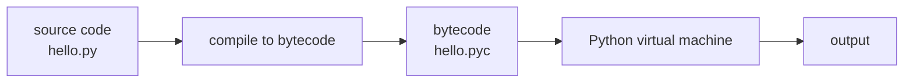

# What is Python?

- Python is a general purpose high-level scripting language :
  - Supports many applications from text processing to WWW browsers and games
- Python is Beginner's Language :
  - Great language for the beginner programmers
- Python is interpreted :
  - Processed at runtime by the interpreter, with no separate compile step to run



- Python is interactive :
  - Prompt allows you to interact with the interpreter directly to write your programs
- Python is Object Oriented :
  - Supports Object-Oriented style programming that encapsulates code within objects
- Python is easy to learn and easy to read :
  - Python has relatively few keywords, simple structure, and a clearly defined syntax
  - Python code is much more clearly defined and visible to the eye

---

# Python Features

- Broad standard library :
  - Files, paths, dates, JSON, CSV, regular expressions, SQLite and testing out of the box
- Portable :
  - The same code runs on Linux, Windows and macOS
- Large ecosystem :
  - Hundreds of thousands of packages on PyPI, installed with `uv add`
- Used across many fields :
  - Automation and scripting, web back ends, data analysis, machine learning, testing
- Extendable :
  - Performance-critical parts can be written in C or Rust and called from Python
- Automatic memory management :
  - Objects are freed by reference counting and a garbage collector, not by hand

---

# History of Python

- Python was developed by Guido van Rossum around 1990 at :
  - National Research Institute for Mathematics and Computer Science in Netherlands
- Python is derived from many other languages :
  - Including Modula-3, C, C++,SmallTalk, Unix shell and other scripting languages
- Python is usable as :
  - Scripting language or compiled to byte-code for building large applications
- Python is copyrighted and the source is open :
  - Released under the PSF License, a permissive licence that allows commercial use
- Python is maintained by a development team at the institute :
  - Development is now steered by the Python Steering Council and the community
- Python supports :
  - Functional and structured programming methods as well as OOP
  - Very high-level dynamic data types and dynamic type checking

---

# Modern Python Tooling

- Python needs an interpreter, an environment and a set of packages :
  - Historically each of these was installed and managed by a separate tool
  - The result was hard to reproduce on a second machine
- Two tools now cover almost all of it :
  - `uv` installs Python, creates the environment and resolves the packages
  - `ruff` checks style and catches a large class of mistakes before you run
- Both are single binaries with no Python of their own to bootstrap :

| Older tool | Replaced by |
|---|---|
| `python.org` installer, `pyenv` | `uv python install` |
| `venv`, `virtualenv` | `uv` creates `.venv` for you |
| `pip`, `pip-tools`, `requirements.txt` | `uv add` and `uv.lock` |
| `flake8`, `isort`, `black`, `pylint` | `ruff check` and `ruff format` |

---

# Getting Started

- Install `uv` once, and let it install Python for you :

```powershell
powershell -ExecutionPolicy ByPass -c "irm https://astral.sh/uv/install.ps1 | iex"
```

- On macOS or Linux use the shell installer :

```bash
curl -LsSf https://astral.sh/uv/install.sh | sh
```

- Close and reopen the terminal, then fetch the interpreter :

```bash
uv python install 3.14
```

- This needs no administrator rights :
  - Any Python already on the machine is left alone, and versions live side by side
- The traditional route is the installer from `https://www.python.org/` :
  - Tick `Add python.exe to PATH` on the first page of the Windows wizard
  - Python 2 reached its end of life in 2020, so Python 3 is the only choice
- Documentation lives at `https://docs.python.org/3/`

---

# Setting up PATH

- Only needed when Python was installed by hand :
  - `uv` puts the interpreter where `uv run` can find it, so it needs none of this
- PATH is an environment variable :
  - Provides a search path that lists directories that OS searches for executables
  - Named PATH in Unix or Path in Windows, and Unix is case-sensitive
- Setting PATH in Linux :

```bash
export PATH="$PATH:/usr/local/bin/python"
```

- Setting PATH in Windows :

```bash
PATH=%PATH%;C:\Python
```

  - Or use the environment variables tab under System Properties
- PYTHONPATH is a separate variable :
  - It tells the interpreter where to find modules you import, not where Python is

---

# Creating a Project

- A project is a directory with a `pyproject.toml` in it :

```bash
uv init course-work
cd course-work
```

- `uv init` writes three things :
  - `pyproject.toml` , the file that names the project and its dependencies
  - `.python-version` , the interpreter this project is pinned to
  - `main.py` , a placeholder to delete or edit

```text
course-work/
├─ pyproject.toml
├─ .python-version
├─ main.py
└─ .venv/            created on the first uv run or uv add
```

- Run code through `uv run`, which uses the project's own interpreter :

```bash
uv run python main.py
```

---

# Adding Dependencies

- `uv add` installs a package and records it in `pyproject.toml` :

```bash
uv add requests
uv add "requests>=2.28,<3"
uv add --dev pytest
```

- Two files describe the dependencies, and both belong in version control :
  - `pyproject.toml` states what the project asks for
  - `uv.lock` states the exact versions that were resolved
- Anyone can then reproduce the environment exactly :

```bash
uv sync          # install exactly what uv.lock says
uv remove requests
```

- There is no environment to activate :
  - `uv run` puts the project's `.venv` in front for the length of one command

> `demo01 · uv_project`

---

# Running Python

- Invoke Python interpreter from any particular directory :
  - Add the Python directory to your path
- Interactive Interpreter :
  - Start the Python interactive interpreter from command line by entering `python`
  - The interpreter answers with its `>>>` prompt, ready for a statement
  - Script can be parameterized with command line arguments `C:\ python -h`
- Script from Command Line :
  - A Python script can be executed at command line by invoking the interpreter

```text
$ python script.py      # Linux
C:> python script.py    # Windows
```

- Integrated Development Environment :
  - Run and debug Python from an editor, which is how most work is done
  - This course uses VS Code, set up two slides on
- Jupyter Notebook on a web server :
  - Cell by cell execution, common in data science work

---

# Python in Interactive Mode

- Start with Hello World Python program in interactive mode :
  - Invoke the interpreter by typing `python` in a command prompt

```text
C:\> python
Python 3.14.0 (main, Oct  7 2025, 10:12:33) [MSC v.1942 64 bit (AMD64)] on win32
Type "help", "copyright", "credits" or "license" for more information.
>>> print("Hello, Python!")
Hello, Python!
>>>
```

- Type the statement right of the `>>>` prompt and press Enter :
  - The interpreter evaluates it and prints the result immediately
- Separate multiple statements with a semicolon ;

---

# Python in Script Mode

- When the interpreter is invoked with a script parameter :
  - The script begins execution and continues until it is finished
  - When the script is finished, the interpreter is no longer active
- All Python files will have extension `.py` :
  - Put the following source code in a `test.py` file

```python
print("Hello, Python!")
```

- Run the script as follows :

```text
C:\ python test.py
```

- In a Unix environment make file executable with `:`

```bash
$ chmod +x test.py # set execute permission
```

- This will produce following result :

```text
Hello, Python!
```

- `print()` default prints a new line

> `demo02 · hellopython`

---

# Linting with ruff

- A linter reads code without running it and reports what looks wrong :
  - Unused imports and variables, shadowed built-ins, unreachable code
  - Style that departs from the conventions the rest of Python follows
- Two commands cover the daily use :

```bash
uv run ruff check .          # report problems
uv run ruff check . --fix    # fix the ones that are safe to fix
uv run ruff format .         # lay the code out consistently
```

- Rules are configured in `ruff.toml`, which ships with this course :
  - It selects the rule set the course material is written against
  - Without it the editor would flag patterns the course uses on purpose

> `demo03 · ruff_findings`

---

# Editor Setup

- The course demonstrates Visual Studio Code :
  - Any editor works, but the slides assume this one
- Install two extensions from the Extensions panel :
  - `Python` , published by Microsoft
  - `Ruff` , published by Astral
- With both installed the editor will :
  - Underline the problems `ruff check` would report, as you type
  - Offer the same fixes, and format on save if you ask it to
  - Resolve imports against the project's `.venv` rather than a global Python
- Point the editor at the project interpreter :
  - Command Palette, `Python: Select Interpreter`, choose the one in `.venv`

---

# Python Identifiers

- Names used to identify things in Python :
  - Variable, function, class, module, or other object
- Identifier Rules :
  - Starts with a letter A to Z or a to z or an underscore (_)
  - Followed by zero or more letters, underscores, and digits (0 to 9)
  - Punctuation characters such as @, $, and % not allowed within identifiers
- Python is a case sensitive programming language :
  - `myVar` and `Myvar` are different
- Naming conventions for Python :
  - Class names start with uppercase letters, all other identifiers with lowercase letters
  - Leading underscore is a weak private indicator :
    - `from M import *` does not import objects with name starting with an underscore
  - Two leading underscores indicates a strongly private identifier :
    - Name mangling is applied to such identifiers by putting class name in front
  - If identifier also ends with two trailing underscores :
    - identifier is a language-defined special name

---

# Python Reserved Words

- May not be used as constant or variable or other identifier name

```text
and exec not
assert finally or
break for pass
class from print
continue global raise
def if return
del import try
elif in while
else is with
except lambda yield
```

---

# Comments in Python

- Comments starts with :
  - A hash sign (#) that is not inside a string literal
  - All characters after the # and up to the physical line end are part of the comment

```python
# First comment
print("Hello, Python!")  # second comment
```

- Will produce following result :

```text
Hello, Python!
```

- Comment may be on same line after statement or expression :

```python
name = "Einstein"  # This is again comment
```

- Comment multiple lines as follows :

```python
# This is a comment.
# This is a comment, too.
# This is a comment, too.
# I said that already.
```

---

# Lines and Indentation

- Blocks of code are denoted by line indentation :
  - No braces for blocks of code for class and function definitions or flow control
- Number of spaces in the indentation is variable :
  - All statements within the block must be indented the same amount

```python
if True:  # Both blocks in first example are fine
    print("True")
else:
  print("False")

if True:  # Second line in second block will generate an error
    print("Answer")
    print("True")
else:
    print("Answer")
  print("False")
```

- `print()` without new line is written as `print("hello python", end="")`
- Semicolon ; allows multiple statements on single line

> `demo04 · lines_and_identation`

---

# Multi Line Statements

- Statements in Python typically end with a newline
- Python allows the use of the line continuation character `(\)` :
  - Denotes that the line should continue

```python
total = item_one + \
        item_two + \
        item_three
```

- Statements contained within the `[], {},` or `()` brackets :
  - No need to use the line continuation character

```python
days = ["Monday", "Tuesday", "Wednesday",
        "Thursday", "Friday"]
```

- On a single line :
  - Semicolon ( ; ) allows multiple statements on single line
  - Neither statement should start a new code block

> `demo05 · multilinestatements`

---

# Quotes in Python

- Python uses quotes to denote string literals :
  - single ('), double (") and triple (''' or """)
  - Same type of quote should start and end the string
  - Triple quotes can be used to span the string across multiple lines

```python
print('hello' + " " + '''world''')
word = 'word'
sentence = "This is a sentence."
paragraph = """This is a paragraph. It is made up of
               multiple lines and sentences."""
```

- Single quote in a single quoted string :
  - Displayed with an escape character \

```python
print('That\'s a brave new world')
```

> `demo06 · quotesandescapes`

---

# Summary : Python Intro

- Python is a general purpose high-level scripting language :
  - Interpreted, interactive and object oriented, developed by Guido van Rossum
- `uv` manages the interpreter, the environment and the packages :
  - `uv python install`, `uv init`, `uv add`, `uv run`
  - `pyproject.toml` states what is wanted, `uv.lock` pins what was resolved
- `ruff` reports style and correctness problems without running the code
- Python can be started in three different ways :
  - Interactive interpreter, script from the command line, from inside an IDE
- Python is a case sensitive programming language :
  - `my_var` and `My_var` are different
- Python uses line indentation to denote blocks of code :
  - No braces for class and function definitions or for flow control
- The line continuation character (\) denotes that a line should continue
- Quotes denote string literals, single, double or triple

> `exercise01 · Python Intro`
