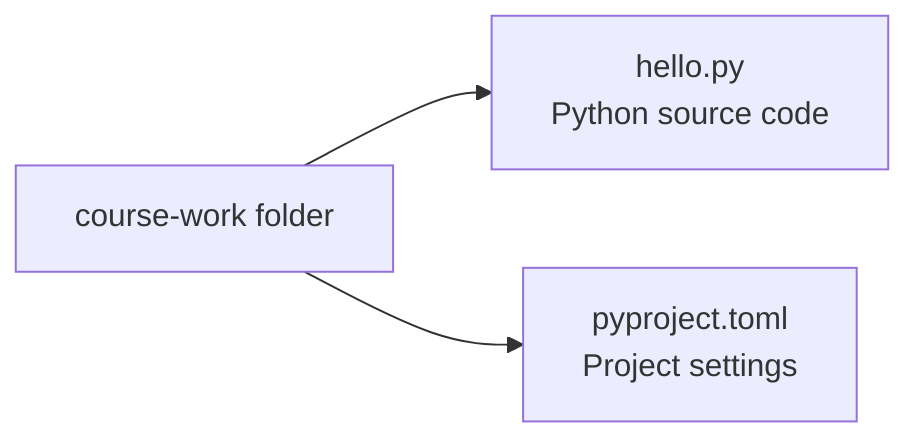

# What is Python?

- Python is a programming language :
  - A program is a set of instructions a computer carries out
  - Python code expresses those instructions as text
- The Python interpreter is the application that runs Python code
- Python programs can process files, automate tasks and build applications
- A small Python program displays a message :

```python
print("Hello, Python!")
```

```text
Hello, Python!
```

---

# Python Background

- Guido van Rossum started Python at CWI in the Netherlands in 1989
- The first public release followed in February 1991
- The name comes from the comedy series *Monty Python's Flying Circus*
- Python is open source :
  - Its source code can be inspected, changed and shared under its licence
  - It is free to use, including in commercial applications

<svg xmlns="http://www.w3.org/2000/svg" viewBox="0 0 960 140" width="100%" role="img" aria-label="Python milestones: development begins in 1989, first public release in 1991, Python 2 in 2000, Python 3 in 2008, Python 2 support ends in 2020">
  <path d="M65 62H895" fill="none" stroke="currentColor" stroke-width="3" opacity=".4" />
  <g fill="currentColor" font-family="sans-serif" text-anchor="middle">
    <circle cx="65" cy="62" r="7" /><circle cx="255" cy="62" r="7" /><circle cx="465" cy="62" r="7" /><circle cx="675" cy="62" r="7" /><circle cx="895" cy="62" r="7" />
    <g font-size="26" font-weight="600"><text x="65" y="33">1989</text><text x="255" y="33">1991</text><text x="465" y="33">2000</text><text x="675" y="33">2008</text><text x="895" y="33">2020</text></g>
    <g font-size="18"><text x="65" y="100">Work begins</text><text x="255" y="100">Public release</text><text x="465" y="100">Python 2</text><text x="675" y="100">Python 3</text><text x="895" y="100">Python 2</text><text x="895" y="124">support ends</text></g>
  </g>
</svg>

- Python 3 introduced changes that broke compatibility with Python 2
- Python 2 examples in older books may need changes to run on Python 3

---

# Python Features

- Python is a general-purpose language with an emphasis on readable code

| Feature | Meaning in practice |
| --- | --- |
| High-level | Work with text, files and collections using built-in operations |
| Interpreted | Run source code through the Python interpreter |
| Interactive | Try statements directly at the `>>>` prompt |
| Portable | Python runs on Windows, macOS and Linux |
| Standard library | Python includes tools for files, dates, internet access and more |
| Third-party packages | Install additional tools for specialised tasks |

- Operating-system paths and external tools can still require platform-specific code
- A library is reusable code; a package groups code that can be installed or imported

---

# Python Applications

- Python programs range from short scripts to complete applications

| Area | Example task | Common tools |
| --- | --- | --- |
| Automation | Rename photos and organise folders | Standard library |
| Data analysis | Summarise listening history and plot trends | pandas, Matplotlib |
| Web applications | Serve a music catalogue through a website | Django, Flask |
| Scientific computing | Calculate with arrays of measurements | NumPy, SciPy |
| Machine learning | Classify images using a trained model | scikit-learn, PyTorch |

- Libraries provide specialised operations; Python code connects them
- Large computations often run inside libraries implemented in compiled languages

---

# Source Code and Output

- Source code is the text written in the Python language
- Output is the text a running program displays
- `print()` displays the value between its parentheses :
  - Quotes mark the beginning and end of a piece of text
  - The displayed text does not include those quotes

```python
print("Playing Imagine")
```

```text
Playing Imagine
```

> `demo01 · first_message`

---

# Files and Folders

- A file stores content under a name :
  - A Python source file has a name ending in `.py`, such as `hello.py`
  - A saved file remains available after the editor closes
- A folder groups files and other folders :
  - A project folder keeps the files for one program together
  - A file's path describes its location
- An editor opens a file so its contents can be read and changed



---

# The Editor and the Terminal

- Visual Studio Code provides two places to work :
  - The editor area contains the Python source file
  - The terminal accepts commands and displays their output
- The Explorer panel lists the files in the open folder
- `File > Open Folder` opens a project folder
- `Terminal > New Terminal` opens a terminal in that folder
- A terminal prompt indicates that a command can be entered :
  - Type the command after the prompt, then press Enter
  - The prompt itself is not part of the command

---

# Preparing Python

- Python must be installed before a Python file can run
- `uv` is a tool that can install Python and run it for a project
- On Windows, open PowerShell from the Start menu and run :

```powershell
powershell -ExecutionPolicy ByPass -c "irm https://astral.sh/uv/install.ps1 | iex"
```

- On macOS or Linux, open Terminal and run :

```bash
curl -LsSf https://astral.sh/uv/install.sh | sh
```

- Close and reopen the terminal, then install Python :

```bash
uv python install 3.14
```

---

# Editor Setup

- Install Visual Studio Code from `https://code.visualstudio.com/`
- Open the Extensions panel using the squares icon on the left :
  - Search for `Python` and install the extension published by Microsoft
  - The extension adds Python editing and running support
- `File > Open Folder` selects the folder shown in the Explorer panel
- A browser-based VS Code in a prepared Codespace already has these tools

| Part | Purpose | Example |
| --- | --- | --- |
| Editor | Write and save source code | Visual Studio Code |
| Python extension | Add Python support to the editor | Microsoft Python |
| Interpreter | Execute Python code | Python 3.14 |
| Project tool | Prepare Python and run commands | `uv` |

---

# Creating a Project

- A project is a folder holding the files for a program
- Open a folder for course work in VS Code, then open a new terminal
- Run each command separately :

```bash
uv init --bare --python 3.14 course-work
cd course-work
```

- `uv init` creates the `course-work` folder and its project settings
- `--bare` starts with only the project settings in `pyproject.toml`
- `cd` changes the terminal's current folder :
  - Commands now run inside `course-work`
- Open the new `course-work` folder with `File > Open Folder`

---

# Creating a Python File

- In the Explorer panel, select New File and enter `hello.py`
- Type the Python statement in the editor area :

```python
print("Playing Imagine")
```

- Save the file with `File > Save` :
  - `Ctrl+S` on Windows and Linux; `Cmd+S` on macOS
  - The `.py` ending is part of the filename
- Saving writes the editor's contents to the file on disk

---

# Running a Python File

- Open a terminal in the folder containing `hello.py`
- Enter this command in the terminal :

```bash
uv run python hello.py
```

- `uv run` starts a command using the project's Python
- `python hello.py` tells Python to execute the saved file
- The first run may display setup messages before the program's output :

```text
Playing Imagine
```

- When the program finishes, the terminal prompt returns

---

# Changing a Program

- Change the text between the quotes in `hello.py` :

```python
print("Playing Yesterday")
```

- Save the file, then run the same command again :

```bash
uv run python hello.py
```

```text
Playing Yesterday
```

- Python runs the saved contents on each run
- Editing a file does not change output from a previous run

> `demo02 · changed_message`

---

# Statements Run in Order

- A statement is an instruction in a Python program
- These statements execute from top to bottom :

```python
print("Playing Imagine")
print("Playing Yesterday")
```

```text
Playing Imagine
Playing Yesterday
```

- Each `print()` ends its output with a new line by default
- Running the file again starts the program from the beginning

> `demo03 · statement_order`

---

# Quotes in Python

- A string is a value containing text
- Matching quotes mark the beginning and end of a string :
  - Single quotes and double quotes both work
  - The opening and closing quote must be the same kind

```python
print("Playing Imagine")
print('Playing Yesterday')
print("Tonight's playlist")
```

- An apostrophe can appear inside a double-quoted string
- Parentheses surround the value passed to `print()`

> `demo04 · quoted_text`

---

# Comments in Python

- `#` starts a comment outside a string :
  - Python ignores the rest of that line
  - A comment explains a reason or a constraint

```python
# Keep the playlist order from the concert.
print("Playing Imagine")
print("Playing Yesterday")
```

- Blank lines can separate parts of a program
- Comments and blank lines do not produce output
- A hash sign inside quotes is text :

```python
print("Track #1")
```

> `demo05 · comments`

---

# Reading a Syntax Error

- Syntax is the set of rules for writing valid Python code
- A missing closing quote breaks those rules :

```text
print("Playing Imagine)
```

- Python reports the file, line number and kind of error :

```text
  File "hello.py", line 1
    print("Playing Imagine)
          ^
SyntaxError: unterminated string literal (detected at line 1)
```

- A `SyntaxError` prevents the script from running
- The marked location is where Python detected the problem

---

# Correcting and Rerunning

- Add the missing closing quote before the closing parenthesis :

```python
print("Playing Imagine")
```

- Save the file and run it again :

```bash
uv run python hello.py
```

```text
Playing Imagine
```

- An error message remains visible in the terminal after the repair
- The most recent run shows whether the saved correction worked

---

# Finding a File to Run

- The terminal has a current folder :
  - The filename in the run command is resolved from that folder
  - The Explorer panel and an existing terminal can show different folders
- A message containing `can't open file` means Python could not open the script :
  - Check that the file is saved as `hello.py`
  - Check that the terminal is in the folder containing it
- Opening the project folder and choosing `Terminal > New Terminal` gives a new terminal there
- An unknown `uv` command means the tool is unavailable in that terminal :
  - After installing uv, close and reopen VS Code

---

# Python in Interactive Mode

- Python can also accept statements directly in a terminal
- Start the interpreter without a filename :

```bash
uv run python
```

- The `>>>` prompt accepts Python code :

```text
>>> print("Playing Imagine")
Playing Imagine
>>> 2 + 3
5
>>> exit()
```

- The interactive interpreter displays the result of `2 + 3` directly
- `exit()` returns to the terminal prompt; terminal commands run there
- Interactive statements are not saved in a `.py` file

---

# Summary : Python Intro

- A Python program is source code saved in a `.py` file
- The editor changes the source; the interpreter runs the saved file
- Terminal commands run from the terminal's current folder
- `uv run python hello.py` runs a Python file
- Statements run from top to bottom; `print()` displays output
- Quotes enclose strings; `#` starts a comment outside a string
- An error message identifies a problem to correct before rerunning
- Changing a program follows a cycle : edit, save, run and inspect the output

> `exercise01 · Python Intro`
