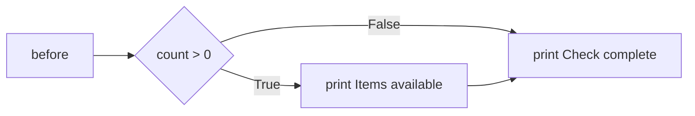
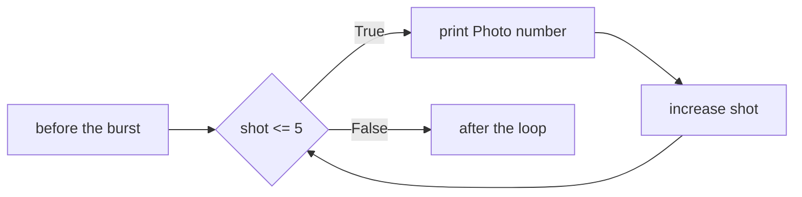
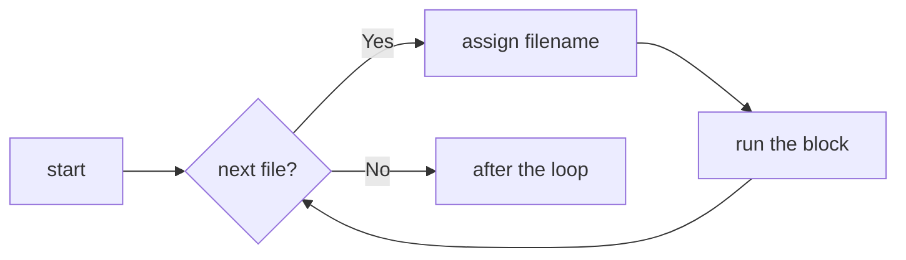

# Control Flow Constructs

- Statements run one after the other unless a control flow construct intervenes :
  - Branching constructs choose which block runs
  - Iteration constructs repeat a block
- Branching statements :
  - `if`, `if...else` and `elif`
  - `match`, which compares one value against a series of patterns
- Iteration statements :
  - `while`, which repeats as long as a condition holds
  - `for`, which takes each item of a sequence in turn
- Statements that steer a loop or fill a gap :
  - `break`, `continue`, a loop's `else`, and `pass`

---

# if Statement

- `if` runs an indented block when its condition is true.
- Execution continues after the block whether the condition is true or false.

```python
count = 3
if count > 0:
    print("Items available")
print("Check complete")
```



- Four spaces of indentation group the statements in the block.
- `0`, `""`, empty collections and `None` also count as false in a condition.

---

# if Example

- A camera checks whether storage has room for another photo :

```python
photos_left = 3
if photos_left > 0:
    print("Photo space available")
    print(f"Room for {photos_left} photos")
print("Camera check complete")
```

```text
Photo space available
Room for 3 photos
Camera check complete
```

- With `photos_left = 0`, the indented block is skipped
- The final message appears in both cases

> `demo01 · if`

---

# else Statement

- `else` runs when the `if` condition is false :
  - Exactly one of the two blocks runs
  - `else` has no condition of its own

```python
filename = input("Photo filename: ")
if filename.lower().endswith(".jpg"):
    print(f"Photo selected: {filename}")
else:
    print("Choose a JPG photo")
```

- `cover.jpg` selects a photo; `notes.txt` asks for a different file
- An optional `else` comes last

> `demo02 · else`

---

# elif Statement

- `elif` tests another condition when earlier conditions were false :
  - Only the first matching block runs
  - An optional `else` handles anything left over

```python
filename = "cover.png"
if filename.endswith(".jpg"):
    print("JPEG photo")
elif filename.endswith(".png"):
    print("PNG image")
else:
    print("Unsupported image format")
```

```text
PNG image
```

> `demo03 · elif`

---

# Nested if...elif...else

- An inner condition is tested only when its outer block runs :
  - The storage check runs only when the battery has enough charge

```python
battery = 80
photos_left = 3
if battery >= 20:
    if photos_left > 0:
        print("Camera ready")
    else:
        print("Storage full")
else:
    print("Charge the battery")
```

- Each nesting level adds four spaces
- A single test can combine these conditions when separate messages are unnecessary :
  - `battery >= 20 and photos_left > 0`

> `demo04 · nested_if`

---

# while Loop

- `while` repeats a block while its condition is true :
  - The condition is tested before every pass, including the first

```python
shot = 1
while shot <= 5:
    print(f"Photo {shot}")
    shot += 1
```

- This photo burst prints `Photo 1` through `Photo 5`
- `shot += 1` changes the value used by the next condition test
- When `shot` reaches `6`, execution continues after the loop



> `demo05 · while`

---

# Infinite while Loop

- A player can keep accepting requests until interrupted :

```python
while True:
    title = input("Queue a track: ")
    print(f"Requested: {title}")
```

- `True` never becomes false, so this loop does not finish by itself
- Press Ctrl+C to interrupt it; Python reports `KeyboardInterrupt`
- A condition with `break` can provide an ordinary exit from a continuous loop

> `demo06 · infinitewhile`

---

# for Loop

- `for` runs a block once for each item in a list, string or other iterable.
- The loop variable receives the next item before the block runs.



- An empty sequence skips the block entirely.
- The loop stops automatically when there are no items left.

---

# Processing Each File

- `filename` takes each name from `files` in turn.
- The unindented `print` runs once, after the loop.

```python
files = ["cover.jpg", "stage.jpg", "crowd.jpg"]
for filename in files:
    print(f"Processing {filename}")
print("All files processed")
```

```text
Processing cover.jpg
Processing stage.jpg
Processing crowd.jpg
All files processed
```

> `demo07 · for`

---

# Iterating by Sequence Index

- A sequence can be walked by index, using `len()` and `range()` :

```python
planets = ["venus", "mars", "jupiter"]
for index in range(len(planets)):
    print("Current planet :", planets[index])
```

- This works, and is what a loop over positions looks like in many languages :
  - `len()` gives the number of elements, `range()` the sequence of positions
  - It is worth recognising, because you will meet it in other people's code
- In Python it is rarely what you want :
  - The index is only used to look the element back up again
  - A `range` that drifts out of step with the sequence is a common bug
- When the element is all you need, iterate the sequence itself :

```python
for planet in planets:
    print("Current planet :", planet)
```

---

# Iterating with enumerate

- When the index is genuinely needed, `enumerate` yields both :

```python
for index, planet in enumerate(planets):
    print(index, planet)
```

```text
0 venus
1 mars
2 jupiter
```

- The two can never fall out of step, because they come from one call
- Counting starts at zero unless a `start` is given :

```python
for number, planet in enumerate(planets, start=1):
    print(number, planet)
```

- The pattern generalises :
  - `enumerate(seq)` for position and element
  - `zip(a, b)` for two sequences walked in step, covered in Comprehensions
  - `dict.items()` for a dictionary's keys and values together

> `demo08 · loopbyindex`


---

# break and continue Statements

- `continue` skips an item and starts the next iteration :

```python
for filename in ["cover.jpg", "notes.txt", "stage.jpg"]:
    if not filename.endswith(".jpg"):
        continue
    print(f"Photo: {filename}")
```

- `break` ends the loop immediately when the requested track is found :

```python
for track in ["Intro", "Orbit", "Echo", "Pulse", "Outro"]:
    if track == "Pulse":
        break
    print(f"Checked {track}")
print("Search complete")
```

- The final message runs after the search; `Outro` is never checked

> `demo09 · breakandcontinue`

---

# Loop with else Combination

- A search uses `else` for the case where no item matched :
  - The `else` block runs when the loop finishes without `break`

```python
requested = "Comet"
playlist = ["Orbit", "Echo", "Pulse"]
for track in playlist:
    if track == requested:
        print(f"Found {requested}")
        break
else:
    print(f"{requested} is not in the playlist")
```

```text
Comet is not in the playlist
```

- With `requested = "Echo"`, `break` skips the `else` block
- A `while` loop can also have `else`; it runs when the condition becomes false

> `demo10 · for_else`

---

# pass Statement

- `pass` fills a required block while an action is still being written :
  - It performs no operation
  - Execution continues with the next statement

```python
command = "skip"
if command == "skip":
    pass  # The next-track action is not implemented yet.
print(f"Command received: {command}")
```

```text
Command received: skip
```

- Unlike `continue`, `pass` does not skip the rest of a loop iteration

> `demo11 · passstatement`

---

# match Statement

- `match` compares a value with the cases in order :
  - Only the first matching case runs

```python
command = "play"
match command:
    case "play":
        print("Playing the current track")
    case "skip":
        print("Moving to the next track")
    case "quit":
        print("Player stopped")
    case _:
        print("Unknown player command")
```

- Quoted strings match those exact values
- `case _` handles remaining values and belongs last
- Execution continues after the block; cases need no `break`
- Python 3.10 or later is required

> `demo12 · matchstatement`

---

# Summary : Control Flow

- Branching statements choose which code runs :
  - `if`, `if...else` and `elif` test conditions in turn
  - `match` compares data against a series of patterns
- Iteration statements repeat a block of code :
  - `while` repeats as long as a condition holds
  - `for` iterates over each item of a sequence
- Statements that steer a loop :
  - `break` exits the loop early
  - `continue` skips to the next iteration
  - An `else` clause runs when the loop finishes without a `break`
- The `pass` statement is a no-op placeholder where a statement is required

> `exercise04 · Control Flow`
