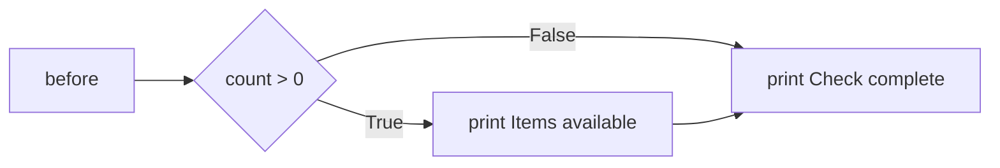
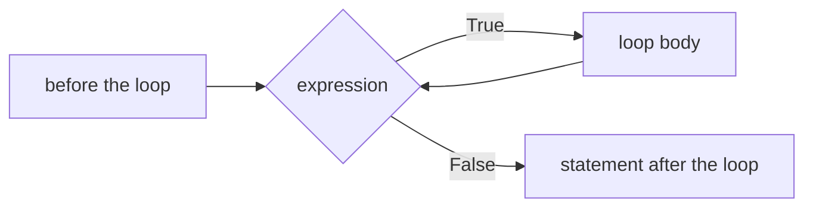
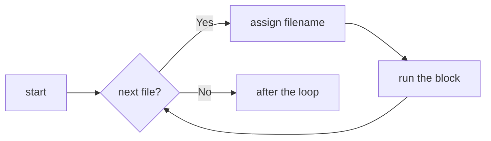

# Control Flow Constructs

- Statements run one after the other unless a control flow construct intervenes :
  - Branching constructs choose which block runs
  - Iteration constructs repeat a block
- Branching statements :
  - `if`, `if...else` and `elif`
  - `match`, which compares one value against a series of patterns
- Iteration statements :
  - `while`, which repeats as long as a condition holds
  - `for`, which takes each item of a sequence in turn
- Statements that steer a loop or fill a gap :
  - `break`, `continue`, a loop's `else`, and `pass`

---

# if Statement

- `if` runs an indented block when its condition is true.
- Execution continues after the block whether the condition is true or false.

```python
count = 3
if count > 0:
    print("Items available")
print("Check complete")
```



- Four spaces of indentation group the statements in the block.
- `0`, `""`, empty collections and `None` also count as false in a condition.

---

# if Example

```python
var1 = 100
if var1:
    print("1 - Got a true expression value")
    print(var1)

var2 = 0
if var2:
    print("2 - Got a true expression value")
    print(var2)
print("Good bye!")
```

- Result :

```text
1 - Got a true expression value
100
Good bye!
```

- In case `if` has only one line it may go on same line :

```python
if expression == 1: print("Value of expression is 1")
```

> `demo01 · if`

---

# else Statement

- Is combined with an `if` statement :
  - Contains the block that runs when the `if` expression is false
- `else` is optional :
  - At most one `else` can follow an `if`, and it comes last
- Syntax `if...else` statement :

```python
if expression:
    statement(s)
else:
    statement(s)
```

- Example reading input with `input` and testing it with `endswith` :

```python
name = input("What is your name? ")
if name.endswith("Gumby"):
    print("Hello, Mr. Gumby")
else:
    print("Hello, stranger")
```

> `demo02 · else`


---

# elif Statement

- Tests several expressions in turn :
  - The block of the first expression that is true runs, and the rest are skipped
- `elif` is optional :
  - Any number of `elif` branches may follow an `if`
- Syntax of the `if...elif` statement :

```text
if expression1:
    statement(s)
elif expression2:
    statement(s)
elif expression3:
    statement(s)
else:
    statement(s)
```

- Where a chain of `elif` tests one value, `match` often reads better :
  - Covered at the end of this module

> `demo03 · elif`


---

# Nested if...elif...else

- An `if` statement can sit inside the block of another :
  - The inner condition is only tested once the outer one is true
- Syntax nested `if...elif...else` :

```text
if expression1:
    statement(s)
    if expression2:
        statement(s)
    elif expression3:
        statement(s)
    else:
        statement(s)
elif expression4:
    statement(s)
else:
    statement(s)
```

- Each level of nesting adds four spaces :
  - More than two levels usually reads better as `and`, or as a function

> `demo04 · nested_if`


---

# while Loop

- Repeats a block for as long as an expression is true :
  - The expression is tested before every pass, including the first

```python
while expression:
    statement(s)
```

- The loop ends when the expression is false :
  - Execution continues with the statement after the loop



- If the expression never becomes false, the loop never ends :
  - Sometimes that is the intent, as in a server or a game that waits for input
  - Such a loop is written `while True:` and left with `break`, covered below
- A body that must run at least once is written the same way :
  - `while True:`, then the body, then `if done:` with `break` under it

> `demo05 · while`


---

# Infinite while Loop

```python
while True:  # the condition never becomes false
    num = input("Enter a number: ")
    print("You entered:", num)
print("Good bye!")  # never reached
```

- Result :

```text
Enter a number: 20
You entered: 20
Enter a number: 3
You entered: 3
Enter a number: Traceback (most recent call last):
  File "06_infinitewhile.py", line 2, in <module>
    num = input("Enter a number: ")
KeyboardInterrupt
```

- A loop written this way continues until interrupted :
  - Press Ctrl+C to stop the program

> `demo06 · infinitewhile`


---

# for Loop

- `for` runs a block once for each item in a list, string or other iterable.
- The loop variable receives the next item before the block runs.



- An empty sequence skips the block entirely.
- The loop stops automatically when there are no items left.

---

# Processing Each File

- `filename` takes each name from `files` in turn.
- The unindented `print` runs once, after the loop.

```python
files = ["sales.csv", "stock.csv", "prices.csv"]
for filename in files:
    print(f"Processing {filename}")
print("All files processed")
```

```text
Processing sales.csv
Processing stock.csv
Processing prices.csv
All files processed
```

> `demo07 · for`

---

# Iterating by Sequence Index

- A sequence can be walked by index, using `len()` and `range()` :

```python
planets = ["venus", "mars", "jupiter"]
for index in range(len(planets)):
    print("Current planet :", planets[index])
```

- This works, and is what a loop over positions looks like in many languages :
  - `len()` gives the number of elements, `range()` the sequence of positions
  - It is worth recognising, because you will meet it in other people's code
- In Python it is rarely what you want :
  - The index is only used to look the element back up again
  - A `range` that drifts out of step with the sequence is a common bug
- When the element is all you need, iterate the sequence itself :

```python
for planet in planets:
    print("Current planet :", planet)
```

---

# Iterating with enumerate

- When the index is genuinely needed, `enumerate` yields both :

```python
for index, planet in enumerate(planets):
    print(index, planet)
```

```text
0 venus
1 mars
2 jupiter
```

- The two can never fall out of step, because they come from one call
- Counting starts at zero unless a `start` is given :

```python
for number, planet in enumerate(planets, start=1):
    print(number, planet)
```

- The pattern generalises :
  - `enumerate(seq)` for position and element
  - `zip(a, b)` for two sequences walked in step, covered in Comprehensions
  - `dict.items()` for a dictionary's keys and values together

> `demo08 · loopbyindex`


---

# break and continue Statements

- `break` leaves the loop immediately :
  - Execution continues with the statement after the loop
- `continue` skips the rest of the current iteration :
  - Control moves directly to the next pass of the loop
- Both statements work inside `while` and `for` loops

```python
for letter in "Python":
    if letter == "h":
        continue
    print("Current Letter :", letter)  # letter 'h' is not printed
print("After first loop!")
for letter in "Programming":
    if letter == "i":
        break
    print("Current Letter :", letter)  # loop stops on letter 'i'
print("After second loop!")
```

> `demo09 · breakandcontinue`


---

# Loop with else Combination

- An `else` clause can be attached to a loop :
  - In a `for` loop, the `else` block runs when the sequence is exhausted
  - In a `while` loop, the `else` block runs when the condition becomes false
  - In both cases, the `else` block is skipped if the loop was left via `break`
- In the following example :
  - The loop searches for a perfect square downwards from 99
  - When 81 is found, `break` leaves the loop and skips the `else` block

```python
from math import sqrt
for n in range(99, 80, -1):
    root = sqrt(n)
    print(root)
    print(int(root))
    if root == int(root):
        print(f"Perfect square is {n}")
        break
else:
    print("Didn't find it!")
```

> `demo10 · for_else`

---

# pass Statement

- Used when Python's syntax requires a statement but no action is needed :
  - A null operation; nothing happens when it executes
  - Commonly used as a placeholder in stubs or empty branches
- When a code block is under construction :
  - `pass` keeps the file syntactically valid until code is written

```python
for letter in "Python":
    if letter == "h":
        pass
        print("This is pass block")
    print("Current Letter :", letter)
print("Good bye!")
```

> `demo11 · passstatement`


---

# match Statement

- `match` compares one value with the cases in order.
- Only the first matching case runs.

```python
command = "help"
match command:
    case "help":
        print("Available commands: help, quit")
    case "quit":
        print("Goodbye")
    case _:
        print("Unknown command")
```

```text
Available commands: help, quit
```

- Quoted strings match those exact values.
- `case _` matches anything left over and belongs last.
- Cases need no `break`; execution continues after the `match` block.
- Python 3.10 or later is required.

> `demo12 · matchstatement`

---

# Summary : Control Flow

- Branching statements choose which code runs :
  - `if`, `if...else` and `elif` test conditions in turn
  - `match` compares data against a series of patterns
- Iteration statements repeat a block of code :
  - `while` repeats as long as a condition holds
  - `for` iterates over each item of a sequence
- Statements that steer a loop :
  - `break` exits the loop early
  - `continue` skips to the next iteration
  - An `else` clause runs when the loop finishes without a `break`
- The `pass` statement is a no-op placeholder where a statement is required

> `exercise04 · Control Flow`
