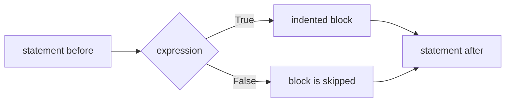
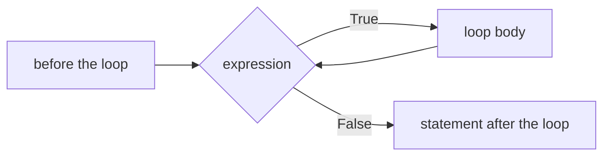
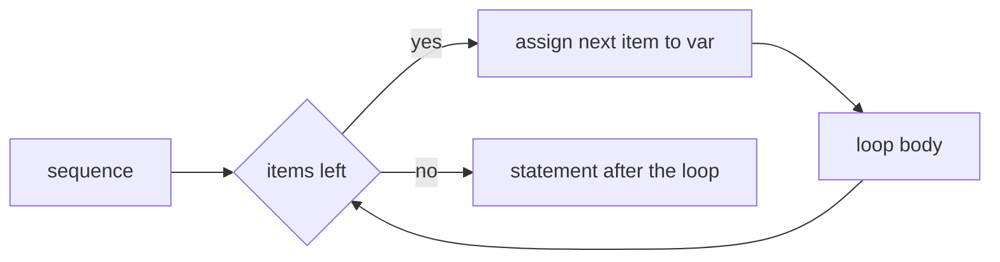

# Control Flow Constructs

- Every programming has control flow constructs :
  - Sequential constructs like statements
  - Branching constructs to take a certain direction
  - Iteration construct to repeat code a number of times
- Branching Statements :
  - `if`
  - `if...else`
  - `elif`
- Iteration Statements :
  - `for`
  - `while`
  - `continue`
  - `pass`

---

# if Statement

- `if` statement in Python is similar to that of other languages :
  - Contains a logical expression using which data is compared
  - Decision is made based on the result of the comparison
- Syntax `if` statement :

```python
if expression:
    statement(s)
```

- Expression is evaluated first :
  - If true that is then statement(s) block are executed
  - Otherwise next statement following statement(s) block is executed



- Numbers and strings represent true values :
  - Except number 0 and empty string
- Grouping statements :
  - Statements indented by the same number of character spaces :
    - Considered to be part of a single block of code
  - Python uses indentation as its method of grouping statements

---

# if Example

```python
var1 = 100
if var1:
    print ("1 - Got a true expression value")
    print (var1)

var2 = 0
if var2:
    print ("2 - Got a true expression value")
    print (var2)
print ("Good bye!")
```

- Result :

```text
1 - Got a true expression value
100
Good bye!
```

- In case `if` has only one line it may go on same line :

```python
if ( expression == 1 ) : print ("Value of expression is 1")
```

> `demo01 · if`

---

# else Statement

- Is combined with an `if` statement :
  - Contains code that executes in case the `if` statement resolves to 0 or false
- `else` statement is an optional statement :
  - Only one `else` statement can follow the `if` statement
- Syntax `if...else` statement :

```python
if expression:
    statement(s)
else:
    statement(s)
```

- Example asking input with `input` and `endswith` methods :

```python
name = input('What is your name? ')
if name.endswith('Gumby'):
     print ('Hello, Mr. Gumby')
else:
     print ('Hello, stranger')
```

> `demo02 · else`


---

# elif Statement

- Allows checking of multiple expressions for truth value :
  - Execute a block of code as soon as one of the conditions evaluates to true
- `elif` statement is optional :
  - Arbitrary number of `elif` statements may be following an `if`
- Syntax of the `if...elif` statement :

```text
if expression1:
    statement(s)
elif expression2:
    statement(s)
elif expression3:
    statement(s)
else:
    statement(s)
```

- Where a chain of `elif` tests one value, `match` often reads better :
  - Covered two slides on, and available from Python 3.10

> `demo03 · elif`


---

# Nested if...elif...else

- `if...elif...else` construct in other `if...elif...else` construct :
  - Allows checking another condition after condition resolves to true
- Syntax nested `if...elif...else` :

```text
if expression1:
    statement(s)
    if expression2:
       statement(s)
    elif expression3:
       statement(s)
    else
       statement(s)
elif expression4:
    statement(s)
else:
    statement(s)
```

> `demo04 · nested_if`


---

# while Loop

- Control flow construct to repeat code number of times :
  - Repetition continues until conditional expression becomes false
  - Expression must be a logical expression evaluating to true or false

```python
while expression:
    statement(s)
```

- `while` loop ends when conditional expression becomes false :
  - Control is passed to the statement following the loop



- In case the condition of a `while` never resolves to a false value :
  - Result is an infinite loop
- Infinite loop might be useful in client/server programming :
  - Server runs continuously on an open port so that clients can communicate with it
- If `while` clause has only one statement :
  - Placement on the same line is allowed

```python
while expression : statement
```


- Python does not support `do .. while` construct

> `demo05 · while`


---

# Infinite while Loop


```python
var = 1
while var == 1 : # This constructs an infinite loop
    num = input("Enter a number :")
    print("You entered: ", num)
print("Good bye!")
```

- Result :

```text
Enter a number :20
You entered: 20
Enter a number :3
You entered: 3
Enter a number between :Traceback (most recent call last):
  File "test.py", line 5, in <module>
     num = input("Enter a number :")
KeyboardInterrupt
```

- Above example will go in an infinite loop :
  - Use CTRL+C to stop the program

> `demo06 · infinitewhile`


---

# for Loop

- Control flow construct to repeat code number of times :
  - Iterates over the items of any sequence, such as a list or a string
- Syntax :

```python
for var in sequence:
    statements(s)
```

- `for` loop operation :
  - Each item in the sequence is assigned to iterating variable `var` in turn
  - Statements(s) block is executed until the entire sequence is finished




```python
words = ['one', 'way', 'ticket', 'to', 'mars']
for word in words:
     print(word , end=' ')
print()
list1 = [0, 1, 2, 3, 4, 5, 6, 7, 8, 9]
for number in list1:
     print(number)
```

> `demo07 · for`


---

# Iterating by Sequence Index

- A sequence can be walked by index, using `len()` and `range()` :

```python
planets = ['venus', 'mars', 'jupiter']
for index in range(len(planets)):
    print('Current planet :', planets[index])
```

- This works, and is what someone arriving from C or Java writes first :
  - `len()` gives the number of elements, `range()` the sequence of positions
  - It is worth recognising, because you will meet it in other people's code
- In Python it is rarely what you want :
  - The index is only used to look the element back up again
  - A `range` that drifts out of step with the sequence is a common bug
- When the element is all you need, iterate the sequence itself :

```python
for planet in planets:
    print('Current planet :', planet)
```

---

# Iterating with enumerate

- When the index is genuinely needed, `enumerate` yields both :

```python
for index, planet in enumerate(planets):
    print(index, planet)
```

```text
0 venus
1 mars
2 jupiter
```

- The two can never fall out of step, because they come from one call
- Counting starts at zero unless a `start` is given :

```python
for number, planet in enumerate(planets, start=1):
    print(number, planet)
```

- The pattern generalises :
  - `enumerate(seq)` for position and element
  - `zip(a, b)` for two sequences walked in step, covered in Comprehensions
  - `dict.items()` for a dictionary's keys and values together

> `demo08 · loopbyindex`


---

# break and continue Statements

- `break` statement terminates the current loop iteration :
  - Resumes execution at next statement after the loop
- `continue` statement returns control to the beginning of the loop :
  - Remaining statements in the current iteration of the loop are skipped
  - Control is moved back to the top of the loop
- `break` and `continue` can be used in both `while` and `for` loops

```python
for letter in 'Python':
    if letter == 'h':
       continue
    print('Current Letter :', letter) # letter 'h' is not printed
print("After first loop!")
for letter in 'Programming':
    if letter == 'i':
       break
    print('Current Letter :', letter) # loop stops on letter 'i'
print("After second loop!")
```

> `demo09 · breakandcontinue`


---

# Loop with else Combination

- `else` statement can be associated with loop statements
- If `else` statement is used with a `for` loop :
  - `else` statement executed when loop has exhausted iterating the list but not on a break
- If `else` statement is used with a `while` loop :
  - `else` statement is executed when the condition becomes false
- In following example :
  - `else` statement is combined with `for` statement
  - Search is done for a perfect square in the range 99 tot 80, number 81 is found

```python
from math import sqrt
for n in range(99, 80, -1):
     root = sqrt(n)
     print(root)
     print(int(root))
     if root == int(root):
        print(f"Perfect square is {n}")
        break
else:
    print("Didn't find it!")
```

> `demo10 · for_else`

---

# pass Statement

- Used when a statement is required syntactically :
  - But it is not desired that any command or code executes
- `pass` statement is a null operation :
  - Nothing happens when it executes
  - Also useful in places where code has not been written yet e.g. in stubs
- `pass` statement is helpful when :
  - A code block is created but it is no longer required
  - Statements inside the block may then be removed
  - Block may remain with `pass` statement so it doesn't interfere with other code parts

```python
for letter in 'Python':
    if letter == 'h':
       pass
       print('This is pass block')
    print('Current Letter :', letter)
print("Good bye!")
```

> `demo11 · passstatement`


---

# match Statement

- Python 3.10 added structural pattern matching, `match` and `case` :
  - It compares a value against a series of patterns and runs the first that fits
  - Older Python has no such statement, which is why chains of `elif` are common

```python
match command.split():
    case ["quit"]:                  # a literal pattern
        return "leaving"
    case ["go", direction]:         # captures the second word
        return f"walking {direction}"
    case ["take" | "get", item] if item != "moon":   # or-pattern with a guard
        return f"picking up the {item}"
    case _:                         # the wildcard, matched last
        return "I do not understand"
```

- It matches the shape of the data as well as its value :
  - A pattern can bind names out of a sequence, as `direction` and `item` do
  - `case _` is the catch-all, and belongs last
- There is no fall through between cases, so no `break` is needed

> `demo12 · matchstatement`

---

# Python Operators

- Operators perform operations on the operands :

```text
4 + 5 = 9
```

- Here 4 and 5 are called operands and `+` is called operator

```text
3 ** 2 = 9
```

- Here 3 and 2 are called operands and `**` is called operator
- Python language supports a number of traditional operators :
  - Arithmetic Operators
  - Comparison Operators
  - Logical (or Relational) Operators
  - Assignment Operators
  - Conditional (or ternary) Operators
- Python also has operators for data structures and objects :
  - Membership operators test for membership in strings, lists and tuples
  - Identity operators compare memory locations of two objects
- Python does not support the increment and decrement operators known from C

---

# Arithmetic and Assignment Operators

| Operator | Arithmetic Operator Description |
|---|---|
| `+` / `-` | Adds or subtracts values on either side of the operator |
| `*` | Multiplies values on either side of the operator |
| `/` | Divide left hand operand by right hand operand with decimal result |
| `//` | Division with quotient result with digits after decimal point removed |
| `%` | Divides left hand operand by right hand operand, returns remainder |
| `**` | Performs exponential (power) calculation on operators |

| Operator | Assignment Operator Description |
|---|---|
| `=` | Assigns values from right side operands to left side operand |
| `+=` / `-=` | Adds or subtracts right operand to left operand and assigns result to left |
| `*=` | Multiplies right operand with left operand and assigns result to left |
| `/=` | Divides left operand by right operand and assigns result to left |
| `%=` | Takes modulus using two operands and assigns result to left |

> `demo13 · pythonoperators`

---

# Python Comparison and Bitwise Operators

| Operator | Comparison Operator Description |
|---|---|
| `==` | Checks if values of two operands are equal or not. If yes condition is true |
| `!=` | Checks if values of two operands are equal or not. If not condition is true |
| `>` / `<` | Checks if value of left operand is greater than or less than right operand |
| `>=` / `<=` | Checks if value of left operand is greater or less than or equal to right operand |

| Operator | Bitwise Operator Description |
|---|---|
| `&` | Copies a bit to the result if it exists in both operands |
| `\|` | Copies a bit to the result if it exists in one of the operands |
| `^` | Copies a bit to the result if it is set in one but not both operands |
| `~` | Unary Binary Ones Complement Operator. Has effect of flipping the bits |
| `<<` / `>>` | Left or right shift by nr. of bits specified by right operand |

---

# Logical, Membership, Identity Operators

| Operator | Logical Operator Description |
|---|---|
| `and` | If both operands are true then the condition becomes true |
| `or` | If any of the operands are non-zero then the condition becomes true |
| `not` | Reverses logical state of operand. True condition will become false |

| Operator | Membership Operator Description |
|---|---|
| `in` | Evaluates to true if it finds variable in specified sequence, false otherwise |
| `not in` | Evaluates to true if it does not find variable in sequence, false otherwise |

| Operator | Identity Operator Description |
|---|---|
| `is` | Evaluates to true if variables on both sides point to the same object |
| `is not` | Evaluates to true if variables on both sides do not point to the same object |

> `demo14 · booleanoperators`

---

# Python Operators Precedence

| Operator | Description |
|---|---|
| `**` | Exponentiation, raise to the power |
| `~ + -` | Complement, unary plus and minus |
| `* / % //` | Multiply, divide, modulo and floor division |
| `+ -` | Addition and subtraction |
| `>> <<` | Right and left bitwise shift |
| `&` | Bitwise AND |
| `^ \|` | Bitwise exclusive OR and regular OR |
| `<= < > >=` | Comparison operators |
| `<> == !=` | Equality operators |
| `= %= /= //= -= += \|=` | Assignment operators |
| `is, is not` | Identity operators |
| `in, not in` | Membership operators |
| `not, or, and` | Logical operators |

---

# Summary : Control Flow and Operators

- Python has the following control flow constructs :
  - `if, if...else, elif, loop, while, continue, pass`
- Pythons `if` statement test a logical expression for `True` or `False` :
  - `else` may be combined with an `if` statement
  - `elif` allows checking of multiple expressions
- Pythons `while` loop is used to repeat code number of times :
  - Repetition continues until conditional expression becomes false
- Pythons `for` loop is used to repeat code number of times :
  - Iterates over the items of any sequence, such as a list or a string
- Pythons `pass` statement used when syntax requires statement :
  - Nothing happens when it executes
- Pythons `break` and `continue` statements :
  - Used to terminate current iteration and pass control elsewhere
- Python supports the following operators :
  - Arithmetic, Comparison, Logical, Assignment and Conditional Operators

> `exercise04 · Control Flow and Operators`
