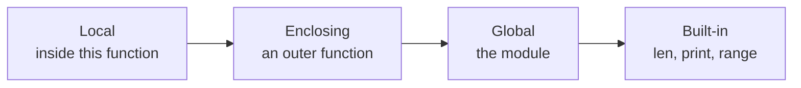

# Functions

- A function gives a name to a task that a program repeats :
  - Delivery charges depend on an order's total
  - The same calculation can be called for each order
- Python provides functions such as `print()`, `input()` and `len()` :
  - Programs define their own functions with `def`
- A function can take values and return a result :
  - The caller supplies the order total
  - The function returns the delivery charge

---

# Function Syntax

- `delivery_cost` calculates the delivery charge for an order :
  - Orders of 50 or more have free delivery
  - Smaller orders have a charge of 4.95

```python
def delivery_cost(total):
    if total >= 50.0:
        return 0.0
    return 4.95
```

- The definition starts with `def`, the name and parentheses :
  - `total` is a parameter that receives the order total
  - The colon starts the indented body
- `return` passes the charge back to the code that called the function

---

# Calling Functions

- Define a function before calling it :
  - Parentheses contain the argument supplied for `total`
  - Each call runs the body with that order total

```python
print(delivery_cost(35.0))
print(delivery_cost(75.0))
```

```text
4.95
0.0
```

- Defining the function does not run its body :
  - The two calls use the same definition with different arguments
  - Omitting a required argument raises `TypeError`

> `demo01 · delivery_cost`

---

# return Statement

- A returned value can be stored and used in another calculation :
  - `shipping` receives the delivery charge
  - The caller adds that charge to the order total

```python
def delivery_cost(total):
    if total >= 50.0:
        return 0.0
    return 4.95

shipping = delivery_cost(35.0)
grand_total = 35.0 + shipping
print(f"Order total: {grand_total:.2f}")
```

```text
Order total: 39.95
```

- `return` ends the current call immediately :
  - An order of 50 or more returns `0.0` before reaching `return 4.95`

> `demo02 · returnstatement`

---

# Functions Without a Result

- Some functions perform a task without returning a useful value :
  - `print_receipt` calculates and prints an order line
  - The caller does not need to store a result

```python
def print_receipt(product, unit_price, quantity):
    total = unit_price * quantity
    print(f"{quantity} x {product}: {total:.2f}")


print_receipt("Keyboard", 25.0, 2)
print_receipt("Mouse", 15.0, 1)
```

```text
2 x Keyboard: 50.00
1 x Mouse: 15.00
```

- Reaching the end of a function returns `None` :
  - A bare `return` also returns `None`

> `demo03 · receipt`

---

# Annotating a Function

- Annotations describe the values a function expects and returns :
  - `total: float` describes the argument
  - `-> float` describes the delivery charge returned to the caller

```python
def delivery_cost(total: float) -> float:
    if total >= 50.0:
        return 0.0
    return 4.95
```

- `-> None` describes a function that does not return a useful value :

```python
def print_receipt(product: str, unit_price: float, quantity: int) -> None:
    total = unit_price * quantity
    print(f"{quantity} x {product}: {total:.2f}")
```

- Annotations help the editor and type checkers; Python does not enforce them
- Collection parameters use the same types as variables, such as `list[str]`

> `demo04 · annotated_delivery`

---

# Documenting a Function

- A docstring describes the task and any rule callers need to know :
  - It is the first string inside the function body
  - Triple quotes allow the description to span several lines

```python
def delivery_cost(total: float) -> float:
    """Return the delivery charge; orders of 50 or more ship free."""
    if total >= 50.0:
        return 0.0
    return 4.95
```

- `help(delivery_cost)` displays the docstring :
  - Tools such as `pdoc` can include it in generated documentation
- The docstring explains the delivery rule without changing the calculation

> `demo05 · docstring`

---

# Function Arguments

- Positional arguments follow the parameter order :
  - `total` receives the first value; `free_from` receives the second

```python
def delivery_cost(total: float, free_from: float) -> float:
    if total >= free_from:
        return 0.0
    return 4.95


print(delivery_cost(35.0, 50.0))
```

- Keyword arguments specify parameter names
- Default values allow an argument to be omitted
- `*args` and `**kwargs` collect extra positional and keyword arguments
- Defining a name again replaces its earlier definition :
  - Python does not select between several definitions by their parameter types

> `demo06 · positionalarguments`

---

# Keyword Arguments

- Keyword arguments identify the parameters by name :
  - The order of keyword arguments can differ from the definition

```python
def delivery_cost(total: float, free_from: float) -> float:
    if total >= free_from:
        return 0.0
    return 4.95


print(delivery_cost(free_from=50.0, total=35.0))
```

```text
4.95
```

- Positional arguments must come before keyword arguments
- Parameter names make calls with several numeric values easier to read

> `demo07 · keywordarguments`

---

# Default Arguments

- A default supplies a value when the caller omits an argument :
  - The usual free-delivery threshold is 50
  - A call can supply a different threshold

```python
def delivery_cost(total: float, free_from: float = 50.0) -> float:
    if total >= free_from:
        return 0.0
    return 4.95


print(delivery_cost(35.0))
print(delivery_cost(35.0, free_from=30.0))
```

```text
4.95
0.0
```

- Parameters without defaults cannot follow parameters with defaults

> `demo08 · defaultarguments`

---

# Passing Object References

- A parameter refers to the same object as the caller's argument :
  - The export starts with the columns `id` and `total`
  - `add_status_column` adds the column required by the export

```python
def add_status_column(columns: list[str]) -> None:
    columns.append("status")
    print(f"Inside: {columns}")

fields = ["id", "total"]
add_status_column(fields)
print(f"After call: {fields}")
```

```text
Inside: ['id', 'total', 'status']
After call: ['id', 'total', 'status']
```

- `append` changes the existing list, so the caller sees the new column

> `demo09 · objectreferences`

---

# Overwriting References

- A function can build a new list while keeping the original list :
  - `columns + ["status"]` creates the export's new column list
  - Assigning to `columns` changes only that local name

```python
def with_status_column(columns: list[str]) -> list[str]:
    columns = columns + ["status"]
    return columns

fields = ["id", "total"]
updated = with_status_column(fields)
print(f"Original: {fields}")
print(f"Export: {updated}")
```

```text
Original: ['id', 'total']
Export: ['id', 'total', 'status']
```

- The caller stores the returned list in `updated`; `fields` keeps its original list

> `demo10 · overwritingreferences`

---

# Mutating Versus Rebinding

- Both functions add a status column, with different effects on the original list :

| Operation inside the function | Effect |
| --- | --- |
| `columns.append("status")` | Adds to the list the caller already holds |
| `columns = columns + ["status"]` | Binds the local name to a new list |
| `return columns` | Passes that new list back to the caller |

- Choose the behaviour the caller needs :
  - Update a shared list when the original should change
  - Return a new list when the original should be preserved
- Integers and strings cannot be changed in place :
  - Calculating a different value creates a new binding

---

# Variable Length Arguments

- `*items` collects extra positional arguments into a tuple
- `**details` collects extra keyword arguments into a dictionary

```python
def print_dispatch(destination: str, *items: str, **details: str) -> None:
    print(f"Send to {destination}")
    for item in items:
        print(f"- {item}")
    for name, value in details.items():
        print(f"{name}: {value}")


print_dispatch("London", "keyboard", "mouse", service="express", reference="A104")
print_dispatch("Paris", "monitor", service="standard")
```

- `args` and `kwargs` are common names; task-specific names can describe their contents
- At a call, `*values` unpacks a sequence and `**options` unpacks a dictionary

> `demo11 · variableargumentlist`

> `demo12 · callingwithstar`

---

# Lambda Functions

- A lambda is a small function passed directly to another function :
  - `sorted` calls the key function for each order
  - `order[1]` selects the order total used for sorting

```python
orders = [("A104", 35.0), ("A105", 75.0), ("A106", 20.0)]
by_total = sorted(orders, key=lambda order: order[1])
print(by_total)
```

```text
[('A106', 20.0), ('A104', 35.0), ('A105', 75.0)]
```

- The value after the colon is returned automatically
- Use a named function when the calculation needs several lines

> `demo13 · lambdafunctions`

---

# Functions in Dictionaries

- A function is a value : it can be stored in a dictionary and called from there
- A dictionary from keys to functions is a dispatch table :
  - Look the function up by its key, then call it : `converters[unit](value)`
  - Replaces a long `if` / `elif` chain; the values can be named functions or lambdas

```python
converters = {
    "C": to_celsius,
    "F": to_fahrenheit,
    "K": lambda value: value + 273.15,
}

unit = "C"
print(converters[unit](212))  # look up the function, then call it

for unit, convert in converters.items():
    print(unit, convert(100))
```

```text
100.0
C 37.77777777777778
F 212.0
K 373.15
```

> `demo14 · functionsindictionaries`

---

# Scope of Variables

- Scope determines where an identifier can be accessed :
  - Variables created inside a function are local to that function
  - Variables created outside any function belong to the module's global scope
- Python looks up names in four scopes, in LEGB order :



- The first scope that contains the name wins; the rest are not searched
- Local variables :
  - Exist only while the function is executing
  - Cannot be read or modified from outside the function
- Global variables :
  - Can be read from anywhere within the module
  - Rebinding a global name inside a function requires `global`
  - Mutating the object it names, such as calling `items.append(x)`, does not

---

# Example Variable Scope

- A local assignment affects only the current call :
  - `preview_fee` displays a local fee without changing the configured fee
- `global` makes an assignment update the module's name :
  - `set_threshold` changes the shared free-delivery threshold

```python
delivery_fee = 4.95
free_from = 50.0

def preview_fee() -> None:
    delivery_fee = 0.0
    print(f"Preview fee: {delivery_fee:.2f}")

def set_threshold() -> None:
    global free_from
    free_from = 75.0

preview_fee()
print(f"Current fee: {delivery_fee:.2f}")
set_threshold()
print(f"Free from: {free_from:.2f}")
```

> `demo15 · variablescope`

---

# Summary : Functions

- Functions are reusable blocks of code defined with `def` :
  - Parameters and return types are documented with type annotations
- Python passes arguments by object reference :
  - Mutating an argument affects the caller; rebinding a parameter name does not
- Flexible argument handling :
  - Positional, keyword, default values, `*args` and `**kwargs`
- Small anonymous functions use `lambda` :
  - Ideal as short key functions passed to `sorted()`
- Functions are values :
  - A dictionary of functions is a dispatch table, `table[key](argument)`
- Variables follow LEGB scope lookup :
  - Local, Enclosing, Global and Built-in scopes

> `exercise05 · Functions`
