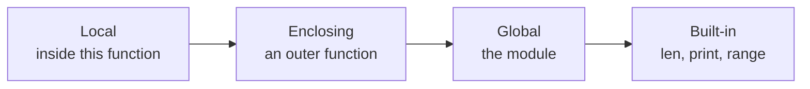

# Functions

- Blocks of reusable code performing some action :
  - Python has many built-in functions like `print(),input(),len()` etc.
  - It is also possible to create user-defined functions
- Functions have the following benefits :
  - Modularity of applications and code reuse
- Rules to define a function in Python :
  - Function blocks begin `def` followed by function name and parentheses
  - Any input parameters or arguments should be placed within parentheses
  - It is also possible to define parameters inside these parentheses
- Code block within every function :
  - Starts with a colon (:) and is indented
- Statement `return [expression]` exits a function :
  - Optionally passing back an expression to the caller
  - A return statement with no arguments is the same as return `None`

---

# Function Syntax

- First statement of function can be documentation string of function :
  - docstrings are picked up by documentation tool `pdoc`
  - Installed by `uv add pdoc3` and used with `pdoc --html <module>`

```python
def function_name(parameters):
    """function_docstring"""
    function_statements
    return expression
```

- By default :
  - Parameters have a positional behavior
  - Should pass them in the same order that they were defined
- Example of a simple Python function :
  - Takes a string as input parameter and prints it on standard screen

```python
def show_message(message):
    """This prints a passed string into this function"""
    print(message)
```

---

# Calling Functions

- Execute functions by calling them :
  - From another function or directly from the Python prompt
  - If functions specify parameters, it is required to pass them
- Function must be defined before they can be called :
  - Order of definition and call is important
- Example of calling the previously defined `show_message()` function :

```python
show_message("First call to user defined function!")
show_message("Again second call to the same function")
show_message() # results in error
```

- Result :

```text
First call to user defined function!
Again second call to the same function
Traceback (most recent call last):
  File "01_showmessage.py", line 10, in <module>
    show_message()
TypeError: show_message() missing 1 required positional argument: 'message'
```

> `demo01 · showmessage`


---

# Pass by Value

- Python passes function parameters by value :
  - Parameter in function is copy of variable in caller and refers to same object
  - Change to object via parameter in function is seen by variable in function's caller
  - Mutable and immutable objects behave differently

```python
def change_me1(mylist):
    mylist.append(40)
    print("List inside the function change_me1: ", mylist)
```

- Call to `change_me1` function :

```python
my_list_outer = [10, 20, 30]
change_me1(my_list_outer)
print("List outside the function: ", my_list_outer)
```

- Reference of passed object is used to append values :

```text
List inside the function change_me1: [10, 20, 30, 40]
List outside the function: [10, 20, 30, 40]
```

> `demo02 · passbyvalue`


---

# Overwriting References

- Reference may be overwritten in the function :

```python
def change_me2(mylist):
    mylist = [1, 2, 3, 4]  # This would assign new reference
    print("Values inside the function change_me2: ", mylist)
```

- Call `change_me2` function :

```python
my_list_outer = [10, 20, 30]
change_me2(my_list_outer)
print("Values outside the function: ", my_list_outer)
```

- Parameter `mylist` is changed in the function `change_me2` :
  - Changing `mylist` within the function does not affect `my_list_outer`
  - Function does nothing to original list and finally this would produce following result :

```text
Values inside the function change_me2: [1, 2, 3, 4]
Values outside the function: [10, 20, 30]
```

- Changing immutable references :
  - Always results in new objects and is true for Strings and Numbers

> `demo03 · overwritingreferences`

> `demo04 · swap`


---

# Mutating Versus Rebinding

- The two previous slides differ in one character, and that changes everything :

<svg viewBox="0 0 960 250" width="100%" style="width:100%;height:auto;display:block;margin:8px 0 4px" role="img" aria-label="Mutating the list through the parameter is visible to the caller, rebinding the parameter is not">
<defs>
<marker id="mr-arrow" viewBox="0 0 10 10" refX="9" refY="5" markerWidth="7" markerHeight="7" orient="auto-start-reverse">
<path d="M 0 0 L 10 5 L 0 10 z" fill="currentColor"/>
</marker>
</defs>
<g fill="none" stroke="currentColor" stroke-width="1.5" opacity="0.4">
<rect x="10" y="10" width="460" height="230" rx="5"/>
<rect x="490" y="10" width="460" height="230" rx="5"/>
</g>
<g fill="currentColor" font-size="20" font-family="ui-monospace, SFMono-Regular, Menlo, Consolas, monospace">
<text x="30" y="42">mylist.append(40)</text>
<text x="510" y="42">mylist = [1, 2, 3, 4]</text>
</g>
<g fill="none" stroke="currentColor" stroke-width="2">
<rect x="30" y="70" width="160" height="38" rx="3"/>
<rect x="30" y="140" width="160" height="38" rx="3"/>
<rect x="270" y="95" width="180" height="58" rx="3"/>
<rect x="510" y="70" width="160" height="38" rx="3"/>
<rect x="510" y="140" width="160" height="38" rx="3"/>
<rect x="750" y="62" width="180" height="54" rx="3"/>
<rect x="750" y="132" width="180" height="54" rx="3"/>
</g>
<g fill="currentColor" font-size="18" font-family="ui-monospace, SFMono-Regular, Menlo, Consolas, monospace" text-anchor="middle">
<text x="110" y="95">my_list_outer</text>
<text x="110" y="165">mylist</text>
<text x="360" y="130">[10,20,30,40]</text>
<text x="590" y="95">my_list_outer</text>
<text x="590" y="165">mylist</text>
<text x="840" y="95">[10, 20, 30]</text>
<text x="840" y="165">[1, 2, 3, 4]</text>
</g>
<g fill="none" stroke="currentColor" stroke-width="1.8" marker-end="url(#mr-arrow)">
<path d="M 190 89 L 230 89 L 230 124 L 264 124"/>
<path d="M 190 159 L 230 159 L 230 124 L 264 124"/>
<path d="M 670 89 L 744 89"/>
<path d="M 670 159 L 744 159"/>
</g>
<g fill="currentColor" font-size="17" opacity="0.75" text-anchor="middle">
<text x="240" y="222">one object, two names, the caller sees the change</text>
<text x="720" y="222">the name is rebound, the caller sees nothing</text>
</g>
</svg>

---

# Function Arguments

- Functions can be called with different types of arguments
- Required arguments :
  - Passed to a function in correct positional order
  - Number of arguments in call should match exactly with the definition
- Keyword arguments :
  - Caller identifies arguments by name and allows parameters to be out of order
  - Python interpreter is able to use the keywords to match the values with parameters
- Default arguments :
  - Assume default value if value is not provided in the function call for that argument
- Variable-length arguments :
  - Sometimes more arguments must be processed than specified in function definition
  - These are called variable-length arguments and are not named in function definition
- Python does not support function overloading :
  - Defining same method with different parameters
  - Python is dynamically typed and supports optional arguments

> `demo05 · power1`

---

# Keyword Arguments

- Function definition :

```python
def print_info(name, age):
    """This prints name and age passed into this function"""
    print("Name: ", name)
    print("Age: ", age)
```

- Function call with keyword arguments :

```python
print_info(age=55, name="Albert")
```

- Result :

```text
Name: Albert
Age: 55
```

- Calling code specifies arguments by name :
  - Parameters do not have to follow the order in the function definition

> `demo06 · keywordarguments`


---

# Default Arguments

- Function definition :

```python
def print_info(name, age=35):
     """This prints name and age passed into this function"""
     print("Name: ", name)
     print("Age: ", age)
```

- Functions calls with and without default arguments :

```python
print_info(age=55, name="Albert")
print_info(name="Werner")
```

- Results :

```python
Name: Albert
Age: 55
Name: Werner
Age: 35
```

> `demo07 · defaultarguments`


---

# Variable Length Arguments

- Syntax for function with variable arguments :

```python
def show_arg_lists(arg, *arg_tuple, **kwargs):
     """Function referencing argument, argument list and keyword arguments"""
     print('arg:', arg)
     print('args:', arg_tuple)
     print('kwargs:', kwargs)
```

- `*args_tuple :`
  - Asterisk (*) indicates variable holding values of all non-keyword variable arguments
  - Tuple remains empty if no additional arguments are specified during function call
- `**args_keywords :`
  - Double asterisk (**) indicates a variable-length argument list with keywords
  - Dictionary remains empty if no keyword arguments are passed

```python
show_arg_lists(1, 2, 3, 4, 5, x=1, y=2)
show_arg_lists(33, x=8, y=9)
show_arg_lists(44)
```

> `demo08 · variableargumentlist`


---

# Anonymous Functions

- `lambda` keyword is used to create small anonymous functions :
  - Not declared in the standard manner by using the `def` keyword
- Lambda form can take any number of arguments :
  - Return just one value in the form of an expression
  - Cannot contain commands or multiple expressions
- Characteristics of lambda functions :
  - Have their own local namespace
  - Cannot access variables besides in parameter list and in global namespace
  - Cannot be a direct call to print because lambda requires an expression
  - Can be stored in variables and passed and returned to functions
- Lambda's appear to be a one-line versions of a function :
  - However they are not equivalent to inline statements in C or C++

---

# Syntax Lambda Functions

- Lambda functions contain only a single statement :

```text
lambda [arg1 [,arg2,.....argn]]:expression
```

- Function definition :

```python
summation = lambda arg1, arg2: arg1 + arg2
```

- Function call :

```python
print("Value of total : ", summation( 10, 20 ))
print("Value of total : ", summation( 20, 20 ))
```

- Result :

```text
Value of total : 30
Value of total : 40
```

> `demo09 · lambdafunctions`


---

# return Statement

- `return [expression]` exits a function :
  - Optionally passing back an expression to the caller
  - `return` statement with no arguments is the same as return `None`
  - `return` statement is not required and then default return value is `None`
- Function definition :

```python
def summation(arg1, arg2):
    """Add both the parameters and return them"""
    tot = arg1 + arg2
    print("Inside the function : ", tot)
    return tot
```

- Function call :

```python
total = summation(10, 20)
print("Outside the function : ", total )
```

- Result :


```text
Inside the function : 30
Outside the function : 30
```

> `demo10 · returnstatement`

---

# Scope of Variables

- Accessibility of variable depends on where it is declared :
  - Scope determines where in program you can access a particular identifier
- A name is looked up in four places, in this order :



- The first place that has the name wins, the rest are never consulted
- Global versus Local variables :
  - Variables defined inside a function body have a local scope
  - Variables defined outside have a global scope
- Local variables :
  - Can be accessed only inside the function in which they are declared
  - When you call a function, the variables declared inside it are brought into scope
- Global variables :
  - Can be accessed throughout the program body by all functions
  - Refer to global instead of a local variable inside function with `global` keyword

---

# Example Variable Scope


```python
x = 50 # This is a global variable
y = 50 # This is a global variable
```

- Function definitions :

```python
def func1():
     x = 2
     print ('Changed local x to', x) # prints 2
def func2():
     print('Access global x as', x)
def func3():
    global y
    y = 2
    print ('Changed global y to', y) # prints 2
```

- Function calls :

```python
func1() # prints 2
print('x is still', x) # prints 50
func2() # prints 50
print('x is still', x) # prints 50
func3() # prints 2
print('Value of y is', y) # prints 2
```

> `demo11 · variablescope`

---

# Summary : Functions

- Functions are blocks of reusable code performing some action :
  - Python has built-in functions and it is possible to create user-defined functions
- Python functions are defined with the `def` statement :
  - They can accept parameters, have a code block and a return statement
- Python passes function parameters by value :
  - Parameter in function refers to same object as in caller
- Functions can be called with different types of arguments :
  - Required, Keyword, Default and Variable-length arguments
- `lambda` keyword is used to create small anonymous functions :
  - Return value as an expression, cannot contain commands or multiple expressions
- Local variables :
  - Variables defined inside a function body have a local scope
- Global variables :
  - Variables defined outside functions have a global scope

> `exercise05 · Functions`
