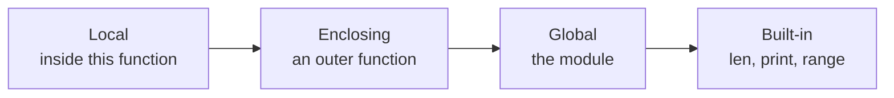

# Functions

- Named blocks of reusable code :
  - Python includes many built-in functions such as `print()`, `input()`, `len()`
  - Programs define their own functions with `def`
- Functions provide modularity and code reuse :
  - A task is written and tested once, then called from multiple places
- Defining a function :
  - Starts with `def`, the function name, and parentheses for parameters
  - The header line ends with a colon `:`, and the body is indented
- Exiting a function :
  - The `return` statement leaves the function and passes a value back
  - A function without a `return`, or a bare `return`, returns `None`

---

# Function Syntax

- The first statement can be a documentation string (docstring) :
  - Explains what the function does and what parameters it expects
  - Documenting tools such as `pdoc` extract docstrings into HTML

```python
def function_name(parameter: type) -> return_type:
    """function docstring"""
    statement(s)
    return expression
```

- Positional parameters :
  - By default, arguments are passed in the order they are defined
- Example of a simple function :
  - Accepts a string and prints it to standard output

```python
def show_message(message: str) -> None:
    """Print the passed string."""
    print(message)
```

---

# Annotating a Function

- Each parameter takes a colon and the type it expects :
  - The result takes an arrow and the type it returns
  - A function that returns nothing is annotated `-> None`

```python
def area(width: float, height: float) -> float:
    return width * height


def show_message(message: str) -> None:
    print(message)
```

- The annotation is documentation the interpreter carries with the function :
  - Nothing is converted and nothing is checked while the program runs
  - Passing the wrong type still works, right up until an operation fails
- What it buys is everything that reads the signature :
  - The editor, a checker, and the next person to read the code
- A collection parameter is annotated like any other collection :

```python
def average(values: list[float]) -> float:
    return sum(values) / len(values)
```

---

# Calling Functions

- A function is invoked by its name followed by parentheses :
  - Any required arguments are placed inside the parentheses
- Functions must be defined before they are called :
  - Python executes line by line, so definitions must come before use
- Calling `show_message()` :

```python
show_message("First call to user defined function!")
show_message("Again second call to the same function")
show_message()  # results in error
```

- Output :

```text
First call to user defined function!
Again second call to the same function
Traceback (most recent call last):
  File "01_showmessage.py", line 10, in <module>
    show_message()
TypeError: show_message() missing 1 required positional argument: 'message'
```

> `demo01 · showmessage`


---

# Passing Object References

- Python passes arguments by object reference :
  - The parameter inside the function is bound to the same object as the caller's argument
  - Both names refer to the identical object in memory
- Mutating an object affects the caller :
  - Modifying a mutable object (such as a list) in place is visible outside
  - Immutable objects (such as integers or strings) cannot be modified in place

```python
def change_me1(mylist: list[int]) -> None:
    mylist.append(40)
    print("List inside the function change_me1:", mylist)
```

- Calling `change_me1` :

```python
my_list_outer = [10, 20, 30]
change_me1(my_list_outer)
print("List outside the function:", my_list_outer)
```

- The caller sees the item added to the list :

```text
List inside the function change_me1: [10, 20, 30, 40]
List outside the function: [10, 20, 30, 40]
```

> `demo02 · objectreferences`


---

# Overwriting References

- Rebinding a parameter does not affect the caller :
  - Assigning to the parameter name creates a new local binding
  - The caller's variable continues to refer to the original object

```python
def change_me2(mylist: list[int]) -> None:
    mylist = [1, 2, 3, 4]  # rebinds the local name
    print("Values inside the function change_me2:", mylist)
```

- Calling `change_me2` :

```python
my_list_outer = [10, 20, 30]
change_me2(my_list_outer)
print("Values outside the function:", my_list_outer)
```

- The caller's list is unchanged :

```text
Values inside the function change_me2: [1, 2, 3, 4]
Values outside the function: [10, 20, 30]
```

> `demo03 · overwritingreferences`

> `demo04 · swap`


---

# Mutating Versus Rebinding

- The two previous slides differ in one character, and that changes everything :

<svg viewBox="0 0 960 250" width="100%" style="width:100%;height:auto;display:block;margin:8px 0 4px" role="img" aria-label="Mutating the list through the parameter is visible to the caller, rebinding the parameter is not">
<defs>
<marker id="mr-arrow" viewBox="0 0 10 10" refX="9" refY="5" markerWidth="7" markerHeight="7" orient="auto-start-reverse">
<path d="M 0 0 L 10 5 L 0 10 z" fill="currentColor"/>
</marker>
</defs>
<g fill="none" stroke="currentColor" stroke-width="1.5" opacity="0.4">
<rect x="10" y="10" width="460" height="230" rx="5"/>
<rect x="490" y="10" width="460" height="230" rx="5"/>
</g>
<g fill="currentColor" font-size="20" font-family="ui-monospace, SFMono-Regular, Menlo, Consolas, monospace">
<text x="30" y="42">mylist.append(40)</text>
<text x="510" y="42">mylist = [1, 2, 3, 4]</text>
</g>
<g fill="none" stroke="currentColor" stroke-width="2">
<rect x="30" y="70" width="160" height="38" rx="3"/>
<rect x="30" y="140" width="160" height="38" rx="3"/>
<rect x="270" y="95" width="180" height="58" rx="3"/>
<rect x="510" y="70" width="160" height="38" rx="3"/>
<rect x="510" y="140" width="160" height="38" rx="3"/>
<rect x="750" y="62" width="180" height="54" rx="3"/>
<rect x="750" y="132" width="180" height="54" rx="3"/>
</g>
<g fill="currentColor" font-size="18" font-family="ui-monospace, SFMono-Regular, Menlo, Consolas, monospace" text-anchor="middle">
<text x="110" y="95">my_list_outer</text>
<text x="110" y="165">mylist</text>
<text x="360" y="130">[10,20,30,40]</text>
<text x="590" y="95">my_list_outer</text>
<text x="590" y="165">mylist</text>
<text x="840" y="95">[10, 20, 30]</text>
<text x="840" y="165">[1, 2, 3, 4]</text>
</g>
<g fill="none" stroke="currentColor" stroke-width="1.8" marker-end="url(#mr-arrow)">
<path d="M 190 89 L 230 89 L 230 124 L 264 124"/>
<path d="M 190 159 L 230 159 L 230 124 L 264 124"/>
<path d="M 670 89 L 744 89"/>
<path d="M 670 159 L 744 159"/>
</g>
<g fill="currentColor" font-size="17" opacity="0.75" text-anchor="middle">
<text x="240" y="222">one object, two names, the caller sees the change</text>
<text x="720" y="222">the name is rebound, the caller sees nothing</text>
</g>
</svg>

---

# Function Arguments

- Python supports several styles of function arguments :
- Positional arguments :
  - Passed to a function in order matching the parameter list
- Keyword arguments :
  - Passed by name (`name=value`), allowing arguments to be given in any order
- Default arguments :
  - Parameters that take a default value when omitted by the caller
- Variable-length arguments :
  - Accept an arbitrary number of positional or keyword arguments
- Python does not support function overloading :
  - Defining the same function name multiple times with different signatures replaces the earlier definition

> `demo05 · power1`

---

# Keyword Arguments

- Function definition :

```python
def print_info(name: str, age: int) -> None:
    """Print the name and age passed to this function."""
    print("Name:", name)
    print("Age:", age)
```

- Calling with keyword arguments :

```python
print_info(age=55, name="Albert")
```

- Output :

```text
Name: Albert
Age: 55
```

- Calling code specifies arguments by name :
  - Positional order does not need to be followed
  - Positional arguments must appear before keyword arguments

> `demo06 · keywordarguments`


---

# Default Arguments

- Default values provide a fallback when an argument is omitted :

```python
def print_info(name: str, age: int = 35) -> None:
    """Print name and age, defaulting age to 35."""
    print("Name:", name)
    print("Age:", age)
```

- Calling with and without the default argument :

```python
print_info(age=55, name="Albert")
print_info(name="Werner")
```

- Output :

```text
Name: Albert
Age: 55
Name: Werner
Age: 35
```

- Parameters without defaults cannot follow parameters with defaults

> `demo07 · defaultarguments`


---

# Variable Length Arguments

- `*args` gathers extra positional arguments into a tuple :
  - Commonly used when a function accepts any number of items
- `**kwargs` gathers extra keyword arguments into a dictionary :
  - Commonly used for configuration or passing options through

```python
def show_arg_lists(arg: int, *args: int, **kwargs: int) -> None:
    """Demonstrate positional and keyword variable-length arguments."""
    print("arg   :", arg)
    print("args  :", args)
    print("kwargs:", kwargs)


show_arg_lists(1, 2, 3, 4, 5, x=1, y=2)
show_arg_lists(33, x=8, y=9)
show_arg_lists(44)
```

> `demo08 · variableargumentlist`


---

# Lambda Functions

- The `lambda` keyword creates a small anonymous function inline :
  - Has no `def` statement and no name of its own
  - The body is a single expression evaluated and returned automatically
  - Cannot contain statements, loops or assignments
- Best framed as a small function passed to another function :
  - `sorted(key=...)` is the classic use case

```python
words = ["banana", "pie", "Washington", "book"]

# Sort by last letter
by_last = sorted(words, key=lambda w: w[-1])
print("By last letter  :", by_last)

# Sort case-insensitively
by_case = sorted(words, key=lambda w: w.lower())
print("Case-insensitive:", by_case)
```

- Output :

```text
By last letter  : ['banana', 'pie', 'book', 'Washington']
Case-insensitive: ['banana', 'book', 'pie', 'Washington']
```

> `demo09 · lambdafunctions`


---

# return Statement

- Exits a function and optionally passes a value back to the caller :
  - A function without a `return`, or a bare `return`, returns `None`
- Function definition :

```python
def summation(arg1: int, arg2: int) -> int:
    """Add both parameters and return the sum."""
    tot = arg1 + arg2
    print("Inside the function :", tot)
    return tot
```

- Calling `summation` :

```python
total = summation(10, 20)
print("Outside the function :", total)
```

- Output :

```text
Inside the function : 30
Outside the function : 30
```

> `demo10 · returnstatement`

---

# Scope of Variables

- Scope determines where an identifier can be accessed :
  - Variables created inside a function are local to that function
  - Variables created outside any function belong to the module's global scope
- Python looks up names in four scopes, in LEGB order :



- The first scope that contains the name wins; the rest are not searched
- Local variables :
  - Exist only while the function is executing
  - Cannot be read or modified from outside the function
- Global variables :
  - Can be read from anywhere within the module
  - Modifying a global variable inside a function requires the `global` keyword

---

# Example Variable Scope

- Global variables are shadowed by local bindings unless declared `global` :

```python
x = 50
y = 50

def func1() -> None:
    x = 2
    print("Local x   :", x)

def func2() -> None:
    global y
    y = 2

func1()
print("x is still:", x)  # 50: global x unchanged
func2()
print("y is now  :", y)  # 2: global y modified
```

> `demo11 · variablescope`

---

# Summary : Functions

- Functions are reusable blocks of code defined with `def` :
  - Parameters and return types are documented with type annotations
- Python passes arguments by object reference :
  - Mutating an argument affects the caller; rebinding a parameter name does not
- Flexible argument handling :
  - Positional, keyword, default values, `*args` and `**kwargs`
- Small anonymous functions use `lambda` :
  - Ideal as short key functions passed to `sorted()`
- Variables follow LEGB scope lookup :
  - Local, Enclosing, Global and Built-in scopes

> `exercise05 · Functions`
