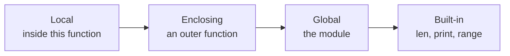

# Functions

- A function gives a name to a task that a program repeats :
  - A music player stores track lengths in seconds
  - Its display needs a duration such as `3:42`
- Python provides functions such as `print()`, `input()` and `len()` :
  - Programs define their own functions with `def`
- A function can take a value and return a result :
  - The caller supplies the number of seconds
  - The function returns the display text

---

# Function Syntax

- `format_duration` turns a track length into display text :
  - `// 60` gives complete minutes; `% 60` gives remaining seconds
  - `:02d` displays the seconds with two digits, including a leading zero

```python
def format_duration(seconds):
    minutes = seconds // 60
    remainder = seconds % 60
    return f"{minutes}:{remainder:02d}"
```

- A definition starts with `def`, the name and parentheses :
  - `seconds` is a parameter that receives a track length
  - The colon starts the indented body
- `return` passes the display text back to the caller

---

# Calling Functions

- Define a function before calling it :
  - Parentheses contain the argument supplied for `seconds`
  - Each call runs the same body with a different track length

```python
print(format_duration(222))
print(format_duration(65))
```

```text
3:42
1:05
```

- Defining the function does not run its body
- Omitting a required argument raises `TypeError`

> `demo01 · format_duration`

---

# return Statement

- A returned value can be stored and used by the caller :
  - `label` receives the duration text
  - The caller includes it in a track description

```python
def format_duration(seconds):
    minutes = seconds // 60
    remainder = seconds % 60
    return f"{minutes}:{remainder:02d}"

label = format_duration(125)
message = f"Yesterday [{label}]"
print(message)
```

```text
Yesterday [2:05]
```

- `return` ends the current call and passes its value back

> `demo02 · returnstatement`

---

# Functions Without a Result

- Some functions perform a task without returning a useful value :
  - `print_playlist` prints a heading and numbered tracks
  - The caller does not need to store a result

```python
def print_playlist(name, tracks):
    print(f"Playlist: {name}")
    for number, title in enumerate(tracks, start=1):
        print(f"{number}. {title}")


print_playlist("Night drive", ["Imagine", "Yesterday"])
```

```text
Playlist: Night drive
1. Imagine
2. Yesterday
```

- Reaching the end of a function returns `None`
- A bare `return` also returns `None`

> `demo03 · playlist`

---

# Annotating a Function

- Annotations describe the values a function expects and returns :
  - `seconds: int` describes the argument; `-> str` describes the result

```python
def format_duration(seconds: int) -> str:
    minutes = seconds // 60
    remainder = seconds % 60
    return f"{minutes}:{remainder:02d}"
```

- `-> None` describes a function that does not return a useful value :

```python
def print_playlist(name: str, tracks: list[str]) -> None:
    print(f"Playlist: {name}")
    for number, title in enumerate(tracks, start=1):
        print(f"{number}. {title}")
```

- Annotations help editors and checkers; Python does not enforce them

> `demo04 · annotated_duration`

---

# Documenting a Function

- A docstring describes the task and rules callers need to know :
  - It is the first string inside the function body

```python
def format_duration(seconds: int) -> str:
    """Format a non-negative track length as minutes and two-digit seconds."""
    minutes = seconds // 60
    remainder = seconds % 60
    return f"{minutes}:{remainder:02d}"
```

- `help(format_duration)` displays the docstring
- Triple quotes allow a description to span lines
- Documentation tools can include docstrings in generated reference pages

> `demo05 · docstring`

---

# Function Arguments

- Positional arguments follow the parameter order :
  - `seconds` receives the first value; `separator` receives the second

```python
def format_duration(seconds: int, separator: str) -> str:
    minutes = seconds // 60
    remainder = seconds % 60
    return f"{minutes}{separator}{remainder:02d}"


print(format_duration(222, ":"))
```

- Keyword arguments specify parameter names
- Default values allow arguments to be omitted
- `*args` and `**kwargs` collect extra positional and keyword arguments
- Defining a name again replaces its earlier definition

> `demo06 · positionalarguments`

---

# Keyword Arguments

- Keyword arguments identify parameters by name :
  - Their order can differ from the definition

```python
def format_duration(seconds: int, separator: str) -> str:
    minutes = seconds // 60
    remainder = seconds % 60
    return f"{minutes}{separator}{remainder:02d}"


print(format_duration(separator=".", seconds=222))
```

```text
3.42
```

- Positional arguments must come before keyword arguments
- Names make the purpose of each argument visible

> `demo07 · keywordarguments`

---

# Default Arguments

- A default supplies a value when an argument is omitted :
  - Track durations usually separate minutes and seconds with `:`
  - A caller can request another separator

```python
def format_duration(seconds: int, separator: str = ":") -> str:
    minutes = seconds // 60
    remainder = seconds % 60
    return f"{minutes}{separator}{remainder:02d}"


print(format_duration(222))
print(format_duration(222, separator="m "))
```

```text
3:42
3m 42
```

- Parameters without defaults cannot follow parameters with defaults

> `demo08 · defaultarguments`

---

# Passing Object References

- A parameter refers to the same object as the caller's argument :
  - `add_encore` adds a final track to the shared queue

```python
def add_encore(tracks: list[str]) -> None:
    tracks.append("Let It Be")
    print(f"Inside: {tracks}")

queue = ["Imagine", "Yesterday"]
add_encore(queue)
print(f"After call: {queue}")
```

```text
Inside: ['Imagine', 'Yesterday', 'Let It Be']
After call: ['Imagine', 'Yesterday', 'Let It Be']
```

- `append` changes the existing list, so the caller sees the encore

> `demo09 · objectreferences`

---

# Overwriting References

- A function can create an encore mix while keeping the original queue :
  - `tracks + ["Let It Be"]` creates a new list
  - Assigning to `tracks` changes only the local name

```python
def with_encore(tracks: list[str]) -> list[str]:
    tracks = tracks + ["Let It Be"]
    return tracks

queue = ["Imagine", "Yesterday"]
extended = with_encore(queue)
print(f"Original: {queue}")
print(f"With encore: {extended}")
```

```text
Original: ['Imagine', 'Yesterday']
With encore: ['Imagine', 'Yesterday', 'Let It Be']
```

- The caller stores the returned list in `extended`; `queue` keeps its original list

> `demo10 · overwritingreferences`

---

# Mutating Versus Rebinding

- Both functions add an encore, with different effects on the original queue :

| Operation inside the function | Effect |
| --- | --- |
| `tracks.append("Let It Be")` | Adds to the list the caller already holds |
| `tracks = tracks + ["Let It Be"]` | Binds the local name to a new list |
| `return tracks` | Passes that new list back to the caller |

- Mutate a shared queue when every caller should see the change
- Return a new mix when the original should stay available
- Integers and strings cannot be changed in place; a different value needs a new binding

---

# Variable Length Arguments

- `*tracks` collects extra positional arguments into a tuple
- `**details` collects extra keyword arguments into a dictionary

```python
def show_playlist(name: str, *tracks: str, **details: str) -> None:
    print(f"Playlist: {name}")
    for track in tracks:
        print(f"- {track}")
    for key, value in details.items():
        print(f"{key}: {value}")


show_playlist("Night drive", "Imagine", "Yesterday", mood="calm", owner="Sam")
```

- At a call, `*values` unpacks a sequence and `**options` unpacks a dictionary
- `args` and `kwargs` are common names; task-specific names describe their contents

> `demo11 · variableargumentlist`

> `demo12 · callingwithstar`

---

# Lambda Functions

- A lambda is a small function passed directly to another function :
  - `sorted` calls the key function for each track
  - `track[1]` selects its duration in seconds

```python
tracks = [("Imagine", 183), ("Yesterday", 125), ("Respect", 149)]
by_length = sorted(tracks, key=lambda track: track[1])
print(by_length)
```

```text
[('Yesterday', 125), ('Respect', 149), ('Imagine', 183)]
```

- The value after the colon is returned automatically
- Use a named function when the calculation needs several lines

> `demo13 · lambdafunctions`

---

# Functions in Dictionaries

- Functions are values that can be stored and called from a dictionary :
  - The key selects which title formatter runs

```python
def clean_title(title: str) -> str:
    return title.strip()


def shout_title(title: str) -> str:
    return title.upper()


formatters = {"clean": clean_title, "shout": shout_title}
print(formatters["clean"]("  Imagine  "))
for name, format_title in formatters.items():
    print(name, format_title("Yesterday"))
```

```text
Imagine
clean Yesterday
shout YESTERDAY
```

- A dictionary mapping keys to functions is a dispatch table

> `demo14 · functionsindictionaries`

---

# Scope of Variables

- Scope determines where an identifier can be accessed :
  - Variables created inside a function are local to that function
  - Variables created outside any function belong to the module's global scope
- Python looks up names in four scopes, in LEGB order :



- The first scope that contains the name wins; the rest are not searched
- Local variables :
  - Exist only while the function is executing
  - Cannot be read or modified from outside the function
- Global variables :
  - Can be read from anywhere within the module
  - Rebinding a global name inside a function requires `global`
  - Mutating the object it names, such as calling `items.append(x)`, does not

---

# Example Variable Scope

- A local assignment affects only the current call :
  - `preview_volume` shows a local volume without changing the configured value
- `global` makes an assignment update the module's name :
  - `set_limit` changes the shared queue limit

```python
volume = 50
queue_limit = 20

def preview_volume() -> None:
    volume = 10
    print(f"Preview volume: {volume}")


def set_limit() -> None:
    global queue_limit
    queue_limit = 30

preview_volume()
print(f"Current volume: {volume}")
set_limit()
print(f"Queue limit: {queue_limit}")
```

> `demo15 · variablescope`

---

# Summary : Functions

- Functions are reusable blocks of code defined with `def` :
  - Parameters and return types are documented with type annotations
- Python passes arguments by object reference :
  - Mutating an argument affects the caller; rebinding a parameter name does not
- Flexible argument handling :
  - Positional, keyword, default values, `*args` and `**kwargs`
- Small anonymous functions use `lambda` :
  - Ideal as short key functions passed to `sorted()`
- Functions are values :
  - A dictionary of functions is a dispatch table, `table[key](argument)`
- Variables follow LEGB scope lookup :
  - Local, Enclosing, Global and Built-in scopes

> `exercise05 · Functions`
