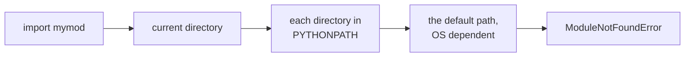

# Modules

- Used to organize number of Python definitions in single file :
  - Used to logically organize your Python code
  - Can be bind and referenced
- Module is a file consisting of Python code :
  - Defines functions, classes, and variables
  - May also include runnable code
  - Grouping related code into a module makes code easier to understand and use
- Python code for module `test` resides in a file named `test.py :`
  - Name of the module is the name of the file without extension
- `test.py` :

```python
def print_func(par):
    print("Hello :", par)
```

- Modules allows code reuse :
  - Code in module can be reused in other python file

---

# import Statement

- `import` statement followed by module name :
  - Makes functions and classes from module available for use in file issuing `import` statement
- `import` has the following syntax :

```text
import module1[, module2[,... moduleN]
```

- On encountering an `import` statement :
  - Module is imported if the module is present in the search path
  - Search path is list of directories that interpreter searches for modules to import
  - Module is loaded only once, regardless of the number of times it is imported
- Import module `test.py` with `import test` at top of the script :
  - Use name of the module as prefix when accessing functions, classes or variables

```python
import test  # Now you can call defined function
test.print_func("pipo")  # Hello : pipo
```

- Name to reference module can be changed with :


```python
import test as t
t.print_func("pipo")  # Hello : pipo
```

> `demo01 · importmodule`


---

# from...import Statement

- `from...import` makes specific names from module accessible:

```text
from modname import name1[, name2[, ... nameN]]
```

- Function `sqrt` from module `math` is imported with :

```python
from math import sqrt
```

- Statement does not import entire module `math` :
  - Only item `sqrt` from module `math` ends up in global symbol table of importing module
- Now the function `sqrt` can be used without prefix :

```python
print(sqrt(9))  # 3.0
```

- Also possible is to import all names from a module with :

```python
from modname import *
```

- Statement should be used sparingly :
  - More names are then visible which can give rise to name conflicts

> `demo02 · usingfromimport`


---

# Locating Modules

- On import the interpreter searches these places in order, first hit wins :



- Search path is stored in system module `sys` as `sys.path` variable :
  - Should import `sys` to be able to access path
  - `sys` module give also access to command line arguments or parameters to script
- `PYTHONPATH` variable :
  - Environment variable, consisting of a list of directories
  - Syntax of `PYTHONPATH` is same as that of the shell variable `PATH`
- Typical `PYTHONPATH` from Windows system :

```bash
set PYTHONPATH=c:\python314\lib;
```

- Typical `PYTHONPATH` from UNIX system :


```bash
set PYTHONPATH=/usr/local/lib/python
```

> `demo03 · pythonpath`


---

# Using Modules

- Every Python program is already a module :
  - Modules must have `.py` extension

```python
# Filename: testmodules.py
def sayhi():
    print("Hi, this is testmodules speaking.")
version = "0.1"
```

- Module can be imported by other module if on `sys.path :`

```python
import testmodules
testmodules.sayhi()
print(testmodules.version)
```

- Alternatively `from .. import` can be used :

```python
from testmodules import sayhi, version
sayhi()
print(version)
```

- Modules contain :
  - Variables, functions, classes and potentially executable code

> `demo04 · usingmodules`


---

# dir Function

- Returns sorted list of strings with names accessible by a module :
  - List contains the names defined in a module and names that are imported
  - Modules, Variables, Functions
- Example `import` built-in module `math` :

```python
import math
content = dir(math)
print(content)
```

- Result :

```text
['__doc__', '__loader__', '__name__', '__package__', '__spec__', 'acos', 'acosh',
'asin', 'asinh', 'atan', 'atan2', 'atanh', 'cbrt', 'ceil', 'comb', 'copysign',
'cos', 'cosh', 'degrees', 'dist', 'e', 'erf', 'erfc', 'exp', 'exp2', 'expm1',
'fabs', 'factorial', 'floor', 'fma', 'fmod', 'frexp', 'fsum', 'gamma', 'gcd',
'hypot', 'inf', 'isclose', 'isfinite', 'isinf', 'isnan', 'isqrt', 'lcm', 'ldexp',
'lgamma', 'log', 'log10', 'log1p', 'log2', 'modf', 'nan', 'nextafter', 'perm', 'pi',
'pow', 'prod', 'radians', 'remainder', 'sin', 'sinh', 'sqrt', 'sumprod', 'tan',
'tanh', 'tau', 'trunc', 'ulp']
```

- `__name__` is module's name
- `__package__` is package name of module

> `demo05 · usingdir`


---

# Packages in Python

- Package is way to organize number of modules together as unit :
  - Package is simply a directory and has a hierarchical file directory structure
  - Consists of modules and subpackages and sub-subpackages and so on
- A package provides a namespace and so prevents name clashes
- Typically modules of a package are placed in a directory :

```text
cameras/
├─ __init__.py     marks the directory as a package
├─ canon.py        defines canon_info()
├─ leika.py        defines leika_info()
└─ nikon.py        defines nikon_info()
```

- `canon.py` could define a simple function like :

```python
def canon_info():
    print("Canon camera")
```

- Package is required to have `__init__.py` in its directory :
  - Indicates directory contains package and makes functions available when package is imported

---

# Explicit Import of Package Modules

- `__init__.py` should be present but can be empty
- If `__init.py__` empty modules of package must be imported explicitly :

```python
import cameras.canon
import cameras.leika
import cameras.nikon
```

- Functions in package are called with full name :

```python
cameras.nikon.nikon_info()
cameras.canon.canon_info()
cameras.leika.leika_info()
```

- Full name consists of :
  - Package name (directory), module name, function name

> `demo06 · explicitimport`


---

# Implicit Import of Package Modules

- Following lines can be added to `__init__.py` :

```python
from cameras.canon import canon_info
from cameras.leika import leika_info
from cameras.nikon import nikon_info
```

- Now modules can be imported by importing the package :

```python
import cameras
```

- Import `cameras` package and call methods as follows :

```python
cameras.nikon_info()
cameras.canon_info()
cameras.leika_info()
```

- Also `from .. import` can be used :

```python
from cameras import nikon_info, canon_info, leika_info
nikon_info()
canon_info()
leika_info()
```

> `demo07 · implicitimport`


---

# reload Function

- Reloads a previously imported module :
  - When module is imported, code in the top-level portion is executed
  - When using multiple imports of the same module top-level code will not execute again
- To reexecute top-level code in a module :
  - Use the `reload()` function from `importlib` module
- Syntax :

```python
from importlib import reload
reload(module_name)
```

- `module_name` :
  - Name of the module you want to reload
  - Not the string containing the module name
- To reload hello module :

```python
reload(hello)
```

> `demo08 · reload`


---

# globals and locals Functions

- Namespace is a dictionary containing :
  - Variable names (keys) and their corresponding objects (values)
- Variables can be in local namespace or global namespace :
  - Variables declared outside functions are in the global namespace
  - Variables declared in function are in the local namespace of that function
- `locals()` and `globals()` methods called from within a function :
  - `locals()` returns all the names that can be accessed locally from that function
  - `globals()` returns all the names that can be accessed globally from that function
- Return type of both these functions is dictionary :
  - Names can be extracted using the `keys()` function

```python
x = 1
def f():
    y = 1
    print("Globals from f")
    print(globals().keys())  # dict_keys(['__name__', '__doc__', ..., 'x', 'f'])
    print("Locals from f")
    print(locals().keys())  # dict_keys(['y'])
f()
```

> `demo09 · localsandglobals`


---

# Test Harness

- Used to run code only when script is run, not when imported

```python
if __name__ == "__main__":
    main()
```

  - Only true when the file is run
  - Not when the module is imported
  - Good practice to test how module is used
- Top level code in module only evaluated first time it is imported :
  - Python maintains an internal list of all modules that have been imported
- When you import a module for the first time :
  - Module script is executed in its own namespace until the end
  - Internal list is updated, and execution continues after the import statement
- Can use reload to force new import e.g. when module changed

> `demo10 · testharness`


---

# Installing Packages

- From PyPI or from VCS, other indexes, local archives
- We use `uv` as our package manager (fast, modern, replaces pip) :
  - `uv add package` : install and add to pyproject.toml
  - `uv remove package` : uninstall
  - `uv sync` : install everything from pyproject.toml
- Common usage of `uv` :

```bash
uv add requests
uv add "requests>=2.28,<3"
uv add --dev pytest
uv run python script.py
```

- The `pyproject.toml` file tracks your dependencies :
  - Replaces `requirements.txt` and `setup.py`
  - Commit it to version control

```bash
uv lock          # generate/update uv.lock
uv export > requirements.txt   # for legacy tools
```

---

# Virtual Environments

- Install packages in separate location, not shared globally :
  - Each environment has its own Python binary
  - Handles different apps requiring different versions of package
- Applications won't break by subsequent library updates :
  - Makes it easier to create distributions
- With `uv`, virtual environments are automatic :

```bash
uv init myproject     # creates pyproject.toml + .venv
uv add requests       # installs into .venv automatically
uv run python app.py  # runs with the venv activated
```

- The environment is a directory beside the project files :

```text
myproject/
├─ pyproject.toml   dependencies this project declares
└─ .venv/
   ├─ Scripts/      the interpreter and installed commands
   └─ Lib/          the installed packages
```

- Without `uv` the same directory is made by `python -m venv .venv`

---

# Summary : Modules

- Module is a file consisting of Python code :
  - Defines functions, classes, and variables, but may also contain runnable code
  - Used to logically organize Python code
- import statement in some other Python source file :
  - Leads to import if the module is present in the search path
  - Current directory, directories in `PYTHONPATH,` default OS path
- Namespace is a dictionary containing :
  - Variable names (keys) and their corresponding objects (values)
  - Variables can be in local namespace or global namespace
- Functions show names defined in module or namespaces :
  - `dir` , `locals` and `globals` functions
- Package defines a single Python application environment :
  - Has a hierarchical file directory structure
- Virtual environments allow to install packages in separate location :
  - Not shared globally and each environment has its own Python binary

> `exercise06 · Modules`
