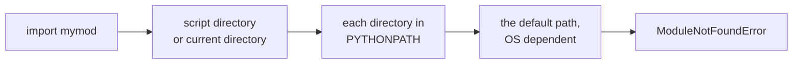

# Modules

- Modules organize Python definitions across separate files :
  - Grouping related functions and classes makes code easier to read and maintain
  - Code defined in a module can be imported and reused across multiple programs
- A module is simply a file containing Python code :
  - Definitions include functions, classes, variables and runnable statements
  - The module name is the file name without the `.py` extension
- For example, `test.py` defines `print_func` :

```python
def print_func(par: str) -> None:
    print("Hello :", par)
```

- Any Python file can import `test.py` and call its functions

---

# import Statement

- The `import` statement makes a module available to the calling file :
  - Python searches for the module in the directories listed on `sys.path`
  - The module's top-level code runs once when imported for the first time
- Syntax of the `import` statement :

```text
import module1[, module2[, ... moduleN]]
```

- Accessing definitions through the module prefix :
  - Functions, classes and variables are prefixed with the module name

```python
import test  # Now you can call defined function

test.print_func("pipo")  # Hello : pipo
```

- Modules can be renamed upon import using `as` :

```python
import test as t

t.print_func("pipo")  # Hello : pipo
```

> `demo01 · importmodule`


---

# from...import Statement

- `from...import` makes specific names accessible directly without prefix :

```text
from modname import name1[, name2[, ... nameN]]
```

- For example, importing `sqrt` from module `math` :

```python
from math import sqrt
```

- The statement imports only the named items into the current namespace :
  - The module object itself is not bound, only `sqrt`
  - The function is called directly without a module prefix :

```python
print(sqrt(9))  # 3.0
```

- Importing all names with `*` is also possible :

```python
from math import *
```

- Wildcard imports should be used sparingly :
  - They clutter the namespace and risk name collisions

> `demo02 · usingfromimport`


---

# Locating Modules

- For modules found through `sys.path`, the normal search order is :



- The first directory depends on how Python starts :
  - Running a script uses its directory; the REPL and `python -m` use the current directory
- Inspect the search path with `sys.path` after `import sys`
- `PYTHONPATH` environment variable :
  - Extra directories inserted after that first directory on startup
  - Follows standard operating system path list conventions
- Setting `PYTHONPATH` in Windows Command Prompt (CMD) :

```bash
set PYTHONPATH=C:\course\modules
```

- Setting `PYTHONPATH` on UNIX :

```bash
export PYTHONPATH=/usr/local/lib/python
```

> `demo03 · pythonpath`


---

# Using Modules

- Any Python file can be imported by other files on `sys.path` :
  - `import mod` imports the module; `from mod import ...` imports specific names

```python
# Filename: testmodules.py
def sayhi() -> None:
    print("Hi, this is testmodules speaking.")


version = "0.1"
```

- Importing `testmodules` and calling its functions :

```python
import testmodules

testmodules.sayhi()
print(testmodules.version)

from testmodules import sayhi, version

sayhi()
```

> `demo04 · usingmodules`


---

# dir Function

- Returns a sorted list of attribute names accessible on an object or module :
  - Lists module variables, functions, classes and imported names
  - Useful in the interactive REPL to explore an unfamiliar library
- Inspecting a module :

```python
import math

print(dir(math)[:6])
```

- Result :

```text
['__doc__', '__loader__', '__name__', '__package__', '__spec__', 'acos']
```

- Special attributes start and end with double underscores, such as `__name__` and `__doc__`

> `demo05 · usingdir`


---

# Packages in Python

- A package organizes multiple modules together under a shared directory :
  - Provides a hierarchical namespace using dotted module names
  - Prevents naming collisions between modules in different packages
- A directory is recognised as a package by having an `__init__.py` file :

```text
cameras/
├── __init__.py     marks the directory as a package
├── canon.py        defines canon_info()
├── leika.py        defines leika_info()
└── nikon.py        defines nikon_info()
```

- For example, `canon.py` defines a function :

```python
def canon_info() -> None:
    print("Canon camera")
```

- `__init__.py` runs when the package is imported :
  - It can be empty or used to expose package-level exports

---

# Explicit Import of Package Modules

- When `__init__.py` is empty, modules inside the package are imported explicitly :

```python
import cameras.canon
import cameras.leika
import cameras.nikon
```

- Functions inside the modules are called using the full dotted path :

```python
cameras.nikon.nikon_info()
cameras.canon.canon_info()
cameras.leika.leika_info()
```

- Dotted names follow the file structure :
  - `package.module.function()`
  - Explicit imports keep it clear which module each function originates from

> `demo06 · explicitimport`


---

# Implicit Import of Package Modules

- `__init__.py` can import names from its internal modules to re-export them :

```python
from cameras.canon import canon_info
from cameras.leika import leika_info
from cameras.nikon import nikon_info
```

- Callers can then import the package directly without naming submodules :

```python
import cameras

cameras.nikon_info()
cameras.canon_info()
cameras.leika_info()
```

- Callers can also import the re-exported functions directly :

```python
from cameras import canon_info, leika_info, nikon_info

nikon_info()
canon_info()
leika_info()
```

> `demo07 · implicitimport`


---

# Test Harness

- Python sets `__name__` to `"__main__"` when run directly, or the module name when imported :
  - The `if __name__ == "__main__":` guard separates library code from execution
  - Functions and classes can be imported without unwanted side effects
  - Exercise 5 used this guard on `play()` so `pytest` could import functions without starting a game

```python
def sayhi() -> None:
    print("Hi, this is testmodules speaking.")


def main() -> None:
    sayhi()


if __name__ == "__main__":
    main()
```

- Direct execution runs `main()`; importing `testharness` defines `sayhi()` without running `main()`

> `demo08 · testharness`


---

# Running Packages with python -m

- Packages can be executed as a script using `python -m package_name` :
  - Python executes `__main__.py` inside the package directory
  - Serves as the package entry point, like `if __name__ == "__main__":` in a single file
- Package layout with `__main__.py` :
  - `cameras3/` contains `__init__.py`, `__main__.py`, `canon.py`, `nikon.py`

```python
# cameras3/__main__.py
from cameras3 import canon_info, nikon_info


def main() -> None:
    print("Cameras package entry point:")
    canon_info()
    nikon_info()


if __name__ == "__main__":
    main()
```

- Run from the terminal with `uv run python -m cameras3`

> `demo09 · package_main`


---

# Installing Packages

- Third-party packages are hosted on PyPI and installed with `uv add` :
  - `uv add package` installs a package and records it in `pyproject.toml`
  - `uv add --dev package` adds a development tool, such as `pytest`
  - `uv remove package` uninstalls a dependency
- Two files track dependencies and belong in version control :
  - `pyproject.toml` declares the project's direct requirements
  - `uv.lock` records the exact resolved versions for reproducibility
- Anyone with the project can reproduce the exact environment :

```bash
uv add requests
uv add "requests>=2.28,<3"
uv add --dev pytest
uv sync          # install exactly what uv.lock says
uv remove requests
```

---

# Virtual Environments

- Virtual environments isolate dependencies per project :
  - Each project has its own libraries and Python executable
  - Different projects can require different versions without conflict
- `uv` manages virtual environments automatically :
  - `.venv/` is created on the first `uv run` or `uv add`
  - Packages are installed into `.venv/` without touching system Python
- There is no environment to activate manually :
  - `uv run` puts the project's `.venv` in front for the command

```text
myproject/
├── pyproject.toml   dependencies declared for this project
├── uv.lock          pinned versions of all installed packages
└── .venv/           created on the first uv run or uv add
```

- Run code through `uv run`, which uses the project's interpreter :

```bash
uv run python app.py
```

- Without `uv`, environments are made by `python -m venv .venv` and activated by hand

---

# Summary : Modules

- Modules organize code into reusable files :
  - A module is a `.py` file defining functions, classes and variables
  - `import` and `from ... import` bring names into the calling file
- Python locates modules using `sys.path` :
  - Script directory (current directory for REPL or `-m`), then `PYTHONPATH` and defaults
  - `dir()` lists the names defined or imported in a module
- Packages group modules into directories with `__init__.py` :
  - Modules inside packages use dotted import paths
  - `python -m package` runs a package via its `__main__.py`
- Executing versus importing :
  - `if __name__ == "__main__":` guards code that only runs when executed directly
- Dependency and environment management :
  - `uv add` installs packages into an automatic `.venv`
  - `uv run` executes commands with the project's environment active

> `exercise06 · Modules`
