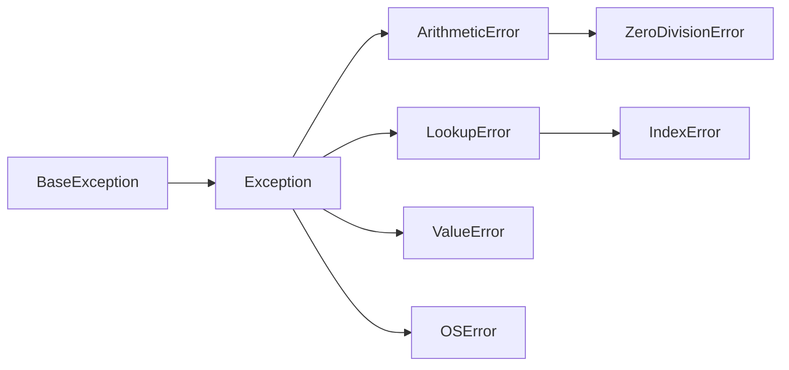
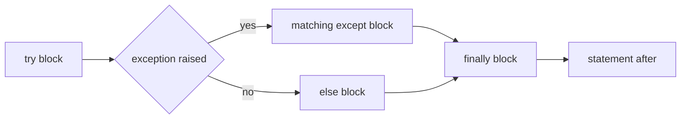

# Unexpected Errors

- Python provides exceptions to handle unexpected errors :
  - Exceptions are events disrupting normal program flow
  - May occur during the execution of program instructions
- When Python encounters conditions it can't cope with :
  - An exception is raised
  - An exception is a Python object that represents an error
- Every exception is a class, and the classes form a tree :



- Catching a class catches everything below it in that tree
- When a Python script raises an exception :
  - The exception must be handled immediately otherwise the script terminates
- Another feature to handle unexpected errors are assertions :
  - Assertions are tests which must be true to continue

> `demo01 · unexpectederrors`


---

# Exception Handling

- Place code that might raise an exception in a `try` block :
  - Code in a `try` block is tested for exceptions
- Include an `except` statement after the `try` block :
  - Place code to handle the problem as elegantly as possible there
  - Generic `except` clause handles any exception

```python
try :
     x = 1
     y = 0
     z = x/y # ZeroDivisionError
except:
     print('Cannot divide by zero')
try :
     fh = open("somefile", "r") # IOError
except:
     print('Cannot open file')
```


- After handling exception in `except` statement :
  - Normal program flow continues

> `demo02 · exceptionhandling`


---

# Typed Exception Handling

- Generic `except` statement with no exceptions defined :
  - Catches all exceptions that occur and is not considered good programming practice
  - Does not make programmer identify root cause of the problem
- Better is the usage of `except` clauses with a type :
  - Single `try` statement can have multiple typed `except` statements
  - Useful when the `try` block might throw different types of exceptions

```python
try :
     x = 1
     y = 0
     z = x/y # ZeroDivisionError
     tup = (1,2,3)
     tup[0] = 2 # TypeError
except ZeroDivisionError :
     print ('Division by zero')
except TypeError :
     print ('Cannot change tuple contents')
```


- `except` corresponding to exception type executes

> `demo03 · typedexceptionhandling`


---

# Exception Handling with Else

- After `except` clause(s) `else` clause can be included :
  - Executes if the code in the `try:` block does not raise an exception

```text
try:
    Do you operations here
except:
    If there is any exception, then execute this block
else:
    If there is no exception then execute this block
```

- Example :

```python
try:
     x = int(input("Please enter a number: "))
except ValueError:
     print("Oops! That was not valid number")
else:
     print ("Yeah! That was a really good number")
```

> `demo04 · exceptionhandlingwithelse`


---

# except Clause Multiple Exceptions

- Same `except` clause may also handle multiple exceptions :

```text
try:
    Do you operations here;
except(Exception1[, Exception2[,...ExceptionN]]]):
    If there is any exception from the given exception list,
    then execute this block
else:
    If there is no exception then execute this block
```

- Example :

```python
for value in (None, "Hi!"):
     try:
          print ("Attempting to convert", value, "-->",)
          print (float(value))
     except(TypeError, ValueError):
          print ("Something went wrong!")
```


- Disadvantage is error messages are less distinctive

> `demo05 · multipleexceptions`


---

# Python Standard Exceptions

| Exception | Description |
|---|---|
| `Exception` | Base class for all exceptions |
| `StopIteration` | Raised when `next()` of iterator does not point to any object |
| `SystemExit` | Raised by the `sys.exit()` function |
| `ArithmeticError` | Base class for all errors that occur for numeric calculation |
| `OverflowError` | When calculation exceeds maximum limit for numeric type |
| `FloatingPointError` | Raised when a floating point calculation fails |
| `ZeroDivisionError` | Raised when division by zero occurs for numeric types |
| `AssertionError` | Raised in case of failure of the assert statement |
| `AttributeError` | Raised in case of failure of attribute reference or assignment |
| `EOFError` | Raised when end of file is reached |
| `ImportError` | Raised when an import statement fails |
| `TypeError` | Raised when operation attempted that is invalid for data type |
| `ValueError` | Raised when function for data type has invalid values |

---

# Python Standard Exceptions

| Exception | Description |
|---|---|
| `KeyboardInterrupt` | Raised when user interrupts program execution, usually by CTRL-C |
| `LookupError` | Base class for all lookup errors |
| `IndexError` | Raised when an index is not found in a sequence |
| `KeyError` | Raised when the specified key is not found in the dictionary |
| `NameError` | Raised when an identifier is not found in the namespace |
| `UnboundLocalError` | Raised when accessing an unassigned local variable |
| `EnvironmentError` | Base class for exceptions occurring outside Python |
| `IOError` | Raised when an input/output operation fails |
| `OSError` | Raised for operating system related errors |
| `SyntaxError` | Raised when there is an error in Python syntax |
| `IndentationError` | Raised when indentation is not specified properly |
| `SystemError` | Raised when the interpreter finds an internal problem |

> `demo06 · assertionerror`

---

# try-finally Clause

- `finally` block may be used along with a `try` block :
  - `finally` block is always executed
  - Whether or not the try-block raised an exception
- Syntax of the `try-finally` :

```text
try:
    Do you operations here;
    Due to any exception, this may be skipped
finally:
    This would always be executed
```

- Combining `finally` and `except` is allowed :
  - `try` block can be followed by multiple `except` clauses and one `finally` clause



- Limitation :
  - It is not possible to use an `else` clause along with a `finally` clause

---

# Example try-finally


```python
try:
    fh = open("testfile", "w")
    fh.write("This is my test file for exception handling!!")
finally:
    print ("Error: can\'t find file or read data")
```

- Result without permission to open the file in writing mode :

```text
Error: can't find file or read data
```

- Same example can be written more cleanly as follows :

```python
try:
    fh = open("testfile", "w")
    try:
       fh.write("This is my test file for exception handling!!")
    finally:
       fh.close()
except IOError:
    print ("Error: can\'t find file or read data")
```

> `demo07 · tryfinally`


---

# Exception Arguments

- An exception can have an argument :
  - Value that gives additional information about the problem
  - Contents of the argument vary by exception
- Capture argument by supplying a variable in `except` clause :

```text
try:
    Do you operations here;
except ExceptionType as Argument:
    You can print value of Argument here...
```

- In case of handling a single exception :
  - Variable follows the name of the exception in the except statement
- In case of handling multiple exceptions :
  - Variable follows the tuple of the exception
- Variable will receive the value of the exception :
  - Can receive a single value or multiple values in the form of a tuple
  - Tuple usually contains the error string, the error number and an error location

---

# Example Argument of an Exception


```python
# Define a function here.
def temp_convert(var):
    try:
       return int(var)
    except ValueError as e:
       print ("Argument does not contain numbers\n", e)
# Call above function here
temp_convert("xyz");
```

- Result :

```text
The argument does not contain numbers
invalid literal for int() with base 10: 'xyz'
```


> `demo08 · exceptionarguments`

---

# Raising Exceptions

- Exceptions can be raised with the `raise` statement :

```text
raise [Exception [, args [, traceback]]]
```

- Explanation :
  - Exception is the type of exception, for example `NameError`
  - Argument is a value for the exception argument
  - The argument is optional; if not supplied, the exception argument is None.
  - Final argument `traceback` is optional and is the `traceback` object for exception
- Example :
  - An exception can be a string, a class, or an object
  - Most of the exceptions that the Python core raises are classes
    - with an argument that is an instance of the class
- Defining new exceptions can be done as follows

---

# Example Raising an Exception

```python
try:
    raise NameError('HiThere')
```

- In order to catch an exception :
  - `except` should refer to same exception thrown as class object
- To capture above exception, write except clause as follows :

```python
try:
    # Business Logic here...
except NameError:
    print('An exception flew by!')
    # raise
else:
    # Rest of the code here...
```

> `demo09 · raisingexceptions`

---

# User Defined Exceptions

- Created by deriving classes from standard built-in exceptions :
  - Exception class may created that is subclassed from `RuntimeError`
  - Useful when more specific information is needed when an exception is caught
- In `try:` block :
  - User-defined exception is raised and caught in the `except` block
  - The variable e is used to create an instance of the class `Networkerror`

```python
class Networkerror(RuntimeError):
    def __init__(self, arg):
       self.args = arg
```

- With above class exception is raised as follows :

```python
try:
    raise Networkerror("Bad hostname")
except Networkerror as e:
    print(e.args)
```

> `demo10 · userdefinedexceptions`


---

# Summary : Exception Handling

- Exceptions are events disrupting normal program flow :
  - Python provides exception handling mechanism for unexpected errors
- Code that might raise an exception is placed in a `try` block :
  - This code is tested for exceptions
- `try` block is followed by an `except` block :
  - Control jumps to this block in case of exceptions and exceptions are handled there
- `try` block may also be followed by a `finally` block :
  - Is always executed whether or not the try-block raised an exception
- Exceptions can have an argument :
  - Value that gives additional information about the problem
- Python has a number of predefined exceptions like :
  - `IOError, ArithmeticError, KeyError, IndentationError`
- Exceptions can be raised with the `raise` statement
- It is possible to create User Defined Exceptions :
  - By deriving classes from standard built-in exceptions

> `exercise08 · Exception Handling`
