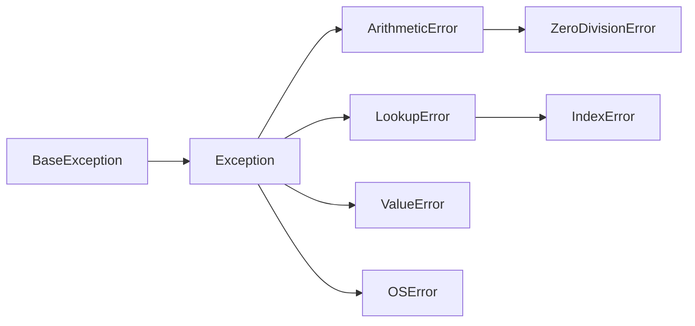
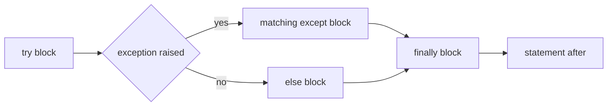

# Unexpected Errors

- Python provides exceptions to handle unexpected errors :
  - Exceptions are events disrupting normal program flow
  - May occur during the execution of program instructions
- When Python encounters conditions it can't cope with :
  - An exception is raised
  - An exception is a Python object that represents an error
- Exception types are classes, and those classes form a tree :



- Catching a class catches everything below it in that tree
- When a Python script raises an exception :
  - Python looks for a matching handler in the callers; if none exists, the script stops
- Another feature to handle unexpected errors are assertions :
  - Assertions are tests which must be true to continue


---

# Reading a Traceback

- Run `01_unexpectederrors.py`; it deliberately ends with an uncaught exception.

```python
def divide(total: int, count: int) -> float:
    return total / count


divide(10, 0)
```

```text
Traceback (most recent call last):
  File "01_unexpectederrors.py", line 5, in <module>
    divide(10, 0)
    ~~~~~~^^^^^^^
  File "01_unexpectederrors.py", line 2, in divide
    return total / count
           ~~~~~~^~~~~~~
ZeroDivisionError: division by zero
```

- Read bottom-up : the type and message, the failing line, then its caller.
- File paths are shortened here; line numbers point into the demo.

> `demo01 · unexpectederrors`


---

# Exception Handling

- A `try` block contains code that may fail.
- A bare `except` catches everything, including keyboard interrupts.
- Recognise this form, but prefer specific exception types.

```python
# A bare except is shown here so the next demo can improve it.
try:
    x = 1
    y = 0
    z = x / y
except:
    print("Cannot divide by zero")

try:
    fh = open("somefile", "r")
except:
    print("Cannot open file")
else:
    fh.close()
```

> `demo02 · exceptionhandling`


---

# Typed Exception Handling

- Catch the errors you can handle.
- `FileNotFoundError` is a subclass of `OSError`.
- Put the specific handler first; Python uses the first matching handler.

```python
try:
    fh = open("somefile", "r")
except FileNotFoundError:
    print("The file does not exist")
except OSError as error:
    print(f"Cannot open the file: {error}")
else:
    fh.close()
```

- Other exception types propagate to the caller.

> `demo03 · typedexceptionhandling`


---

# Exception Handling with Else

- `else` runs only when the `try` block finishes without an exception.
- Keep code that does not need the handler in `else`.

```python
try:
    x = int(input("Please enter a number: "))
except ValueError:
    print("Oops! That was not a valid number")
else:
    print(f"Yeah! {x} was a really good number")
```

> `demo04 · exceptionhandlingwithelse`


---

# except Clause Multiple Exceptions

- Same `except` clause may also handle multiple exceptions :

```text
try:
    Do your operations here;
except(Exception1[, Exception2[,...ExceptionN]]]):
    If there is any exception from the given exception list,
    then execute this block
else:
    If there is no exception then execute this block
```

- Example :

```python
for value in (None, "Hi!"):
    try:
        print("Attempting to convert", value, "-->", end=" ")
        print(float(value))
    except (TypeError, ValueError):
        print("Something went wrong!")
```


- Disadvantage is error messages are less distinctive

> `demo05 · multipleexceptions`


---

# Python Standard Exceptions

| Exception | Typical cause |
|---|---|
| `ValueError` | A valid type has an unsuitable value, such as `int("six")`. |
| `TypeError` | An operation receives an unsuitable type. |
| `NameError` | A name has not been defined. |
| `AttributeError` | An object has no such attribute. |
| `IndexError` | A sequence index is out of range. |
| `KeyError` | A dictionary has no such key. |
| `ZeroDivisionError` | Division by zero. |
| `OSError` | A file or operating system operation fails. |
| `FileNotFoundError` | A requested file or directory does not exist. |
| `AssertionError` | An `assert` condition is false. |

---

# Assertions Check Programmer Assumptions

- Use `assert` for an internal assumption, not for validating user input.
- Python can disable assertions with `-O`; raise an exception for required checks.

```python
def kelvin_to_fahrenheit(temperature: float) -> float:
    assert temperature >= 0, "Colder than absolute zero!"
    return (temperature - 273.15) * 1.8 + 32


print(f"{kelvin_to_fahrenheit(273.15):.1f}")  # 32.0
print(kelvin_to_fahrenheit(-5))  # Deliberate AssertionError.
```

> `demo06 · assertionerror`

---

# try-finally Clause

- `finally` block may be used along with a `try` block :
  - `finally` block is always executed
  - Whether or not the try-block raised an exception
- Syntax of the `try-finally` :

```text
try:
    Do your operations here;
    Due to any exception, this may be skipped
finally:
    This would always be executed
```

- Combining `finally` and `except` is allowed :
  - `try` block can be followed by multiple `except` clauses and one `finally` clause



- `else` and `finally` can be combined :
  - `else` runs when no exception was raised, `finally` runs in every case

---

# Example try-finally

- `finally` runs while an exception propagates to a handler.
- It does not handle the exception itself.

```python
def divide(total: int, count: int) -> float:
    try:
        return total / count
    finally:
        print("This always runs")


try:
    divide(10, 0)
except ZeroDivisionError:
    print("Cannot divide by zero")
```

```text
This always runs
Cannot divide by zero
```

> `demo07 · tryfinally`


---

# Exception Arguments

- `except ValueError as error` binds the exception object to `error`.
- `str(error)` gives its message; `print(error)` uses that text.
- `error.args` holds the constructor arguments as a tuple.
- Some types expose additional attributes, such as `OSError.filename`.


---

# Example Argument of an Exception

```python
def temp_convert(value: str) -> None:
    try:
        print(int(value))
    except ValueError as error:
        print("Argument does not contain numbers:", error)


temp_convert("xyz")
```

```text
Argument does not contain numbers: invalid literal for int() with base 10: 'xyz'
```

> `demo08 · exceptionarguments`


---

# Raising Exceptions

- Exceptions can be raised with the `raise` statement :

```text
raise ExceptionType(args)
raise ExceptionType(args) from cause
raise
```

- Explanation :
  - `ExceptionType` is the class of the exception, for example `NameError`
  - `args` are passed to its constructor and kept in the exception's `args` attribute
  - `from cause` chains the new exception to the one that caused it
  - A bare `raise` inside an `except` block re-raises the exception being handled
- Every exception is an instance of a class :
  - Built-in exceptions derive from `BaseException`, nearly all of them from `Exception`
  - Your own exceptions should derive from `Exception` or one of its subclasses

---

# Example Raising an Exception

```python
try:
    raise NameError("HiThere")
```

- In order to catch an exception :
  - `except` should refer to same exception thrown as class object
- To capture above exception, write except clause as follows :

```python
try:
    raise NameError("HiThere")
except NameError:
    print("An exception flew by!")
    raise  # re-raise it for a caller to handle
```

> `demo09 · raisingexceptions`

---

# User Defined Exceptions

- Created by deriving classes from standard built-in exceptions :
  - Exception class may be created that is subclassed from `RuntimeError`
  - Useful when more specific information is needed when an exception is caught
- In `try:` block :
  - User-defined exception is raised and caught in the `except` block
  - The name `e` is bound to the `NetworkError` instance that was raised

```python
class NetworkError(RuntimeError):
    def __init__(self, hostname: str) -> None:
        super().__init__(f"Bad hostname: {hostname}")
        self.hostname = hostname
```

- With above class exception is raised as follows :

```python
try:
    raise NetworkError("example.invalid")
except NetworkError as e:
    print(e)  # Bad hostname: example.invalid
    print(e.hostname)  # example.invalid
```

> `demo10 · userdefinedexceptions`


---

# Testing an Expected Exception

- `pytest.raises` checks that the indented code raises the expected exception :
  - The test fails if no exception is raised or a different type is raised
  - `with` limits the check to that block and handles the expected exception

```python
import pytest


def divide(a: float, b: float) -> float:
    return a / b


def test_divide_by_zero() -> None:
    with pytest.raises(ZeroDivisionError):
        divide(10, 0)
```

- Run this demo from its folder with the test runner installed in Exercise 5 :

```bash
uv run pytest 11_pytest_raises.py
```

> `demo11 · pytest_raises`

---

# Summary : Exception Handling

- Exceptions are events disrupting normal program flow :
  - Python provides exception handling mechanism for unexpected errors
- Code that might raise an exception is placed in a `try` block :
  - This code is tested for exceptions
- `try` block is followed by an `except` block :
  - Control jumps to this block in case of exceptions and exceptions are handled there
- `try` block may also be followed by a `finally` block :
  - Is always executed whether or not the try-block raised an exception
- Exceptions can have an argument :
  - Value that gives additional information about the problem
- Python has a number of predefined exceptions like :
  - `ValueError`, `TypeError`, `KeyError` and `OSError`
- Exceptions can be raised with the `raise` statement
- It is possible to create User Defined Exceptions :
  - By deriving classes from standard built-in exceptions

> `exercise08 · Exception Handling`
