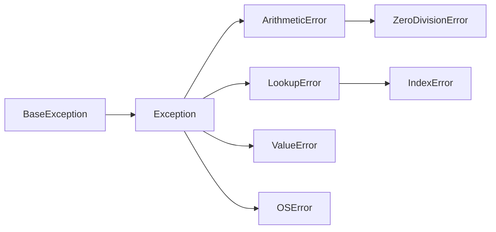
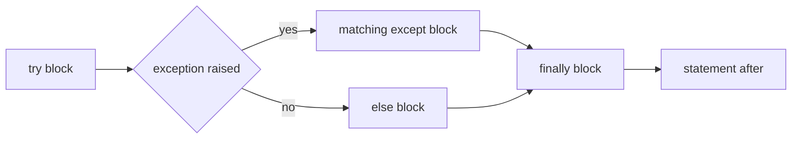

# Unexpected Errors

- Python provides exceptions to handle unexpected errors :
  - Exceptions are events disrupting normal program flow
  - May occur during the execution of program instructions
- When Python encounters conditions it can't cope with :
  - An exception is raised
  - An exception is a Python object that represents an error
- Exception types are classes, and those classes form a tree :



- Catching a class catches everything below it in that tree
- When a Python script raises an exception :
  - Python looks for a matching handler in the callers; if none exists, the script stops
- Assertions check internal programmer assumptions :
  - A false assertion raises `AssertionError`


---

# Reading a Traceback

- A playlist contains a duration that cannot be converted to an integer :

```python
def parse_seconds(text: str) -> int:
    return int(text)


parse_seconds("three")
```

```text
Traceback (most recent call last):
  File "01_unexpectederrors.py", line 5, in <module>
    parse_seconds("three")
    ~~~~~~~~~~~~~^^^^^^^^^
  File "01_unexpectederrors.py", line 2, in parse_seconds
    return int(text)
ValueError: invalid literal for int() with base 10: 'three'
```

- Read the type and message, then the failing line and its caller
- File paths are shortened; line numbers refer to the demo

> `demo01 · unexpectederrors`

---

# Exception Handling

- A `try` block contains an operation that may fail
- A matching `except` block handles the failure :

```python
text = "three"
try:
    seconds = int(text)
except ValueError:
    print(f"Invalid track length: {text!r}")
```

```text
Invalid track length: 'three'
```

- Catch a specific error that the program can handle
- A bare `except:` also catches keyboard interrupts; avoid it for ordinary input errors

> `demo02 · exceptionhandling`

---

# Typed Exception Handling

- Handlers are tested in order; only the first matching handler runs :
  - A specific error belongs before a broader class

```python
try:
    seconds = int("three")
except ValueError:
    print("Track length must be a whole number")
except Exception as error:
    print(f"Other problem: {error}")
else:
    print(f"Track length: {seconds}")
```

- `ValueError` also belongs to `Exception`, so the second handler is not reached
- A broad handler is useful only when the program has a meaningful recovery
- Unmatched errors propagate to the caller

> `demo03 · typedexceptionhandling`

---

# Exception Handling with Else

- `else` runs only when `try` finishes without an exception :
  - Keep the conversion in `try` and the successful result in `else`

```python
text = "222"
try:
    seconds = int(text)
except ValueError:
    print(f"Invalid track length: {text!r}")
else:
    print(f"Track length: {seconds} seconds")
```

```text
Track length: 222 seconds
```

> `demo04 · exceptionhandlingwithelse`

---

# except Clause Multiple Exceptions

- A playlist duration may be missing or contain a nonnumeric label
- One handler can give both cases the same recovery :

```python
lengths = [222, None, "live"]
for length in lengths:
    try:
        print(f"Length: {int(length)} seconds")
    except (TypeError, ValueError):
        print(f"Missing or invalid duration: {length!r}")
```

```text
Length: 222 seconds
Missing or invalid duration: None
Missing or invalid duration: 'live'
```

- Catch a tuple of exception types when the same action handles each one
- Use separate handlers when the recovery differs

> `demo05 · multipleexceptions`

---

# Python Standard Exceptions

| Exception | Typical cause |
|---|---|
| `ValueError` | A valid type has an unsuitable value, such as `int("six")`. |
| `TypeError` | An operation receives an unsuitable type. |
| `NameError` | A name has not been defined. |
| `AttributeError` | An object has no such attribute. |
| `IndexError` | A sequence index is out of range. |
| `KeyError` | A dictionary has no such key. |
| `ZeroDivisionError` | Division by zero. |
| `OSError` | A file or operating system operation fails. |
| `FileNotFoundError` | A requested file or directory does not exist. |
| `AssertionError` | An `assert` condition is false. |
| `EOFError` | `input()` reaches the end of the input, with Ctrl+D on Linux and macOS, or Ctrl+Z and Enter on Windows. |
| `KeyboardInterrupt` | The user presses Ctrl+C. It is a `BaseException`, so `except Exception` does not catch it. |

---

# Assertions Check Programmer Assumptions

- An assertion checks an internal assumption about the program's own logic :
  - Reversing a playlist must preserve its number of tracks

```python
def reverse_playlist(tracks: list[str]) -> list[str]:
    reversed_tracks = tracks[::-1]
    assert len(reversed_tracks) == len(tracks), "Reversing must preserve every track"
    return reversed_tracks


print(reverse_playlist(["Orbit", "Echo", "Pulse"]))
```

- An incorrect slice such as `tracks[:-1]` makes this assertion fail
- Assertions can be disabled with `-O`
- Required checks on incoming data use `raise`, so they remain active

> `demo06 · assertionerror`

---

# try-finally Clause

- `finally` runs when execution leaves a `try` block :
  - It runs on success, on `return` and while an exception propagates
  - It performs cleanup; it does not handle the exception



- An unmatched exception also passes through `finally` before reaching a caller
- `except`, `else` and `finally` can be combined in one statement

---

# Example try-finally

- An invalid track length leaves the function through its `finally` block :

```python
def parse_seconds(text: str) -> int:
    try:
        return int(text)
    finally:
        print("Duration check finished")


try:
    parse_seconds("live")
except ValueError:
    print("Duration unavailable")
```

```text
Duration check finished
Duration unavailable
```

- The caller handles the error after the final message appears

> `demo07 · tryfinally`

---

# Exception Arguments

- `except ValueError as error` binds the exception object to `error`.
- `str(error)` gives its message; `print(error)` uses that text.
- `error.args` holds the constructor arguments as a tuple.
- Some types expose additional attributes, such as `OSError.filename`.


---

# Example Argument of an Exception

- The exception retains the detail needed to report the faulty value :

```python
text = "live"
try:
    int(text)
except ValueError as error:
    print(f"Cannot read track length {text!r}: {error}")
    print(error.args)
```

```text
Cannot read track length 'live': invalid literal for int() with base 10: 'live'
("invalid literal for int() with base 10: 'live'",)
```

> `demo08 · exceptionarguments`

---

# Raising Exceptions

- `raise` reports a value that converts successfully but breaks a required rule :
  - A duration's seconds field must be between `0` and `59`

```python
def parse_duration(text: str) -> int:
    minutes_text, seconds_text = text.split(":")
    minutes = int(minutes_text)
    seconds = int(seconds_text)
    if minutes < 0 or not 0 <= seconds < 60:
        raise ValueError(f"Invalid duration: {text!r}")
    return minutes * 60 + seconds
```

- The error message identifies the rejected duration
- `raise` inside an `except` block re-raises the current exception
- `raise NewError(...) from error` records another error as its cause

---

# Example Raising an Exception

- The parser returns seconds for valid text and raises for an invalid duration :

```python
def parse_duration(text: str) -> int:
    minutes_text, seconds_text = text.split(":")
    minutes = int(minutes_text)
    seconds = int(seconds_text)
    if minutes < 0 or not 0 <= seconds < 60:
        raise ValueError(f"Invalid duration: {text!r}")
    return minutes * 60 + seconds


print(parse_duration("3:42"))
try:
    parse_duration("3:99")
except ValueError as error:
    print(error)
    raise  # Let the caller decide how to recover.
```

- The first call prints `222`; the second reports `Invalid duration: '3:99'`
- The final `raise` propagates the error after it has been reported

> `demo09 · raisingexceptions`

---

# User Defined Exceptions

- A specific exception type lets a caller distinguish a playlist rule failure :

```python
class InvalidDurationError(ValueError):
    pass
```

- `InvalidDurationError` is also a `ValueError`; the existing broader handler still matches

> `demo10 · userdefinedexceptions`

---

# Summary : Exception Handling

- Exceptions are events disrupting normal program flow :
  - Python provides exception handling mechanism for unexpected errors
- Code that might raise an exception is placed in a `try` block :
  - This code is tested for exceptions
- `try` block is followed by an `except` block :
  - Control jumps to this block in case of exceptions and exceptions are handled there
- `try` block may also be followed by a `finally` block :
  - Is always executed whether or not the try-block raised an exception
- Exceptions can have an argument :
  - Value that gives additional information about the problem
- Python has a number of predefined exceptions like :
  - `ValueError`, `TypeError`, `KeyError` and `OSError`
- Exceptions can be raised with the `raise` statement
- It is possible to create User Defined Exceptions :
  - By deriving classes from standard built-in exceptions

> `exercise08 · Exception Handling`
