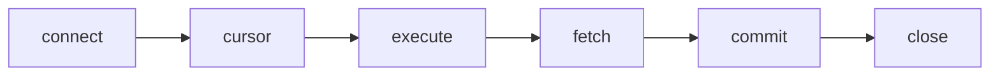

# Python DB API

- Provides a standard interface from Python to databases :
  - Most Python database interfaces adhere to this standard
  - Each database has its own module highly consistent with others
- The standard is described in PEP 249 :
  - Modules are available for most of the popular relational databases
  - Code written for one database reads almost the same for another
- Python DB API 2.0 compatible modules :
  - `sqlite3` (SQLite), part of the standard library and used in this module
  - `psycopg` (PostgreSQL)
  - `mysqlclient` or `PyMySQL` (MySQL and MariaDB)
  - `oracledb` (Oracle)
  - `pyodbc` (any database with an ODBC driver, such as SQL Server and DB2)

---

# DB API Concepts

- DB API uses two main concepts for processing queries :
  - Connections and cursors
- Every script follows the same shape :



- Connection objects logically wrap a database connection :
  - Provide access to the database and handle transactions
- `sqlite3.connect()` opens a database file, and creates it if it does not exist
- Cursor objects used to manipulate and query the database :
  - Created on connections using the `conn.cursor()` method
  - Cursor objects provide ways to execute statements and access results

```python
con = sqlite3.connect("watchlist.db")
cur = con.cursor()
cur.execute("CREATE TABLE IF NOT EXISTS films(id INTEGER PRIMARY KEY, title TEXT)")
```

---

# Check Database Version

- A first query asks SQLite for its version :
  - `fetchone()` returns the result row as a tuple, here with one value
  - `close()` releases the database file

```python
import sqlite3

con = sqlite3.connect("watchlist.db")  # creates watchlist.db if it does not exist
cur = con.cursor()
cur.execute("SELECT sqlite_version()")
print(f"SQLite version: {cur.fetchone()[0]}")
con.close()
```

```text
SQLite version: 3.50.4
```

- The version depends on the Python installation.

> `demo01 · databaseversion`


---

# Using with

- A connection used in a `with` statement manages the transaction :
  - When the block ends normally, the changes are committed
  - When the block ends with an exception, the changes are rolled back

```python
import sqlite3
con = sqlite3.connect("watchlist.db")
with con:
    cur = con.cursor()
    cur.execute("SELECT COUNT(*) FROM films")
con.close()  # `with con:` commits or rolls back, it does not close
```

- The connection stays open after the block :
  - Close it yourself with `con.close()` when you are done
- `closing()` from `contextlib` calls `close()` when the block ends, so one `with` line can commit and close :

```python
from contextlib import closing

with closing(sqlite3.connect("watchlist.db")) as con, con:
    cur = con.cursor()
    cur.execute("SELECT COUNT(*) FROM films")
```

> `demo02 · usingwith`


---

# Inserting Data

- Cursor objects provides a `cursor.execute()` method :
  - Execute SQL statements on a connection
- `INTEGER PRIMARY KEY` makes SQLite number the rows :
  - An `INSERT` that leaves out `id` gets the next number
- This demo creates the `films` table that the later demos read :

```python
import sqlite3
con = sqlite3.connect("watchlist.db")
with con:
    cur = con.cursor()
    cur.execute("DROP TABLE IF EXISTS films")
    cur.execute("""
        CREATE TABLE films(id INTEGER PRIMARY KEY, title TEXT, year INT,
                           minutes INT, watched INT DEFAULT 0, rating INT)
        """)
    cur.execute("INSERT INTO films(title, year, minutes) VALUES('Spirited Away', 2001, 125)")
    cur.execute("INSERT INTO films(title, year, minutes) VALUES('Amélie', 2001, 122)")
    cur.execute("INSERT INTO films(title, year, minutes) VALUES('Arrival', 2016, 116)")
    cur.execute("INSERT INTO films(title, year, minutes) VALUES('Paddington 2', 2017, 104)")
    cur.execute("INSERT INTO films(title, year, minutes) VALUES('Coco', 2017, 105)")
    cur.execute("INSERT INTO films(title, year, minutes) VALUES('Parasite', 2019, 132)")
```

> `demo03 · insertingdata`


---

# Prepared Statements

- `executemany()` repeats one parameterized statement for each tuple
- Each `?` placeholder receives a value from that tuple, in order :

```python
import sqlite3
films = (
    ("Spirited Away", 2001, 125),
    ("Amélie", 2001, 122),
    ("Arrival", 2016, 116),
    ("Paddington 2", 2017, 104),
    ("Coco", 2017, 105),
    ("Parasite", 2019, 132),
)
con = sqlite3.connect("watchlist.db")
with con:
    cur = con.cursor()
    cur.execute("DROP TABLE IF EXISTS films")
    cur.execute("""
        CREATE TABLE films(id INTEGER PRIMARY KEY, title TEXT, year INT,
                           minutes INT, watched INT DEFAULT 0, rating INT)
        """)
    cur.executemany("INSERT INTO films(title, year, minutes) VALUES(?, ?, ?)", films)
```

> `demo04 · preparedstatements`


---

# Last inserted row id

- Sometimes we need to determine the id of last inserted row :
  - In Python SQLite we use the `lastrowid` attribute of the cursor object
- The name `":memory:"` opens a database that lives only while the program runs :

```python
import sqlite3
con = sqlite3.connect(":memory:")
with con:
    cur = con.cursor()
    cur.execute("CREATE TABLE films(id INTEGER PRIMARY KEY, title TEXT)")
    cur.execute("INSERT INTO films(title) VALUES('Spirited Away')")
    cur.execute("INSERT INTO films(title) VALUES('Arrival')")
    cur.execute("INSERT INTO films(title) VALUES('Paddington 2')")
    film_id = cur.lastrowid
    print(f"Paddington 2 was added with id {film_id}")
```

```text
Paddington 2 was added with id 3
```

> `demo05 · lastinsertedrowid`


---

# Retrieving Data

- `fetchall()` returns all rows of the result as a list of tuples :
  - The `films` table comes from demo03 or demo04, so run one of them first

```python
import sqlite3
con = sqlite3.connect("watchlist.db")
with con:
    cur = con.cursor()
    cur.execute("SELECT id, title, year FROM films")
    rows = cur.fetchall()
    for row in rows:
        print(row)
```

```text
(1, 'Spirited Away', 2001)
(2, 'Amélie', 2001)
(3, 'Arrival', 2016)
```

- Other fetch methods read part of the result :

```python
first_row = cur.fetchone()
next_10_rows = cur.fetchmany(10)
all_remaining_rows = cur.fetchall()
```

> `demo06 · retrievingdata`

---

# Filtering and Grouping Data

- `WHERE` filters rows; `?` binds the value from the parameter tuple
- `GROUP BY` forms groups; `COUNT(*)` counts rows and `SUM` adds non-NULL values
- `COALESCE(value, 0)` replaces SQL `NULL` with zero, including an empty `SUM`
- `ORDER BY` sorts results; `DESC` puts the largest total first

```python
import sqlite3

# Run demo03 or demo04 first to create the films table.
con = sqlite3.connect("watchlist.db")
try:
    cur = con.cursor()
    cur.execute("""
        SELECT year, COUNT(*), COALESCE(SUM(minutes), 0)
        FROM films WHERE year >= ?
        GROUP BY year ORDER BY SUM(minutes) DESC
        """, (2010,))
    for row in cur.fetchall():
        print(row)
finally:
    con.close()
```

> `demo07 · aggregatingdata`

---

# Rows by Column Name

- A row is a tuple by default, so a column is read by its position :
  - `row[1]` works, but the reader has to know what the second column is
- Set `row_factory` on the connection to `sqlite3.Row` :
  - Every row can then be read by column name as well as by position

```python
import sqlite3
con = sqlite3.connect("watchlist.db")
con.row_factory = sqlite3.Row  # rows can now be read by column name
with con:
    cur = con.cursor()
    cur.execute("SELECT * FROM films")
    rows = cur.fetchall()
    for row in rows:
        print(f"{row['title']} ({row['year']}), {row['minutes']} min")
```

```text
Spirited Away (2001), 125 min
Amélie (2001), 122 min
```

> `demo08 · rowfactory`


---

# Fetching Rows

- Returning all data at a time may not be feasible :
  - It is also possible to fetch rows one by one with `fetchone()` :

```python
import sqlite3
con = sqlite3.connect("watchlist.db")
with con:
    cur = con.cursor()
    cur.execute("SELECT id, title, minutes FROM films")
    while True:
        row = cur.fetchone()
        if row is None:
            break
        print(row[0], row[1], row[2])
```

- `fetchone()` method returns next row from the table :
  - If there is no more data left, it returns `None`

> `demo09 · fetchone`


---

# Parameterized Queries

- Passing data from Python to the database :
  - First discouraged option is quoting values and sending plain SQL to the database
  - Second option preferred using binding parameters in the SQL with place holders
- A bound value needs no quoting, so a title such as `Howl's Moving Castle` is safe
- Python sqlite3 module supports two types of placeholders :
  - Question marks and named placeholders

```python
import sqlite3
film_id = 3
rating = 5
con = sqlite3.connect("watchlist.db")
with con:
    cur = con.cursor()
    cur.execute("UPDATE films SET watched = 1, rating = ? WHERE id = ?", (rating, film_id))
    print(f"Number of rows updated: {cur.rowcount}")
```

- Named placeholders take a dictionary :

```python
cur.execute("SELECT id, title FROM films WHERE title = :title", {"title": title})
```

> `demo10 · parameterizedqueries`


---

# Metadata

- Metadata is information about the data in the database :
  - Contains information about the tables and columns like name and datatypes

```python
import sqlite3
con = sqlite3.connect("watchlist.db")
with con:
    cur = con.cursor()
    cur.execute("PRAGMA table_info(films)")
    data = cur.fetchall()
    for d in data:
        print(d[0], d[1], d[2])
```

```text
0 id INTEGER
1 title TEXT
2 year INT
3 minutes INT
4 watched INT
5 rating INT
```

- Metadata in SQLite can be obtained using `PRAGMA` command :
  - Or by querying the SQLite system table `sqlite_master`

> `demo11 · metadata`


---

# Transactions

- Transactions logically wrap statements into blocks of execution :
  - Transactions are units of recovery
- Main benefit is that you can undo changes very easily :
  - Ensures data consistency at all times
  - Not all databases provide transactions !
- Transactions conform to ACID principles :
  - Atomicity, Consistency, Isolation, Durability
- DB API supports transactions if the database supports them :
  - Via methods on the connection object
- Write all changes of the last transaction block to the database :

```python
con.commit()
```

- Undo all changes applied to the database on the connection :

```python
con.rollback()
```

---

# Committing Data

- `save_ratings` stores a batch of ratings, all of them or none :

```python
def save_ratings(ratings: list[tuple[int, int]]) -> None:
    con = sqlite3.connect("watchlist.db")
    try:
        cur = con.cursor()
        for film_id, stars in ratings:
            if not 1 <= stars <= 5:
                raise ValueError(f"rating must be 1 to 5, got {stars}")
            cur.execute("UPDATE films SET watched = 1, rating = ? WHERE id = ?", (stars, film_id))
        con.commit()  # without this line, close() discards the updates
    except (sqlite3.Error, ValueError) as e:
        con.rollback()  # undoes every update of this batch
        print(f"Error: {e}")
    finally:
        con.close()

save_ratings([(2, 3), (6, 9)])  # 9 is refused, so the rating of film 2 is undone too
save_ratings([(1, 4), (6, 5)])
```

```text
Error: rating must be 1 to 5, got 9
```

- Afterwards films 1 and 6 are watched and rated; film 2 is not

> `demo12 · transactions`

---

# Summary : Python Database Access

- Python DB API is standard interface from Python to databases :
  - Each database has its own module highly consistent with others
- DB API uses two main concepts for processing queries :
  - Connections and cursors
- Connection objects logically wrap a database connection :
  - Provide means to handle database transactions
- Cursor objects used to manipulate and query the database :
  - Created on connections using the `conn.cursor()` method
- If same query must be repeated multiple times :
  - Can use parameterized queries with question marks or named parameters
- A connection in a `with` statement commits or rolls back the transaction :
  - It does not close the connection; `con.close()` does that
- DB API supports transactions if database supports them :
  - `commit()` keeps a batch of changes, `rollback()` undoes it

> `exercise10 · Python Database Access`
