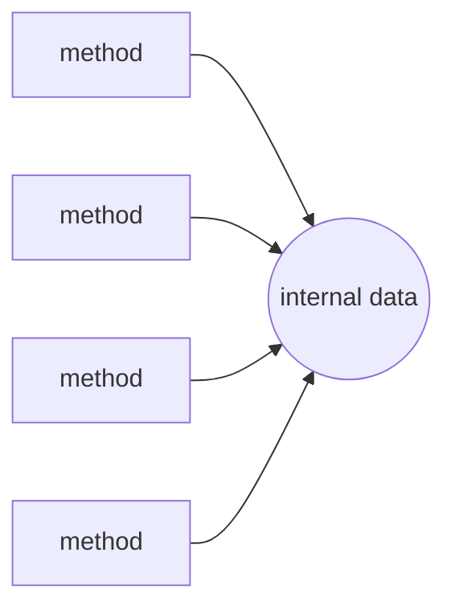

# Object Orientation in Python

- Python is object-oriented language :
  - Creating and using classes and objects is built in the language
  - Classes are created in `Python` with the `class` keyword
- Class :
  - Blueprints for a set of related objects with both description and implementation
  - Defines a set of attributes and methods that characterize any object of the class
  - Attributes are data members, Methods, accessed via dot notation
- Object or Instance :
  - An individual object of a certain class which has own identity
  - A unique instance of a data structure that's defined by its class
  - State represents current values of attributes
  - State differs per object, behavior is shared by all instances
- Inheritance :
  - Subclass inherits attributes and methods from a superclass
  - New attributes and methods may be added

---

# Example Class and Objects

- A class is a blueprint; each object has its own state :

| | Car Class | Object Car A | Object Car B |
|---|---|---|---|
| Instance Variables | Plate Number | ABC 111 | XYX 123 |
| | Color | Blue | Red |
| | Manufacturer | Mitsubishi | Toyota |
| | Current Speed | 50 km/h | 100 km/h |
| Instance Methods | Accelerate Method | | |
| | Turn Method | | |
| | Brake Method | | |

---

# OO Terminology Overview

- Instance variable :
  - Variable defined inside a method and belongs only to current instance of a class.
  - Also called data member for instance fields
- Class variable :
  - Variable that is shared by all instances of a class
  - Also called data member for class fields
  - Class variables are defined within a class but outside any of the class's methods
  - Class variables aren't used as frequently as instance variables are
- Function overloading :
  - The assignment of more than one behavior to a particular function
  - The operation performed varies by the types of objects (arguments) involved.
- Operator overloading :
  - The assignment of more than one function to a particular operator

---

# Creating Classes

- `class` statement creates a new class definition :
  - Name of the class immediately follows the keyword `class` followed by a colon :

```python
class ClassName:
    'Optional class documentation string'
    class_suite
```

- The class has a documentation string :
  - Can be access via `ClassName.__doc__`
- `class_suite` consists of all the component statements :
  - Class members
  - Data attributes
  - Functions

> `demo01 · simplestclass`


---

# Example Creating Classes and Objects


```python
class Employee :
    'Common base class for all employees'
    empCount = 0
    def __init__(self, name, salary):
       self.name = name
       self.salary = salary
       Employee.empCount += 1
    def displayCount(self):
      print ("Total Employee %d" % Employee.empCount)
    def displayEmployee(self):
       print ("Name : ", self.name, ", Salary: ", self.salary)
```

- To create instances of a class :
  - Call class using class name and pass arguments that `__init__` method accepts
- Create object of `Employee` class :

```python
emp1 = Employee("Albert", 2000)
```

> `demo02 · classwithmethods`


---

# Class Members

- `empCount` :
  - Class variable whose value would be shared among all instances of a this class
  - Accessible as `Employee.empCount` from inside the class or outside the class
- `__init__()` :
  - Special method which is called class constructor or initialization method
  - Called by Python when you create a new instance of this class
- Instance methods :
  - Declared like normal functions but first argument to each method is `self`
  - No need to include this argument when you call methods since Python adds it
- `self` must be explicitly listed as first argument to method :
  - Instance variables are referred to with " `self.XXX` “
- `self` is a reference to the instance :
  - Reference to the container for state of object


  - In many OO languages, instance is hidden in method definitions
  - In Python, instance is visible and explicit in method definitions

> `demo03 · classwithinit`


---

# Creating and Using Objects

- Creating objects :

```python
"This would create first object of Employee class"
emp1 = Employee("Albert", 2000)
"This would create second object of Employee class"
emp2 = Employee("Werner", 5000)
```

- Access object's attributes using dot operator with object :

```python
emp1.displayEmployee()
emp2.displayEmployee()
```

- Access class variable using class name :

```python
print("Total Employee %d" % Employee.empCount)
```

- Result :

```python
Name : Albert ,Salary: 2000
Name : Werner ,Salary: 5000
```


```python
Total Employee 2
```

> `demo04 · classdata`


---

# Accessing Attributes

- In Python can add, remove, or modify attributes at any time :

```python
emp1.age = 7 # Add an 'age' attribute
emp1.age = 8 # Modify 'age' attribute
del emp1.age # Delete 'age' attribute
```

- There are alternative functions to access attributes :
  - `getattr(obj, name[, default])` : Access the attribute of object
  - `hasattr(obj,name)` : Check if attribute exists or not
  - `setattr(obj,name,value)` : Set or create attribute
  - `delattr(obj, name)` : Delete an attribute
- Example code :

```python
hasattr(emp1, 'age') # Returns true if 'age' attribute exists
getattr(emp1, 'age') # Returns value of 'age' attribute
setattr(emp1, 'age', 8) # Set attribute 'age' at 8
delattr(empl, 'age') # Delete attribute 'age'
```

---

# Property Syntax

- Attributes of class can be accessed using get and set functions :
  - Allow set function to have side effect such as a value check

```python
class SquareGetterSetter(object):
     def get_length(self): # Java-style
          return self._length
     def set_length(self, length): # Java-style
          self._length = length
```

- However Python also supports property syntax :
  - Setters and getters are hidden by propery syntax and this is more pythonic way
  - May be added after class is used by clients without breaking them

```python
class SquarePropertySyntax(object):
     def get_length(self):
          return self._length
     def set_length(self, length):
          self._length = length
     length = property(get_length, set_length)
```

> `demo05 · propertysyntax`

> `demo06 · classproperties`


---

# Built-In Class Attributes

- Every Python class has following built-in attributes :
  - `__dict__` : Dictionary containing the class's namespace
  - `__doc__` : Class documentation string, or None if undefined
  - `__name__` : Class name.
  - `__module__` : Module name in which the class is defined
              This attribute is "__main__" in interactive mode.

  - `__bases__` : A possibly empty tuple containing the base classes
              In the order of their occurrence in the base class list

- Can be accessed using dot operator like any other attribute

---

# Accessing Built-in Class Attributes


```python
print ("Employee.__doc__:", Employee.__doc__)
print ("Employee.__name__:", Employee.__name__)
print ("Employee.__module__:", Employee.__module__)
print ("Employee.__bases__:", Employee.__bases__)
print ("Employee.__dict__:", Employee.__dict__)
```

- Result :

```python
Employee.__doc__: Common base class for all employees
Employee.__name__: Employee
Employee.__module__: __main__
Employee.__bases__: (<class 'object'>,)
Employee.__dict__: {'__module__': '__main__', 'displayCount':
<function displayCount at 0xb7c84994>, 'empCount': 2,
'displayEmployee': <function displayEmployee at 0xb7c8441c>,
'__doc__': 'Common base class for all employees',
'__init__': <function __init__ at 0xb7c846bc>}
```

> `demo07 · builtinattributes`


---

# Destroying Objects

- Python deletes unneeded objects automatically to free space :
  - This process of periodically reclaims of memory is termed Garbage Collection
- Python's garbage collector runs during program execution :
  - Triggered when an object's reference count reaches zero
- Reference count changes as nr of aliases pointing to it change :
  - Increase when it's assigned a new name
  - Increase when placed in a container (list, tuple, or dictionary)
  - Decrease when deleted with `del`
  - Decrease when reference is reassigned or its reference goes out of scope
- Reference count reaches zero :
  - Python collects it automatically
- `__del__()` destructor :
  - May print the class name of an instance that is about to be destroyed
  - Might be used to clean up any non-memory resources used by an instance

---

# Example Destructor

```python
class Point:
    def __init__(self, x=0, y=0):
        self.x = x
        self.y = y
    def __del__(self):
        class_name = self.__class__.__name__
        print(class_name, "destroyed")

pt1 = Point()
pt2 = pt1
pt3 = pt1
print(id(pt1), id(pt2), id(pt3))  # prints ids of the objects
del pt1
del pt2
del pt3
```

- Result :

```python
3083401324 3083401324 3083401324
Point destroyed
```

- The destructor is only called when the last reference is deleted

> `demo08 · destructordemo`

> `demo09 · circularreference`


---

# Static Methods

- Static methods do not receive `self` as first parameter :
  - May access data associated with the class instead of instance
- Method can be made `static` in two ways :
  - Annotate method with `@staticmethod` decoration
  - Exporting by calling `staticmethod` with method as parameter and return value

```python
class Account:
    interestRate = 10

    def getInterestRate1():
        return Account.interestRate
    getInterestRate1 = staticmethod(getInterestRate1)

    @staticmethod
    def getInterestRate2():
        return Account.interestRate

print(Account.getInterestRate1())
print(Account.getInterestRate2())
```

- A static method typically is called through the class

> `demo10 · staticmethods1`


---

# Encapsulation

- Encapsulation is a well known object oriented concept :
  - Internal class data is hidden behind functions
  - Result is implementation hiding and modularity



---

# Data Hiding

- Many object oriented languages support data hiding :
    - Attributes and methods may have modifiers like public, private and protected
- Python does not support real data hiding as other languages :
    - Attributes and methods can however be made more difficult to access
- Attributes made private with double underscore prefix in name :

```python
__secretCount = 0
```

- Attributes will not be directly visible to outsiders :
    - Access of such attributes from outside should include class name

```python
print(s._Secretive__secretCount)
```

- Methods can also be protected with double underscore as prefix :

```python
def __inaccessible(self):
        print("Bet you can't see me...")
```

- Methods can accessed from the outside in the following way :

```python
s._Secretive__inaccessible()
```

---

# Example Data Hiding


```python
class Secretive:
     __secretCount = 0
     def count(self):
          self.__secretCount += 1
          print (self.__secretCount)
s.count()
s.count()
print (s._Secretive__secretCount)
print (s.__secretCount)
```

- Result :

```python
Traceback (most recent call last):
  File "", line 21, in <module>
     print (s.__secretCount)
AttributeError: 'Secretive' object has no attribute '__secretCount'
```

> `demo11 · datahiding`


---

# Override Base Methods

- Generic functionality that you can override in your own classes :
- `__init__ ( self [,args...] ) :`
  - Constructor (with any optional arguments)

```python
obj = className(args)
```

- `__del__( self ) :`
  - Destructor, deletes an object

```python
del obj
```

- `__repr__( self ) :`
  - Evaluatable string representation

```python
repr(obj)
```

- `__str__( self ) :`
  - Printable string representation

```python
str(obj)
```

---

# Summary : Python Classes

- Classes are blueprints for a set of related objects :
  - Define both attributes and methods and are created with `class` keyword
- Objects are instances of classes :
  - Each object has its own state and identity, instance methods have `self` parameter
- Constructor is method named `__init__()` :
  - Creates object and called by assigning a variable of the object type
- To get and set attributes Python supports property syntax :
  - Setters and getters are hidden by propery syntax and this is more pythonic way
- Python deletes unneeded objects automatically to free space :
  - This process of periodically reclaims of memory is termed Garbage Collection
- Encapsulation is hiding internal data through methods :
  - `private` instance variables have double underscores `__var__`
  - Can be accessed through a scrambled name
- Static methods and properties bound to class not to object :

> `exercise11 · Python Classes`

  - Static data only exists once per class rather than per instance
