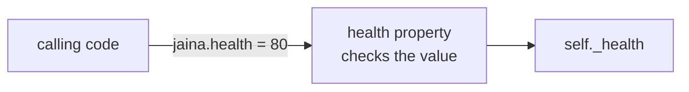

# Object Orientation in Python

- Python is an object-oriented language :
  - Every value in Python is an object, and every object has a class
  - Classes of your own are created with the `class` keyword
- Class :
  - A blueprint for a set of related objects
  - Defines the attributes and methods that every object of the class has
  - Attributes hold data, methods are functions; both are reached with dot notation
- Object or instance :
  - An individual object of a certain class, with its own identity
  - Its state is the current value of its attributes
  - State differs per object, behavior is shared by all instances
- Inheritance :
  - A class can extend another class, inheriting its attributes and methods

---

# Example Class and Objects

- A class is a blueprint; each World of Warcraft character has its own state :

<table>
<thead>
<tr><th></th><th>Character Class</th><th>Object Character A</th><th>Object Character B</th></tr>
</thead>
<tbody>
<tr><td rowspan="4">Instance<br/>Variables</td><td>Name</td><td>Jaina</td><td>Hogger</td></tr>
<tr><td>Level</td><td>60</td><td>11</td></tr>
<tr><td>Health</td><td>95</td><td>35</td></tr>
<tr><td>Zone</td><td>Dalaran</td><td>Elwynn Forest</td></tr>
<tr><td rowspan="3">Instance<br/>Methods</td><td colspan="3">Introduce Method</td></tr>
<tr><td colspan="3">Take Damage Method</td></tr>
<tr><td colspan="3">Heal Method</td></tr>
</tbody>
</table>

---

# Creating Classes

- The `class` statement creates a new class :
  - The name of the class follows the keyword `class`, then a colon
  - The indented block below it is the body of the class

```python
class Character:
    """A World of Warcraft character, with nothing in it yet."""

    pass  # an empty block
```

- The string on the first line of the body is the documentation string :
  - It can be read as `Character.__doc__`
- Calling the class creates an object :

```python
jaina = Character()
print(jaina)
```

```text
<__main__.Character object at 0x0000024A00FD8D70>
```

> `demo01 · simplestclass`

---

# A First Attribute and Method

- One attribute, `name`, and one method, `introduce` :

```python
class Character:
    def __init__(self, name: str) -> None:
        self.name = name

    def introduce(self) -> None:
        print(f"I am {self.name}")

jaina = Character("Jaina")
thrall = Character("Thrall")
jaina.introduce()
thrall.introduce()
```

```text
I am Jaina
I am Thrall
```

- `Character("Jaina")` creates an object and runs `__init__` on it :
  - `self` is the new object; `self.name = name` stores the name on it
- `jaina.introduce()` runs `introduce` with `self` set to `jaina`

> `demo02 · firstmethod`

---

# Example Creating Classes and Objects

- The same pattern with more attributes and methods :

```python
class Character:
    """A World of Warcraft character, with its own health."""
    def __init__(self, name: str, health: int) -> None:
        self.name = name
        self.health = health
    def take_damage(self, amount: int) -> None:
        self.health = max(self.health - amount, 0)
    def heal(self, amount: int) -> None:
        self.health = min(self.health + amount, 100)
    def show_status(self) -> None:
        print(f"{self.name} : {self.health} health")
```

- Call the class by its name and pass the arguments that `__init__` accepts :

```python
jaina = Character("Jaina", 100)
```

---

# Class Members

- `__init__()` :
  - The initialization method, often called the constructor
  - Called by Python when you create a new instance of this class
  - Sets the instance attributes, here `self.name` and `self.health`
- Instance methods :
  - Declared like normal functions, but the first parameter of each method is `self`
  - You do not pass `self` when you call a method, since Python adds it
- `self` is a reference to the instance :
  - Instance attributes are read and written as `self.health`
  - `jaina.take_damage(10)` changes the health of `jaina` and of no other character
- Python frees objects for you when nothing refers to them any more :
  - `__del__` exists and you rarely need it

---

# Creating and Using Objects

- Creating objects :

```python
jaina = Character("Jaina", 100)
hogger = Character("Hogger", 60)
```

- Access the object's methods and attributes using the dot operator :

```python
hogger.take_damage(25)
jaina.take_damage(10)
jaina.heal(5)

jaina.show_status()
hogger.show_status()
```

- Result :

```text
Jaina : 95 health
Hogger : 35 health
```

- Each object keeps its own `health`; the methods are shared

> `demo03 · character`

---

# Accessing Attributes

- In Python you can add, remove, or modify attributes at any time :

```python
jaina.mount = "Gryphon"  # Add a 'mount' attribute
jaina.mount = "Swift Gryphon"  # Modify 'mount' attribute
del jaina.mount  # Delete 'mount' attribute
```

- Four functions do the same with an attribute name held in a string :
  - Useful when the name is only known while the program runs

```python
attr = "mount"  # an attribute name held in a variable
print(hasattr(jaina, attr))  # True if the attribute exists
setattr(jaina, attr, "Swift Gryphon")  # Set or create the attribute
print(getattr(jaina, attr))  # Returns the value of the attribute
delattr(jaina, attr)  # Delete the attribute
print(getattr(jaina, attr, "no mount"))  # The default, because the attribute is gone
```

```text
False
Swift Gryphon
no mount
```

---

# Class Attributes and Instance Attributes

```python
class Character:
    max_level = 60  # class attribute, one value shared by every character
    def __init__(self, name: str) -> None:
        self.name = name  # instance attribute, one value per character

jaina = Character("Jaina")
thrall = Character("Thrall")
print(jaina.name, thrall.name)  # Jaina Thrall
print(jaina.max_level, thrall.max_level)  # 60 60
Character.max_level = 70  # an expansion raises the cap for everyone
print(jaina.max_level, thrall.max_level)  # 70 70
jaina.max_level = 80  # creates an instance attribute on jaina only
print(jaina.max_level, thrall.max_level, Character.max_level)  # 80 70 70
```

- A class attribute is assigned in the class body; an instance attribute on `self`
- Reading `jaina.max_level` looks on the object first, then on the class
- Assigning `jaina.max_level` writes to the object; change shared data on the class
- Methods that need no instance exist as well, `@staticmethod` and `@classmethod` :
  - They are covered in the Advanced Python course

> `demo04 · classattributes`

---

# `__str__` and `__repr__`

```python
class Character:
    def __init__(self, name: str, health: int) -> None:
        self.name = name
        self.health = health
    def __repr__(self) -> str:
        return f"Character({self.name!r}, {self.health!r})"
    def __str__(self) -> str:
        return f"{self.name} ({self.health} health)"

jaina = Character("Jaina", 100)
print(jaina)  # str(), for people
print(repr(jaina))  # repr(), for developers
print([jaina])  # a list shows the repr() of its items
```

```text
Jaina (100 health)
Character('Jaina', 100)
[Character('Jaina', 100)]
```

- `__str__` is used by `print()`, `str()` and f-strings
- `__repr__` is used by the interactive prompt, by containers and by `!r` :
  - Make it look like the call that creates the object; `str()` falls back to it

> `demo05 · strrepr`

---

# Attributes Are Public

- An attribute set in `__init__` is public, and that is fine :
  - Any code that has the object can read it and assign to it
  - No methods are written to get or set it

```python
class Character:
    def __init__(self, name: str, health: int) -> None:
        self.name = name
        self.health = health

jaina = Character("Jaina", 100)
print(jaina.health)  # read it
jaina.health = 80  # write it
print(jaina.health)
```

```text
100
80
```

> `demo06 · publicattributes`

---

# A Computed Attribute

- Whether a character is alive depends on its health :
  - As a method, `def is_alive(self)`, it is called as `jaina.is_alive()`
  - With `@property` above the `def`, it is read as `jaina.is_alive`, like an attribute

```python
class Character:
    def __init__(self, name: str, health: int) -> None:
        self.name = name
        self.health = health
    @property
    def is_alive(self) -> bool:
        return self.health > 0

jaina = Character("Jaina", 30)
print(jaina.is_alive)  # no parentheses
jaina.health = 0
print(jaina.is_alive)  # always current
jaina.is_alive = True  # read-only : there is no setter
```

```text
True
False
AttributeError: property 'is_alive' of 'Character' object has no setter
```

> `demo07 · computedproperty`

---

# When a Plain Attribute Is Not Enough

- The `Character` so far accepts any health, `jaina.health = -20` included
- The fix makes `health` a property whose setter checks the value :

```python
class Character:
    def __init__(self, name: str, health: int) -> None:
        self.name = name
        self.health = health  # goes through the setter below
    @property
    def health(self) -> int:
        return self._health
    @health.setter
    def health(self, value: int) -> None:
        if not 0 <= value <= 100:
            raise ValueError(f"health must be between 0 and 100, got {value}")
        self._health = value
```

- The value is stored in `self._health`, the property's own storage
- The code that uses the class does not change :
  - `jaina.health = 0` still works, and `jaina.health = -20` now raises `ValueError`

> `demo08 · validatingsetter`

---

# The Rule of Thumb

- Start with a plain attribute :
  - Do not write getter and setter methods in advance
- Turn it into a property the day it needs a rule :
  - A check on the value, or a value computed from other attributes
  - The calling code keeps writing `jaina.health`, so nothing else changes
- The property keeps its value in an attribute with a leading underscore :
  - `_health` is internal to the class, by convention



---

# Internal Attributes

- Python has no keyword that makes an attribute private :
  - A leading underscore, `_gold`, means internal, by convention
  - Code outside the class can reach it, and is expected not to
- Two leading underscores, `__auth_code`, make Python rename the attribute to `_Character__auth_code`

```python
class Character:
    def __init__(self, name: str) -> None:
        self.name = name  # public
        self._gold = 0  # internal, by convention
        self.__auth_code = "7f3a"  # name mangled to _Character__auth_code

jaina = Character("Jaina")
print(jaina.name)
print(jaina._gold)  # works, but the underscore says: not for you
print(jaina._Character__auth_code)  # the mangled name still works
```

```text
Jaina
0
7f3a
```

> `demo09 · internalattributes`

---

# A Class Can Extend Another

```python
class Character:
    def __init__(self, name: str, health: int) -> None:
        self.name = name
        self.health = health
    def describe(self) -> str:
        return f"{self.name} has {self.health} health"

class Mage(Character):
    def __init__(self, name: str, health: int, spells: list[str]) -> None:
        super().__init__(name, health)  # the Character part
        self.spells = spells  # what a Mage adds
    def describe(self) -> str:  # replaces Character.describe
        return f"{super().describe()} and knows {len(self.spells)} spells"
```

- `Mage` inherits every method of `Character`, adds to it and may replace methods
- `super().__init__(...)` runs the `Character` initialization, so `name` and `health` are set
- `Mage("Jaina", 70, ["Fireball", "Frostbolt", "Blizzard"]).describe()` returns :
  - `Jaina has 70 health and knows 3 spells`
- Inheritance in depth is covered in the Advanced Python course

> `demo10 · inheritance`

---

# Summary : Python Classes

- Classes are blueprints for a set of related objects :
  - Define both attributes and methods and are created with the `class` keyword
- Objects are instances of classes :
  - Each object has its own state and identity, instance methods have a `self` parameter
- The initialization method is named `__init__()` :
  - Called by Python when the class is called to create an object
- Instance attributes belong to one object, class attributes are shared by all instances
- `__str__` and `__repr__` decide how an object is printed
- Attributes are public; a property adds a rule without changing the calling code :
  - Start with a plain attribute, turn it into a property the day it needs a rule
- A leading underscore marks an attribute as internal, by convention
- A class can extend another, and calls `super().__init__()` to set up the parent part

> `exercise11 · Python Classes`
