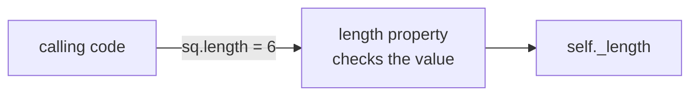

# Object Orientation in Python

- Python is an object-oriented language :
  - Every value in Python is an object, and every object has a class
  - Classes of your own are created with the `class` keyword
- Class :
  - A blueprint for a set of related objects
  - Defines the attributes and methods that every object of the class has
  - Attributes hold data, methods are functions; both are reached with dot notation
- Object or instance :
  - An individual object of a certain class, with its own identity
  - Its state is the current value of its attributes
  - State differs per object, behavior is shared by all instances
- Inheritance :
  - A class can extend another class, inheriting its attributes and methods

---

# Example Class and Objects

- A class is a blueprint; each object has its own state :

<table>
<thead>
<tr><th></th><th>Car Class</th><th>Object Car A</th><th>Object Car B</th></tr>
</thead>
<tbody>
<tr><td rowspan="4">Instance<br/>Variables</td><td>Plate Number</td><td>ABC 111</td><td>XYX 123</td></tr>
<tr><td>Color</td><td>Blue</td><td>Red</td></tr>
<tr><td>Manufacturer</td><td>Mitsubishi</td><td>Toyota</td></tr>
<tr><td>Current Speed</td><td>50 km/h</td><td>100 km/h</td></tr>
<tr><td rowspan="3">Instance<br/>Methods</td><td colspan="3">Accelerate Method</td></tr>
<tr><td colspan="3">Turn Method</td></tr>
<tr><td colspan="3">Brake Method</td></tr>
</tbody>
</table>

---

# Creating Classes

- The `class` statement creates a new class :
  - The name of the class follows the keyword `class`, then a colon
  - The indented block below it is the body of the class

```python
class Person:
    """A person, with nothing in it yet."""

    pass  # an empty block
```

- The string on the first line of the body is the documentation string :
  - It can be read as `Person.__doc__`
- Calling the class creates an object :

```python
p1 = Person()
print(p1)
```

```text
<__main__.Person object at 0x000001CECE9D8D70>
```

> `demo01 · simplestclass`

---

# Example Creating Classes and Objects

```python
class Employee:
    """Common base class for all employees."""
    emp_count = 0
    def __init__(self, name: str, salary: float) -> None:
        self.name = name
        self.salary = salary
        Employee.emp_count += 1
    def display_count(self) -> None:
        print(f"Total Employee {Employee.emp_count}")
    def display_employee(self) -> None:
        print(f"Name : {self.name}, Salary: {self.salary}")
```

- To create an instance of a class :
  - Call the class by its name and pass the arguments that `__init__` accepts
- Create an object of the `Employee` class :

```python
emp1 = Employee("Albert", 2000)
```

---

# Class Members

- `__init__()` :
  - The initialization method, often called the constructor
  - Called by Python when you create a new instance of this class
  - Sets the instance attributes, here `self.name` and `self.salary`
- Instance methods :
  - Declared like normal functions, but the first parameter of each method is `self`
  - You do not pass `self` when you call a method, since Python adds it
- `self` is a reference to the instance :
  - Instance attributes are read and written as `self.name`
  - `self` is visible and explicit in every method definition
- `emp_count` :
  - A class attribute, shared by all instances, read as `Employee.emp_count`
- Python frees objects for you when nothing refers to them any more :
  - `__del__` exists and you rarely need it

---

# Creating and Using Objects

- Creating objects :

```python
# This would create first object of Employee class
emp1 = Employee("Albert", 2000)
# This would create second object of Employee class
emp2 = Employee("Werner", 5000)
```

- Access the object's methods and attributes using the dot operator :

```python
emp1.display_employee()
emp2.display_employee()
print(f"Total Employee {Employee.emp_count}")
```

- Result :

```text
Name : Albert, Salary: 2000
Name : Werner, Salary: 5000
Total Employee 2
```

> `demo02 · employee`

---

# Accessing Attributes

- In Python you can add, remove, or modify attributes at any time :

```python
emp1.age = 7  # Add an 'age' attribute
emp1.age = 8  # Modify 'age' attribute
del emp1.age  # Delete 'age' attribute
```

- Four functions do the same with an attribute name held in a string :
  - Useful when the name is only known while the program runs

```python
attr = "age"  # an attribute name held in a variable
print(hasattr(emp1, attr))  # True if the attribute exists
setattr(emp1, attr, 8)  # Set or create the attribute
print(getattr(emp1, attr))  # Returns the value of the attribute
delattr(emp1, attr)  # Delete the attribute
print(getattr(emp1, attr, "no age"))  # The default, because the attribute is gone
```

```text
False
8
no age
```

---

# Class Attributes and Instance Attributes

```python
class Car:
    wheels = 4  # class attribute, one value shared by every car
    def __init__(self, plate: str) -> None:
        self.plate = plate  # instance attribute, one value per car

a = Car("ABC 111")
b = Car("XYX 123")
print(a.plate, b.plate)  # ABC 111 XYX 123
print(a.wheels, b.wheels)  # 4 4
Car.wheels = 6  # changes the shared value
print(a.wheels, b.wheels)  # 6 6
a.wheels = 3  # creates an instance attribute on a only
print(a.wheels, b.wheels, Car.wheels)  # 3 6 6
```

- A class attribute is assigned in the class body; an instance attribute on `self`
- Reading `a.wheels` looks on the object first, then on the class
- Assigning `a.wheels` always writes to the object, so change shared data on the class
- Methods that need no instance exist as well, `@staticmethod` and `@classmethod` :
  - They are covered in the Advanced Python course

> `demo03 · classattributes`

---

# `__str__` and `__repr__`

```python
class Car:
    def __init__(self, plate: str, color: str) -> None:
        self.plate = plate
        self.color = color
    def __repr__(self) -> str:
        return f"Car({self.plate!r}, {self.color!r})"
    def __str__(self) -> str:
        return f"{self.color} car {self.plate}"

car = Car("ABC 111", "Blue")
print(car)  # str(), for people
print(repr(car))  # repr(), for developers
print([car])  # a list shows the repr() of its items
```

```text
Blue car ABC 111
Car('ABC 111', 'Blue')
[Car('ABC 111', 'Blue')]
```

- `__str__` is used by `print()`, `str()` and f-strings
- `__repr__` is used by the interactive prompt, by containers and by `!r` :
  - Make it look like the call that creates the object; `str()` falls back to it

> `demo04 · strrepr`

---

# Attributes Are Public

- An attribute set in `__init__` is public, and that is fine :
  - Any code that has the object can read it and assign to it
  - No methods are written to get or set it

```python
class Square:
    def __init__(self, length: float) -> None:
        self.length = length

sq = Square(5)
print(sq.length)  # read it
sq.length = 6  # write it
print(sq.length)
```

```text
5
6
```

> `demo05 · publicattributes`

---

# A Computed Attribute

- The area of a square depends on its length :
  - As a method, `def area(self)`, it is called as `sq.area()`
  - With `@property` above the `def`, it is read as `sq.area`, like an attribute

```python
class Square:
    def __init__(self, length: float) -> None:
        self.length = length
    @property
    def area(self) -> float:
        return self.length * self.length

sq = Square(5)
print(sq.area)  # no parentheses
sq.length = 6
print(sq.area)  # always current
sq.area = 50  # read-only : there is no setter
```

```text
25
36
AttributeError: property 'area' of 'Square' object has no setter
```

> `demo06 · computedproperty`

---

# When a Plain Attribute Is Not Enough

- The `Square` so far accepts any length, `sq.length = -3` included
- The fix makes `length` a property whose setter checks the value :

```python
class Square:
    def __init__(self, length: float) -> None:
        self.length = length  # goes through the setter below
    @property
    def length(self) -> float:
        return self._length
    @length.setter
    def length(self, value: float) -> None:
        if value < 0:
            raise ValueError(f"length must not be negative, got {value}")
        self._length = value
```

- The value is stored in `self._length`, the property's own storage
- The code that uses the class does not change :
  - `sq.length = 6` still works, and `sq.length = -3` now raises `ValueError`

> `demo07 · validatingsetter`

---

# The Rule of Thumb

- Start with a plain attribute :
  - Do not write getter and setter methods in advance
- Turn it into a property the day it needs a rule :
  - A check on the value, or a value computed from other attributes
  - The calling code keeps writing `sq.length`, so nothing else changes
- The property keeps its value in an attribute with a leading underscore :
  - `_length` is internal to the class, by convention



---

# Internal Attributes

- Python has no keyword that makes an attribute private :
  - A leading underscore, `_balance`, means internal, by convention
  - Code outside the class can reach it, and is expected not to
- Two leading underscores, `__pin`, make Python rename the attribute to `_Account__pin`

```python
class Account:
    def __init__(self, owner: str) -> None:
        self.owner = owner  # public
        self._balance = 0  # internal, by convention
        self.__pin = "1234"  # name mangled to _Account__pin

acc = Account("Albert")
print(acc.owner)
print(acc._balance)  # works, but the underscore says: not for you
print(acc._Account__pin)  # the mangled name still works
```

```text
Albert
0
1234
```

> `demo08 · internalattributes`

---

# A Class Can Extend Another

```python
class Employee:
    def __init__(self, name: str, salary: float) -> None:
        self.name = name
        self.salary = salary
    def describe(self) -> str:
        return f"{self.name} earns {self.salary}"

class Manager(Employee):
    def __init__(self, name: str, salary: float, team: list[str]) -> None:
        super().__init__(name, salary)  # the Employee part
        self.team = team  # what a Manager adds
    def describe(self) -> str:  # replaces Employee.describe
        return f"{super().describe()} and leads {len(self.team)} people"
```

- `Manager` inherits every method of `Employee`, adds to it and may replace methods
- `super().__init__(...)` runs the `Employee` initialization, so `name` and `salary` are set
- `Manager("Marie", 6000, ["Albert", "Werner"]).describe()` returns :
  - `Marie earns 6000 and leads 2 people`
- Inheritance in depth is covered in the Advanced Python course

> `demo09 · inheritance`

---

# Summary : Python Classes

- Classes are blueprints for a set of related objects :
  - Define both attributes and methods and are created with the `class` keyword
- Objects are instances of classes :
  - Each object has its own state and identity, instance methods have a `self` parameter
- The initialization method is named `__init__()` :
  - Called by Python when the class is called to create an object
- Class attributes are shared by all instances, instance attributes belong to one object
- `__str__` and `__repr__` decide how an object is printed
- Attributes are public; a property adds a rule without changing the calling code :
  - Start with a plain attribute, turn it into a property the day it needs a rule
- A leading underscore marks an attribute as internal, by convention
- A class can extend another, and calls `super().__init__()` to set up the parent part

> `exercise11 · Python Classes`
